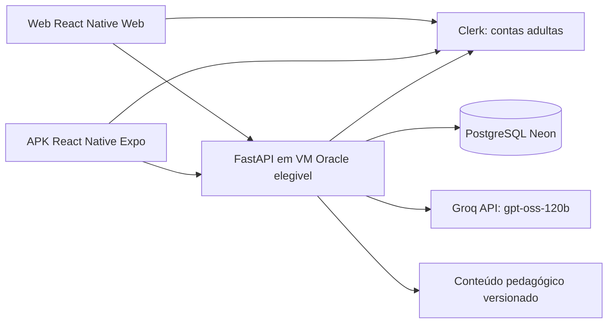

# Arquitetura proposta

Estado: **proposta concreta 0.2**, alinhada ao PDF §§9.1–9.5, ainda não implementada. Revisada para API de IA hospedada e servidor fora do computador da empresa. Não trocar framework ou atualizar versões como condição automática para redesenhar.

## Componentes e limites



Frontend mantém React Native 0.79.6/Expo53/TS5.8 como ponto de partida e React Navigation. React Native Web oferece interface web para adultos e executor acessível quando aplicável. Não criar uma aplicação somente web. Banca confirmada pelo usuário: Android APK + web; iOS deve conservar contratos e componentes portáveis, mas a verificação nativa precisa de aparelho/build específico.

Backend é monólito modular FastAPI/Python3.11+, Pydantic, SQLAlchemy2 e Alembic. Preferir SQLAlchemy ao uso simultâneo de dois ORMs; versões exatas serão fixadas numa prova técnica, sem alegar que “estável atual” do PDF é uma versão reproduzível. Uvicorn serve a API. PostgreSQL armazena transações e cache simples de IA; não há necessidade concreta de NoSQL, Redis, filas externas, microserviços ou motor vetorial.

Clerk é a identidade recomendada pelo PDF, apenas para adultos. O app usa sua sessão por adaptador; FastAPI verifica assinatura/issuer/audience/expiração e associa `sub` ao usuário local. **Permissões e vínculos são do backend Eleva**, não do botão de seleção de profissão e nem de metadata editável pelo cliente. O SDK atual documentado precisa de prova de compatibilidade com SDK53; não se presume que a instalação mais recente funcione. [Documentação oficial](https://clerk.com/docs/expo/getting-started/quickstart).

## Estrutura futura por funcionalidade

```text
app-frontend/
  src/app/                   # composição, providers, rotas e escolha de adaptadores
  src/features/
    auth/                    # presentation/, application/, data/
    students/                # presentation/, application/, domain/, data/
    assessments/
    activities/              # catálogo, atribuições, executor, tentativas e observações
    trails/
    guidance/
    reports/
    classrooms/
    accessibility/           # preferências e adaptadores de leitura/Libras por plataforma
    feedback/
  src/shared/
    ui/                      # Button/Input/Dialog/StatePanel; sem regras de alfabetização
    theme/                   # tokens e provider reativo
    http/                    # transporte, sessão, erro tipado
    storage/                 # sessão nativa e cache de preferência
    contracts/               # DTOs compartilhados realmente necessários
    i18n/
  test-fixtures/             # dados sintéticos, não importados por telas
api/
  app/main.py
  app/core/                  # configuração, conexão, identidade e erros
  app/features/<feature>/    # router.py, schemas.py, service.py, repository.py, models.py
  app/integrations/groq.py
  app/content/               # catálogo pedagógico aprovado e versionado
  migrations/
  tests/
  scripts/                   # seed idempotente e verificação da demonstração
```

Isso é destino incremental, não comando para criar outro app dentro de Eleva V2 agora. Uma feature simples não precisa de cinco subpastas vazias: começar com arquivos coesos; dividir quando necessário. `shared` não recebe regras ou entidades específicas só para evitar importações. Tipos de Child, Activity e Report saem do arquivo de navegação; rotas mantêm apenas parâmetros/IDs.

## Caminho de uma operação

Tela → hook/caso de uso da feature → interface de repositório → adaptador API → backend verifica sessão e vínculo → serviço transacional → banco → DTO canônico → atualização do estado.

Tela não importa mock, Axios, SDK de IA ou segredo. Estado Zustand cuida de seleção, carregamento e cache de sessão; não é fonte de verdade da conclusão/nível. Backend é autoridade das regras, mesmo que funções puras no frontend antecipem a visualização. Validações de formulário auxiliam UX; servidor repete validações de integridade/autorização.

A VM hospeda API/regras, sem executar LLM. O PostgreSQL conserva eventos pedagógicos e snapshots de métricas; backend envia recorte minimizado e instruções Markdown à API pronta. Não há treinamento, fine-tuning ou infraestrutura de GPU. Seleção da Groq inicialmente para prova operada por adultos e dados fictícios, liberação infantil pendente D15. [Revisão de escopo](10-revisao-api-e-acompanhamento.md).

## Contratos de acesso a dados

Exemplo de forma futura, **apenas especificação**:

```ts
interface StudentsRepository {
  list(query: { classroomId?: string; cursor?: string }): Promise<Page<StudentSummary>>;
  get(id: string): Promise<StudentDetail>;
  create(command: CreateStudent, operationId: string): Promise<StudentDetail>;
  updateProfile(id: string, command: UpdateStudentProfile, version: number): Promise<StudentDetail>;
}
interface LearningRepository {
  saveAssessment(studentId: string, command: AssessmentDraft, operationId: string): Promise<Assessment>;
  startAttempt(studentId: string, assignmentId: string, operationId: string): Promise<Attempt>;
  saveResponse(attemptId: string, command: ItemResponse, version: number): Promise<Attempt>;
  finishAttempt(attemptId: string, operationId: string): Promise<LearningSnapshot>;
  addObservation(studentId: string, command: AdultObservation, operationId: string): Promise<Observation>;
}
```

`ApiStudentsRepository` e `MockStudentsRepository` implementam a mesma interface. `app/composition` seleciona o conjunto uma única vez, por configuração de ambiente; domínio/telas não têm `if mock`. Preservar a ideia de fachada dos serviços atuais e ampliar para comandos tipados. Testes de contrato rodam contra ambos. O mock mantém IDs estáveis e isolamento por identidade fictícia, mas continua explicitamente simulado.

Na configuração de banca integrada, desabilitar mock, validar `/health/ready` e exibir ambiente em “Sobre”. Não fazer fallback silencioso para mock quando a API falhar. Rede indisponível apresenta dados anteriores datados ou erro; pendência de salvamento nunca aparece como “salvo”.

## Estratégia de migração futura

1. Estabilizar testes existentes e criar tokens reativos; Button/Input/Dialog/StatePanel primeiro.
2. Implementar conta + estudante num fluxo vertical real e adaptadores, conservando o protótipo como referência.
3. Trocar PUT de Child por comandos de avaliação, tentativa, observação, vínculo e preferência. Não permitir cliente definir owner, score global ou permissões.
4. Migrar trilhas e regras validadas para backend com testes de invariantes; não duplicar divergências de UI.
5. Reconstruir telas por catálogo Txx; manter uma rota de cada vez, remover transição provisória ao terminar a feature.
6. Integrar relatório e IA sobre os mesmos eventos persistidos. Trocar endpoint/SDK deve afetar adaptador, não tela.

As sete modificações prévias do usuário devem ser incorporadas conscientemente na etapa de implementação; nunca usar checkout/reset para substituí-las. Não há migração de banco real nesta auditoria. Fixtures atuais viram seed de teste revisado, não dados a importar automaticamente como fatos históricos.
# Adendo implementado · 29/10/2026

A raiz continua `alfabeta/`, com `app/` para composição/navegação/contexto de interface, `features/` e `shared/`. `WorkspaceProvider` guarda somente escola/turma/criança/período por adulto/dispositivo, nunca autoridade de progresso. Hooks separam respostas pelo caminho consultado, descartando dados do contexto anterior durante troca. Backend modular adiciona `activities/journey.py`, etapas normalizadas e FK opcional em atribuições; comandos transacionais e autorização são reaproveitados. Arquivamento não remove snapshots/histórico. [Detalhes e limites atuais](15-revisao-ux-jornadas.md).
