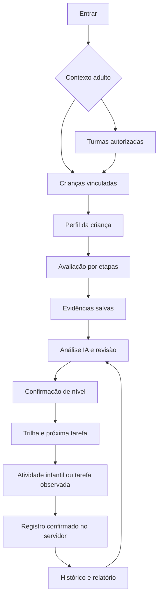

# UX, telas, temas e acessibilidade

## Direção e hierarquia

**USU**: educacional, azul e branco, menos informação e próximo passo evidente. Nenhum manual oficial de marca foi localizado. **PROP**: telas com título curto, identificação do contexto, uma ação principal e detalhes sob demanda. Não mostrar percentuais, diagnósticos e cinco ações em todos os cards.

**Decisão do usuário implementada em 29/10/2026:** responsável no mobile: **Início, Crianças, Trilhas, Relatórios, Perfil**. Professor: **Início, Escolas, Trilhas, Relatórios, Perfil**. Biblioteca/autoria e configurações continuam acessíveis por Perfil e atalhos pertinentes. Início docente usa escola → turma → estudantes autorizados; o responsável vê jornadas individuais e próximos passos. Na web a partir de 1000 px usa lateral; fonte grande adapta para navegação inferior com rótulos completos. Executor oculta destinos adultos. Ver [revisão 15](15-revisao-ux-jornadas.md) e galeria para fluxos/estados realmente exercitados, separados das propostas anteriores.

Responsável: selecionar criança → próximo passo (cadastrar, avaliar ou continuar atividade). Professor: selecionar turma → aluno ou ação de avaliar/atribuir; métricas coletivas num destino próprio. Criança: tela dedicada com uma instrução, estímulo, resposta e continuar; sem menu de relatórios, comparação ou autoria. “Voltar ao adulto” encerra o contexto infantil e pede confirmação/reautenticação local quando necessário; isso não substitui autorização no servidor.

## Fluxos

Sem IA disponível: evidências continuam gravadas; último nível confirmado permanece; conteúdo geral revisado acessível. Sem avaliação: não inventar nível pré-silábico padrão. Perfil pode indicar “Ainda não avaliada” e ação Avaliar.

## Catálogo de telas

Cada tela aparece no [wireframe local](wireframes/index.html); [catálogo textual](wireframes/catalogo.md) reproduz hierarquia sem depender de navegador. São documentação de baixa fidelidade, não implementação.

| ID | Tela / público | Informação principal e ação | Secundárias / estados específicos |
|---|---|---|---|
| T01 | Entrar / adulto | E-mail, senha → Entrar | Criar conta, recuperar, acessibilidade antes do login; enviando/erro |
| T02 | Cadastro / adulto | Nome, e-mail, senha, papel, termos → Criar | Verificar e-mail; erro de campo; não criar criança nesta etapa |
| T03 | Conta e perfil / adulto | Nome e contexto → Salvar alteração | E-mail verificado via provedor; preferências, ajuda, feedback e sair |
| T04 | Recuperar/redefinir / adulto | E-mail → Enviar; código/link → Nova senha | Confirmação neutra; expirado; reenviar com limite |
| T05 | Confirmar saída / adulto | Informar pendências → Sair | Cancelar; retry de salvamento; foco no diálogo |
| T06 | Cadastrar/editar criança / adulto | Nome e nascimento → Continuar | Escola/turma opcionais; adaptações em etapa própria, dados sensíveis opcionais |
| T07 | Vínculos / gestor | Quem tem acesso e escopo → Convidar | Revogar com confirmação; sem vínculo; convite pendente |
| T08 | Aceitar convite / adulto | Criança/solicitante/escopo → Aceitar | Recusar; conta destinatária diferente; expirado; duplicado |
| T09 | Avaliação / adulto e criança supervisionada | Um item/evidência por etapa → Próximo | Instrução/texto/áudio/Libras; rascunho, interrompido, erro de gravação |
| T10 | Revisar avaliação / adulto habilitado | Evidências e sugestão separadas → Confirmar | Corrigir com justificativa; dados insuficientes; IA indisponível |
| T11 | Trilha / adulto/criança | Próxima tarefa disponível → Continuar | Concluídas em seção recolhida; bloqueio explicado; sem avaliação |
| T12 | Executor infantil | Instrução curta+resposta → Confirmar resposta | Ouvir/repetir, Ver em Libras, Pausar; erro, resposta pendente |
| T13 | Resultado/pausa / criança | Resposta registrada ou pausa → Continuar/retomar | Tentar de novo sem punição; salvamento pendente; voltar ao adulto |
| T14 | Registro de atividade observada / adulto | Data, atividade, desempenho → Salvar registro | Apoio usado, comentário; validação; sem vínculo |
| T15 | Análise/recomendação IA / adulto | Origem/data, evidências e sugestões → Revisar/publicar | Gerar nova, aguardar, cota, falha, resultado anterior, conteúdo geral |
| T16 | Histórico e progresso / adulto | Nível confirmado + registros cronológicos → Ver relatório | Contagens separadas de score, filtro; vazio/insuficiente |
| T17 | Relatório individual/bimestral / adulto | Criança, intervalo, resumo e evidências → Ver registros | Ano/bimestre; sem período aprovado; sem dados; print/PDF só se entregue |
| T18 | Relatório coletivo / professor | Turma e período → Abrir estudante | Distribuição+contagens, lista textual; sem ranking por diagnóstico |
| T19 | Biblioteca / adulto | Atividades ou orientações, busca → Abrir item | Geral/individual, sem resultado, erro; criar apenas professor |
| T20 | Conteúdo/orientação / adulto | Título/texto, autor, versão → Ouvir ou aplicar | Libras em conteúdo coberto; favorito; sem acesso |
| T21 | Autoria docente / professor | Tipo/template, título, conteúdo, destino → Publicar | Rascunho, prévia, erro, revisão; avaliação usa instrumento aprovado |
| T22 | Escola/turma / professor | Contexto e estudantes autorizados → Abrir estudante | Criar turma mínima, atribuir atividade, relatório; vazio/sem concessão |
| T23 | Acessibilidade e aparência / todos | Tema, contraste, texto, leitura, Libras → Aplicar automático | Prévia, resetar, erro de sync; sem diagnóstico |
| T24 | Feedback e participação / adulto | Comentário → Enviar feedback | Adesão futura opcional separada; enviado/retry/cancelar adesão |

## Contrato de estados de interface

Aplicável às consultas/mutações de todas as FRDs; não obrigar tela sem operação assíncrona a fingir loading.

| Estado | Conteúdo/ação concreta | Regra de interação |
|---|---|---|
| Carregamento inicial | “Carregando atividades”, indicador com rótulo | Preservar título/voltar; anunciar uma vez, evitar shimmer em redução de movimento |
| Atualizando | Manter conteúdo anterior + “Atualizando…” | Mostrar data anterior; não trocar lista por vazio |
| Erro | “Não foi possível carregar. Tente novamente.” + botão | Sem dado técnico; formulário mantém valores; foco em resumo de erro após envio |
| Vazio real | “Ainda não há registros” + próxima ação permitida | Não substituir por zeros ou dados demonstrativos |
| Sem vínculo/permissão | “Nenhuma criança vinculada” / “Acesso indisponível” | Convidar/aceitar conforme papel; não listar nomes alheios |
| Dados insuficientes | “Precisamos de mais evidências” + quais itens faltam conforme instrumento | Sem nível/score inventado; orientações gerais acessíveis |
| Salvando/pendente | “Salvando…”; se falhar: “Não salvo — tentar novamente” | Desabilitar duplicação; nunca navegar automaticamente para sucesso sem ACK |
| Salvo | “Registro salvo às…” + próximo passo | Mensagem persistente suficiente para leitura; não depender só de toast |
| Conflito | “Este registro foi atualizado por outra pessoa” → Recarregar/comparar | Não sobrescrever; preservar rascunho da edição |
| IA indisponível | “A análise não foi concluída; seus registros estão salvos” | Tentar depois/ver conteúdo geral/última análise datada; não trocar por mock |
| Sem conexão | Último conteúdo confirmado datado, se existir | Informar limites; manter edição atual; não alegar offline completo |
| Sessão expirada | Pedir entrar novamente | Ocultar dados até revalidar; retomada após autorização e sem vazar entre contas |

## Tokens semânticos e tema reativo

Proposta visual, sem reivindicar tons oficiais. Armazenar paletas em um único módulo e resolver tokens por `themePreference` + esquema do sistema + contraste. Recalcular via provider/hook; styles que dependem de cor são criados em função dos tokens ativos. Nunca fixar `Appearance.getColorScheme()` no import nem alterar apenas o navigator.

| Token de cor | Claro | Escuro | Alto contraste claro | Alto contraste escuro |
|---|---|---|---|---|
| background | #F5F8FC | #0D1726 | #FFFFFF | #000000 |
| surface | #FFFFFF | #17263B | #FFFFFF | #000000 |
| text.primary | #172B4D | #F4F7FC | #000000 | #FFFFFF |
| text.secondary | #42526E | #C4D0E1 | #000000 | #FFFFFF |
| border.control | #66788A | #8BA1BC | #000000 | #FFFFFF |
| action.background | #1351B4 | #9CC7FF | #003A70 | #FFEA00 |
| action.text | #FFFFFF | #10233E | #FFFFFF | #000000 |
| focus.ring | #0047AB | #FFE08A | #8B2400 | #00FFFF |
| status.error.text | #B42318 | #FFB4AB | #8B0000 | #FFB4AB |
| status.success.text | #146C43 | #9FE2BD | #004000 | #9FE2BD |
| status.warning.text | #805500 | #FFE08A | #593B00 | #FFEA00 |

Completar tokens `selected`, `pressed`, `hover`, `disabled`, `input.error`, `link`, `overlay` e chart.series por significado. Estado selecionado tem borda2px, marca e texto; links sublinhados. Disabled mantém leitura e motivo textual; não reduzir opacidade indiscriminadamente. Alta contraste remove gradiente/sombra, reforça bordas e foco e preserva semântica. Não é simples inversão. Não depender das cores dos cinco níveis: mostrar nome textual; gráficos têm tabela/descrição e padrões.

Tipografia proposta: família legível existente Poppins ou sistema se fonte não carregar; corpo16, apoio14, título24 (unidades escaláveis), line-height de1,4–1,6 em relação ao tamanho efetivo. Conteúdo infantil20–28 conforme tarefa, sujeito a teste; não impor uma fonte “para dislexia” como eficácia comprovada. Espaçamento4/8/12/16/24/32; raio8/12, borda1 e2 em alto contraste, foco3. Altura mínima de controle48dp/48CSSpx como meta confortável, layout cresce com conteúdo; unidades dp não são milímetros físicos. Evitar textos importantes em9–11px como no protótipo.

WCAG2.2 AA é referência web: contraste de texto normal4,5:1, grande3:1, componentes/indicadores3:1; redimensionar texto200%, reflow320CSSpx; teclado, foco perceptível/não oculto, nomes/estados e alvos mínimos. A meta interna de48 supera o mínimo de24CSSpx com exceções do critério2.5.8. Alto contraste busca7:1 no texto principal como meta adicional, sem declarar AAA. [Recomendação W3C](https://www.w3.org/TR/WCAG22/). O cálculo de pares de tokens será evidência parcial; não avalia todos os estados/composições nem declara conformidade.

## Recursos demonstráveis e cobertura

Todos são **planejados**. A localização, ativação, dependência, aceite e demonstração fazem parte do requisito, e não só da intenção visual.

| ID/recurso | Onde e ativação / efeito | Web / Android / iOS | Dependência e aceite / demonstração |
|---|---|---|---|
| A01 Tema claro/escuro/sistema | T23 antes/depois do login; seleção única; sistema acompanha mudanças ao vivo | W/A/i planejados | Provider reativo+config nativa; alternar com formulário/diálogo aberto e manter legibilidade/valores após reinício |
| A02 Alto contraste independente | T23, switch; respeita tema base, remove efeitos sutis e reforça foco/bordas | W/A/i | Tokens e forced-colors na web; verificar pares/estados. Na banca trocar no mesmo conteúdo e operar sem cor |
| A03 Texto ampliado/reflow | T23 opções padrão/120%/150% adicionais ao tamanho do sistema; zoom livre no navegador | W/A/i | RN allowFontScaling sem cap global; layout flexível e useWindowDimensions; testar maior fonte Android e200%/400%zoom web,320CSSpx, sem cortes/rolagem bidirecional de texto |
| A04 Leitor de tela | Sem ativação interna obrigatória; compatível com NVDA/TalkBack/VoiceOver | W NVDA; A TalkBack na banca; i VoiceOver pendente | Roles, label, state, value, headings; foco por etapa; percorrer avaliação e ouvir erro/sucesso sem repetição excessiva |
| A05 Teclado/foco/diálogos | Sempre na web; Tab/ShiftTab/Enter/Espaço/Esc | W obrigatório; teclado nativo avaliar separado | Semântica real; foco inicial, trap, fundo inerte, retorno ao acionador; abrir T05 e cancelar sem mouse; foco não coberto pelo widget |
| A06 Toque/gestos | Controles48; opções selecionáveis para qualquer arraste | W/A/i | Template precisa alternativa equivalente; atividade de ordenar permite selecionar origem e destino por botões. Não usar precisão motora como medida de alfabetização |
| A07 Linguagem e foco infantil | T09/T12, instrução de uma ação por etapa; próximo passo | W/A/i | Revisão de compreensão e pedagógica; apresentar atividade sem dashboard adulto, repetir instrução |
| A08 Leitura de instruções | T09/T12/T20: Ouvir, Parar, Repetir; preferência de áudio T23 | W/A/i com adaptador | expo-speech compatível SDK53 a instalar/provar; voz PT-BR disponível no SO/browser. Não falar sobre leitor de tela automaticamente; teste com som e texto. No iOS silêncio físico pode impedir áudio |
| A09 Alternativa textual/mídia | Texto sempre ao lado de instrução falada; player com controles; vídeos com legenda/transcrição e descrição relevante | W/A/i | Produção editorial; não oferecer item só auditivo como única rota de avaliação se adaptação aprovada; leitura assistida não deve revelar gabarito inadvertidamente |
| A10 Reduzir movimento | T23 acompanha sistema, usuário pode reduzir; efeitos desativados | W/A/i | AccessibilityInfo/prefers-reduced-motion, adaptação MotiShim; sem loops/spring/shake indispensáveis. Demonstrar resultado instantâneo mantendo texto |
| A11 Preferências persistidas | T23 e suporte da criança T06; aplica sem reiniciar | W/A/i | Escopos abaixo; erro de sync visível e cache local. Sair e entrar em outra conta não herda preferências infantis/privadas |
| A12 Libras | T23 ativa acesso; T09/T12/T20 “Ver em Libras”; widget web opcional separado | W widget+vídeos; A/i vídeos | Vídeos produzidos/revisados; revisor e mídia ainda ausentes. Demonstrar vídeo essencial no APK e conteúdo estático via widget na web; informar limite de cobertura e rede |

React Native oferece APIs assistivas com comportamento diferente entre Android/iOS; não presumir equivalência por uma prop. [RN0.79](https://reactnative.dev/docs/0.79/accessibility). Leitura proposta usa TTS, e documentação histórica do SDK53 lista o módulo; sites de documentação atuais redirecionaram a versão53 para latest, por isso o código/guia do branch53 foi consultado como referência histórica: [expo-speech SDK53](https://github.com/expo/expo/blob/sdk-53/docs/pages/versions/v53.0.0/sdk/speech.mdx). Não instalar a versão latest por inferência.

Apoio de fala na versão inicial promete **Ouvir/Parar/Repetir**. Pausa/retomada só será exibida onde o adaptador suportar; no Android, parar+repetir é suficiente e deve estar claro. Textos dinâmicos de IA podem ser lidos pelo TTS, mas não terão tradução humana em Libras em tempo real. Áudio não inicia automaticamente; nenhuma tarefa exige efeito sonoro para entender o acerto.

## Escopo das preferências

Antes do login: dispositivo/browser guarda tema, contraste, escala extra e movimento; apenas preferências não sensíveis. Depois do login: preferências adultas persistidas no servidor prevalecem, com cache local namespaced por userId. “Sistema” continua a resolver cores/tamanho naquele dispositivo; não salvar “sistema=escuro” como escolha permanente. Preferência de diagnóstico nunca necessária.

Na atividade infantil, usar preferências adultas do dispositivo como base visual e sobrepor **adaptações funcionais da criança** (instruções curtas, apoio de leitura/Libras, tempo/apoio) vinculadas ao estudante. Não reduzir fonte/contraste impostos pelo sistema para “padronizar” a criança. Preferências de som respeitam silenciar local e controle da sessão. Alterar adaptações não modifica score/nível. Limpar dados por conta ao sair; configuração visual pré-login pode continuar no dispositivo compartilhado sem expor dados.

## Libras: solução e limites concretos

VLibras Widget7.0 documenta inclusão de script em **HTML**, inicialização e opções de posição/avatar. Integrar só no shell web, uma instância, com carregamento sob ativação, erro de rede explícito, foco visível e testes de sobreposição/teclado. Não enviar campos privados, nomes ou resultados de criança ao tradutor: limitar páginas/conteúdo público estático; nas telas privadas manter vídeos essenciais sem carregar widget até comprovar tecnicamente o escopo de tradução. Se a versão não permitir restringir trechos com segurança, disponibilizar widget apenas em Ajuda/Biblioteca geral. [Instalação oficial](https://vlibras.gov.br/doc/widget/installation/webpageintegration.html).

Suíte tem aplicativos móveis, mas isso **não comprova SDK embutível em RN**. Guia mobile oficial de2021 descreve aplicativo React/TypeScript com arquivosCSS e playerUnity, não uma integração Expo53 validada. Não escolher WebView como suposta solução de toda UI nativa, nem um botão que só abre o aplicativo externo. [Guia oficial mobile](https://vlibras.gov.br/files/Dev_VLibras_CrossPlatform_App.pdf). A página do Governo alerta que VLibras não substitui intérprete humano. [Informação oficial](https://www.gov.br/governodigital/pt-br/acessibilidade-e-usuario/vlibras).

**Principal Android/iOS e base comum web: vídeos MP4 produzidos/revisados**, player por adaptador de plataforma (expo-video compatível SDK53; HTML video na web), sem autoplay, tela ampliável, repetir, parar, legenda e texto equivalente. [Referência histórica expo-video](https://github.com/expo/expo/blob/sdk-53/docs/pages/versions/v53.0.0/sdk/video.mdx). Preservar proporção e mãos/expressão do intérprete, não recortar ao formato do card. Incluir os vídeos essenciais no build para reprodução sem rede; demais vídeos indicam streaming/download e erro. Não assumir que cache de streaming significa funcionamento offline.

Lote mínimo proposto:8 vídeos curtos, com versões e responsáveis: boas-vindas/ajuda, como iniciar, como responder, repetir/ouvir instrução, pausar/voltar ao adulto, registrar observação, compreender nível/relatório como apoio, e uma atividade demonstrável com instrução integral em Libras. Conteúdo específico da atividade exige vídeo correspondente; oito vídeos gerais não tornam todas as atividades traduzidas. Cada vídeo fica mapeado em manifesto `contentId/version/videoId/reviewer/reviewedAt/license/localAsset` e possui texto correspondente.

Estimativa de planejamento, sem orçamento contratado:2–4 dias de roteiros/adequação e integração, mais agenda/tradução/gravação/revisão especializada (potencialmente1–2 semanas ou mais). Custo e prazo dependem do profissional; usuário confirmou que buscará revisão. Sem arquivos e revisão, Libras permanece **pendente**, mesmo que o player esteja pronto. Conteúdo automático pode ser mostrado como apoio automático limitado; não como garantia de compreensão ou acessibilidade completa.

## Avaliação e demonstração

Verificar web com teclado e NVDA em larguras320/768/1280, zoom200/400%, todos os temas e diálogo. Android real: TalkBack, maior fonte/tamanho de exibição, orientação/layout suportado, toque, sem áudio e redução de animação; iOS VoiceOver quando houver dispositivo. Checklist por tela e cenário, não apenas axe ou contraste. Correções de acessibilidade entram em critérios de conclusão de cada feature; não deixar para uma “pintura” final.
