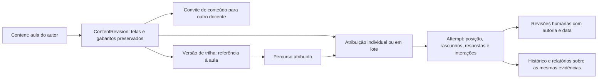

# Aulas por telas, reutilização e gestão de estudantes · 29/10/2026

## Estado e fontes

A etapa anterior foi retomada e concluída tecnicamente: catálogo → mapa → aula → executor, pausa/retomada, entregas e investigação pedagógica. Evidências e limites estão no [checkpoint 16](16-trilhas-aulas-investigacao.md). Esta ampliação implementa o pedido posterior de aulas por telas e cinco mecânicas; não é apenas outra proposta documental.

Fontes acadêmicas continuam PDF/Markdown, RF e UC originais e FRDs F01–F11 da revisão 0.2. O formato de editor, o compartilhamento entre docentes e os campos adicionais abaixo são detalhamentos solicitados nesta conversa, não novos requisitos acadêmicos retroativos. D03/D15 não foram declaradas resolvidas.

Aplicativo permanece em `alfabeta/`, React Native/Expo 53/TypeScript. Backend FastAPI modular, SQLAlchemy e Alembic. Identidade Better Auth real local; dados fictícios persistidos no SQLite de desenvolvimento. Nenhuma VM, conta de serviço, banco remoto, commit ou publicação foi realizada. Alterações preexistentes preservadas.

## Percurso do professor

1. Início → **Minhas aulas**, ou Trilhas → **Biblioteca e construtor de aulas**.
2. **Criar aula** → Sobre: título, descrição, objetivo, dificuldade indicada pelo autor, habilidades, capa, público e adaptações. Dificuldade não é nível confirmado do estudante.
3. **Telas**: adicionar texto, imagem, vídeo YouTube, texto/imagem, texto/vídeo, atividade ou conclusão. Miniaturas, anterior/próxima e adicionar no cabeçalho; duplicação, exclusão e ordenação por controles acessíveis. Não há arrastar obrigatório.
4. Cada atividade abre editor específico para sua mecânica. Feedbacks, dicas, leitura do enunciado, obrigatoriedade e tentativas ficam em detalhes opcionais. Prévia não produz respostas ou estatísticas.
5. **Salvar rascunho** permanece no cabeçalho e aceita conteúdo incompleto estruturalmente válido. Disponibilizar exige validação completa no servidor. Demonstração sintética só em desenvolvimento/teste; publicação real requer parecer favorável da versão por revisor designado. Não se inventou parecer.
6. Aula disponibilizada pode ser atribuída pela biblioteca ou referenciada numa trilha. No ateliê de trilhas: configurar aula → **Aula com telas da biblioteca**. Uma versão pode ser usada em várias trilhas sem copiar seu conteúdo.

## Mecânicas entregues e limites pedagógicos

| Mecânica | Editor e resposta | Correção e acesso |
|---|---|---|
| Escolha única | Alternativas com texto/imagem e um ID correto | Correspondência exata de ID; clique, toque ou teclado |
| Múltipla seleção | Alternativas e conjunto de IDs corretos | Igualdade de conjuntos; não soma acertos parciais arbitrários |
| Ordenação | Letras/sílabas/palavras como elementos e ordem correta | Sequência exata; banco embaralhado de forma estável na tentativa; botões de adicionar, retirar e mover |
| Associação | Origens, destinos, imagens opcionais e pares | Mapeamento completo um para um; selecionar origem e destino, sem depender de gesto motor |
| Escrita curta | Até dez variantes aceitas e normalização configurável | NFC, espaços, caixa e acentos conforme autor; padrão para variante desconhecida = revisão humana, sem zero automático |

As mesmas mecânicas permitem verdadeiro/falso, reconhecer imagem/palavra, montar sílabas ou ordenar uma frase, quando configuradas adequadamente. Não se declarou que todo exemplo sintético possui valor pedagógico aprovado. Reconhecimento de voz/escrita manuscrita, localização de regiões, classificação livre, áudio gravado como questão e gamificação competitiva não foram acrescentados por quantidade; dependem de definição de tarefa, conteúdo, modalidade e avaliação específicas. Atividades orais acompanhadas continuam como observações adultas.

Critério padrão de conclusão = telas de conteúdo percorridas e questões obrigatórias entregues. Conteúdo somente expositivo também é suportado. Não se exige duração de vídeo, cronômetro ou saldo de vidas. Revisão escrita pode bloquear o avanço se o autor configurar isso explicitamente. Sem essa opção, a resposta aguarda revisão nos relatórios e a entrega permite continuar. Nenhuma dessas contagens confirma nível de alfabetização.

Referências consultadas: [IES/WWC — habilidades fundamentais de leitura](https://ies.ed.gov/ncee/wwc/PracticeGuide/21) aborda relação entre sons/letras, partes de palavras e reconhecimento/escrita; não valida automaticamente currículo em português ou limiares deste produto. [CAST — ação e expressão](https://udlguidelines.cast.org/action-expression/) orienta variar meios de resposta e navegação. A escolha das cinco mecânicas é uma decisão de produto a validar em D03.

## Conteúdo, versão, atribuição e execução

`Content.kind=lesson` separa aulas por telas de atividades/instrumentos/orientações legados. `ContentRevision` preserva a versão e seu estado de disponibilização; editar cria nova versão em rascunho. `Assignment.content_revision_id` referencia a revisão; seu campo antigo `snapshot` fica vazio para novas aulas. Atribuição não duplica as telas. Tentativas e percursos antigos mantêm seus snapshots e IDs. `LearningStage` liga a referência à aula e, quando aplicável, ao percurso da trilha.

`Attempt` guarda cursor, telas reconhecidas, rascunhos parciais, respostas, apoios e interações. Confirmar registra tentativa de item; revisar a escrita registra outro evento com docente/data/justificativa. Entregas permanecem imutáveis quanto às respostas; revisão posterior tem rastreabilidade própria. Novas tentativas são explícitas. Não é permitido repetir apenas para contornar uma entrega aguardando revisão obrigatória.

Comandos exigem identidade, vínculo ativo, versão esperada e `Idempotency-Key`. Lotes validam todos os destinatários antes de gravar, deduplicam estudante/turma/escola e são transacionais. Autoridade de correção e conclusão fica no servidor. Respostas de mutação não repetem todo o conteúdo da aula; o cliente mescla o estado canônico com o conteúdo versionado carregado inicialmente.

Conflito entre acessos (409) preserva a seleção local e oferece carregar explicitamente o progresso salvo, sem reenviar a resposta antiga automaticamente. Revogação detectada (403/404) remove o exercício corrente e permite voltar à lista. Recuperação de conflito, ausência de sobrescrita silenciosa e descarte da tela após perda de acesso têm teste frontend próprio; concorrência real em PostgreSQL continua a validar no ambiente autorizado.

Módulos: `backend/app/features/lessons/{contracts,drafts,grading,service,router,player}.py`; `alfabeta/src/features/lessons/` contém biblioteca, construtor, editores, registro de mecânicas, prévia, atribuição e executor. Repositório HTTP e hooks continuam separados das telas. Não foi criado outro aplicativo ou ORM.

Migrations locais: `a05de62fa711` (reuso/telas), `b18703af9002` (situação por revisão), `80c95fbd1e56` (índices de listagens/evidências). Todas posteriores a `938e600aa420`; aplicação somente no SQLite local conhecido, com backup. Execução em PostgreSQL continua pendente de uma branch autorizada. Compilação SQL PostgreSQL não equivale a teste nesse banco.

## Compartilhamento e autorização

- **Minhas aulas**, **Compartilhadas comigo**, **Recebidas** e **Públicas** têm busca e paginação. Convite exige identificador de uma conta docente distinta; ela aceita antes de usar a versão.
- Usar uma aula recebida não permite editar a original. Cópia autorizada cria conteúdo independente com origem/versão e preserva limites de redistribuição, inclusive ao copiar uma cópia.
- O autor escolhe permissão para copiar e redistribuir. Biblioteca identifica autor e origem. Convites enviados podem ser revogados; novas atribuições por esse compartilhamento são bloqueadas, sem apagar histórico ou cópias já autorizadas. Revogação de vínculo do estudante bloqueia seus recursos e mídia histórica imediatamente nas consultas seguintes.
- Seleção em lote: estudantes buscados por página, turmas próprias e escolas próprias. Uma matrícula ou profissão não concede acesso geral. Cada estudante incluído precisa de grant ativo; compartilhar conteúdo não cria grant de estudante.
- Catálogo de trilhas e imagens respeita a autorização das aulas privadas referenciadas. Mídia não ganha URL pública: leitura autenticada por autoria, conteúdo autorizado ou atribuição histórica com grant ativo.

## Estudantes e informações restritas

A interface ativa usa **Estudantes/Alunos**. Lista virtualizada de 20 por página, busca com atraso curto, nome/seta abre acompanhamento; três pontos reúne ações secundárias. **Adicionar** permanece no cabeçalho e é anunciado como “Adicionar estudante”. Professores também chegam à gestão pelo Início e por Escolas.

Cadastro possui dados básicos e etapa opcional de apoios. Condições informadas (TEA/TDAH/dislexia/outra), deficiências, comunicação e apoios pedagógicos são categorias separadas, com múltipla seleção, origem e observação adicional. Vazio significa não informado. Não há diagnóstico gerado pelo app nem pontuação por condição. Campos ficam em `StudentCare.characteristics`, fora de listagens amplas e snapshots da IA; compartilhamento exige concessão específica do gestor. Preferências de apresentação continuam independentes e acessíveis sem diagnóstico.

Cadastro em contexto de turma pode criar a matrícula autorizada na mesma transação, evitando salvar um estudante que desapareça do filtro atual. Não matricula em turma de outro docente nem concede acesso a terceiros.

## Progresso, relatórios e carregamento

O executor salva rascunho após pequena pausa na edição, ao navegar, pausar e sair pelo fluxo do app. Só mostra “salvo” após confirmação. Falha mantém alterações na tela e permite repetir a operação com a mesma chave; versão impede sobrescrita concorrente. Reabrir recupera posição e rascunho. Não há promessa de funcionamento offline: encerrar o processo antes de confirmar uma gravação ainda exige tratamento posterior; a interface informa pendência.

Relatórios usam as tentativas persistidas. Para comparar novas questões com feedback imediato, utiliza-se a primeira confirmação de cada item na primeira entrega da atribuição; repetir depois de ver feedback não apaga a evidência anterior. Legado conserva sua política de primeira entrega. Escrita sem julgamento fica fora do denominador corrigível, com pendência visível. Revisão humana atualiza o resultado derivado e conserva justificativa/data. Conclusões, tentativas, tarefas e nível confirmado permanecem medidas distintas.

Panorama e contexto docente calculam contagens e distribuição de todo o filtro no banco. Detalhes são paginados; respostas comparáveis e observações detalhadas informam que pertencem à página exibida. Investigação de turma consulta grupos de até 50 colegas, incluindo o estudante em foco e com navegação por grupos; a legenda distingue o grupo carregado do total autorizado. Busca de apoio usa igualdade de elementos, sem substring. Datas seguem `America/Sao_Paulo`.

Biblioteca e estudantes usam `usePaged`, sem cache global compartilhado. Mudança de conta desmonta o workspace; respostas antigas são descartadas pela geração de sessão. Uma recarga tardia de filtro antigo também é descartada. Há placeholders estáticos, estado vazio, erro/repetição, controles assíncronos e bloqueio de envio duplicado. Índices cobrem vínculos, atribuições, tentativas, avaliações, observações, autoria e compartilhamentos. Isso não é certificação de desempenho em produção com milhares de usuários.

## Mídia e acessibilidade

Claro/escuro/sistema, contraste independente, fonte adicional, fonte do sistema e movimento reduzido usam o provider/tokens existente. Seleção também usa marca textual/estado assistivo. Controles de toque têm pelo menos 48 px; foco web visível, diálogos com isolamento e devolução de foco. Setas e botões substituem arrastar. Uma tarefa por tela no executor, sem relatórios ou métricas adultas invadindo a atividade. Leitura só aparece para a questão quando autorizada pelo autor; apoios efetivamente utilizados são registrados.

YouTube usa iframe na web e `react-native-webview` **13.13.5**, compatível com o manifesto local do Expo 53. Carregamento explícito, sem autoplay, ID validado e alternativa textual obrigatória; falha não impede ler o conteúdo. Não se baixa vídeo nem se inventa autorização. Exportação de release mantém reprodução externa desabilitada até configurar `EXPO_PUBLIC_YOUTUBE_EMBEDS_ENABLED=true` após revisar D15/mídia. Preview técnico em desenvolvimento é operado por adulto. Reprodução nativa real ainda precisa de validação.

Os [parâmetros oficiais do player](https://developers.google.com/youtube/player_parameters) e a [orientação de incorporação](https://support.google.com/youtube/answer/171780?hl=en) foram consultados: usar `youtube-nocookie` não elimina obrigações para aplicativo infantil; a autodeclaração indicada pelo fornecedor e direitos/legendas precisam ser conferidos. Não foi criada conta ou feita essa declaração pelo usuário.

VLibras permanece isolado na ajuda pública web. Manifesto/player de Libras nativo/web continua sem vídeos revisados: estrutura não conta como tradução entregue. TTS depende de voz PT-BR do aparelho; texto permanece disponível. WCAG 2.2 AA é referência, sem declaração de conformidade. TalkBack e comportamento nativo exigem aparelho/APK.

## Verificações e próximos passos

Validação final: **47 testes backend e 22 testes frontend, em 13 suítes**, passaram, com TypeScript e lint. Cadeia completa de migrations passou em SQLite novo; repetição do seed local confirmou **zero registros novos**, preservando os criados pela interface. SQL PostgreSQL atual foi gerado offline em `backend/migrations/postgresql-current.sql`; execução remota não foi feita. [Galeria atual](evidencias/aulas-v4-galeria.html).

Exportação web atual: `AppEntry-de558413aa796d321373ebc3c32babfa.js`. Exportação Android/Hermes também foi executada; recibo em `evidencias/aulas-v4-verificacao.json`. Exportar JavaScript não monta nem instala APK. `java`/`adb` não estão disponíveis neste ambiente; URLs de desenvolvimento também não servem como hospedagem do celular. Nenhum teste iOS foi executado.

Na web, foram conferidos 390 px, 1280 px e o percurso de retomada em 320 px com fonte adicional de 150%, escuro/alto contraste, sem overflow horizontal nesse percurso. Diálogo de cadastro manteve salvar no rodapé, foco cíclico por Tab/Shift+Tab, fechamento por Escape e retorno ao contexto. Preferências foram salvas e consultadas pela API; A foi restaurada para claro/100% após o teste. Houve um 401 de `/me` durante logout, sem erro de renderização ou conteúdo de outra conta; consultas após a nova sessão funcionaram.

Imagens sem texto equivalente exigem rótulo alternativo na publicação. Associação renderiza também as imagens de origem, com significado acessível nos controles; essa regressão tem teste próprio. A revisão final também distingue “tarefas concluídas” de quantidade de questões, mostra confirmações preservadas por item e não apresenta razão 0/0 como resultado pedagógico. Mensagens de validação usam campos e linguagem legíveis em português, sem ecoar valores enviados.

Pela interface local: criação de rascunho incompleto; cópia de aula, alteração e nova versão; disponibilização sintética; envio P → Q e aceite; Q atribuiu a própria turma, com Caio/Bia recebendo a mesma revisão. Cadastro sintético de Jo com apoio estruturado persistiu. Lia percorreu os cinco formatos; escrita desconhecida aguardou revisão e a revisão apareceu no relatório. Theo pausou/retomou com ordenação incompleta. Logout/troca real de contas e filtros foram exercitados. Nenhuma dessas operações comprova chamada live de IA.

Pendências externas preservadas: D03/D14 (conteúdos, instrumentos, rubricas, habilidades, variantes e profissional revisor), D05 (mídias Libras reais/revisadas), D13/D15 (privacidade/termos e liberação de dados reais/público infantil), Groq sem chave/live, Neon/VM/DNS/HTTPS/SMTP ausentes. APK instalado, TalkBack, reprodução/voz reais em Android e iOS não foram comprovados. Demais mecânicas/modalidades são evolução explícita, não botões decorativos nem capacidades atribuídas a modelo textual.
