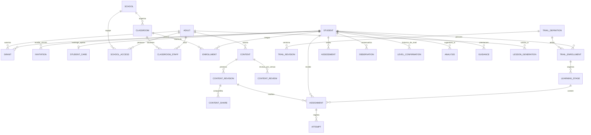
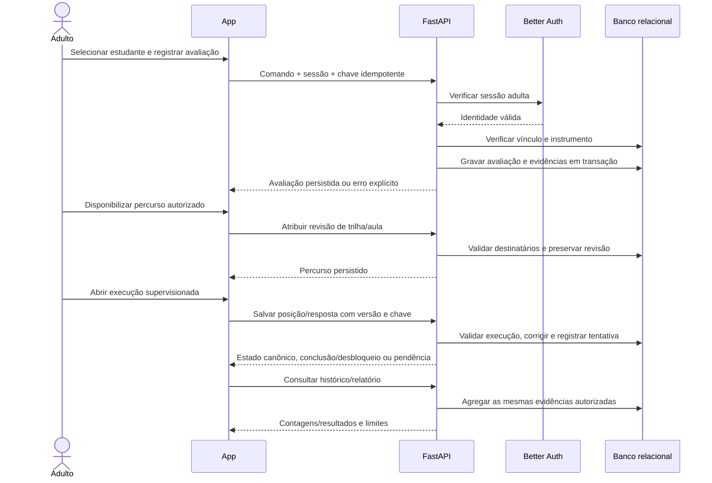

# Atualização do TCC — escopo, mudanças e orientação editorial

**Referência: 19/11/2026.** Material de passagem para quem revisará o trabalho acadêmico. A implementação continua; este documento fixa o escopo previsto e descreve separadamente a situação demonstrada. Não é declaração de aplicativo finalizado.

**Orientação posterior do professor, incorporada neste corte:** retirar o capítulo de prototipagem; renomear proposta de desenvolvimento para **Desenvolvimento**; incluir obrigatoriamente **Resultado e discussão** e **Conclusão**; Trabalhos Futuros opcional. Aplicar correções da banca1 conforme lista/ata efetivamente fornecida. O alinhamento verbal relata realizações comprovadas, sem transformar pendência em resultado. [Conferência depois da revisão pelo Claude](20-checklist-finalizacao-tcc.md).

**PDF atualizado recebido durante a preparação do commit:** `alfabeta/Eleva-para-Codex/ModeloEntregaFinal-1.pdf`, 62 páginas, distinto do original de63. Esse arquivo, apresentado pela equipe como a última versão, é a base editorial a preservar. Foi conferida sua estrutura textual: ainda contém Prototipagem, Proposta de desenvolvimento e Clerk; as orientações novas precisam ser aplicadas. Isso não é revisão acadêmica integral de todas as alterações da banca. As páginas/matrizes deste mapa continuam referenciando o original de63 páginas; conferir remissões na base mais recente.

**Para encaminhar hoje:** envie este arquivo e [19-prompt-atualizacao-tcc.md](19-prompt-atualizacao-tcc.md), junto com o TCC original. O prompt pode ser copiado integralmente para outra conversa. Nenhuma credencial deve acompanhar o material.

## 1. Fontes e precedência

- Original: `alfabeta/Eleva-para-Codex/Eleva-TCC.md`, conversão por página do PDF de 63 páginas `Eleva-TCC-original.pdf`, no mesmo diretório. **O original foi preservado.** O arquivo chamado `ModeloEntregaFinal (1)(2).pdf` não foi localizado com esse nome no workspace.
- Base funcional: documentos 01–10 de `Eleva V2/`, FRDs F01–F11 e regras comuns. São especificações; sua existência não comprova entrega.
- Evolução implementada: registros 11–17, matriz 12, código atual em `alfabeta/`, `backend/` e `identity/`; diagnóstico e recibo de verificações desta revisão.
- Pedidos posteriores: reaproveitar a base, mudar a apresentação gradualmente; Better Auth; aulas por telas, cinco mecânicas, compartilhamento/versionamento; IA também na autoria; gestão institucional; acessibilidade e relatórios exportáveis. Não atribuir esses detalhamentos retroativamente ao PDF.

As páginas abaixo são **físicas do PDF original**. Da página física 13 em diante, a impressa é a física menos 6. Depois da edição, a paginação precisa ser recalculada. Não usar a página antiga como número definitivo da nova versão.

## 2. O que o aplicativo terá: escopo consolidado

O Elevva é uma aplicação educacional mobile e web para apoiar a alfabetização e o acompanhamento pedagógico. Integra **Trilhas → aulas → atividades → registros → relatórios**, com autoria docente, colaboração entre adultos autorizados e adaptações de acesso.

| Área | Compromisso funcional da versão-alvo | Situação no corte atual |
|---|---|---|
| Identidade | Contas adultas distintas, cadastro, login, perfil, logout e recuperação de acesso | Better Auth integrado localmente; recuperação por e-mail depende de SMTP e validação completa |
| Responsáveis e docentes | Acesso somente aos estudantes vinculados; concessão, aceite e revogação; múltiplos adultos por estudante | Implementado e testado localmente; profissão não abre acesso geral |
| Estudantes | Cadastro, edição, acompanhamento, apoios opcionais e informações restritas com permissão própria | Implementado localmente; categorias clínicas, deficiências, comunicação e apoios ficam separadas |
| Escolas e turmas | Contexto docente, matrículas, equipe escolar e gestão explicitamente autorizada | Estrutura local e testes de autorização; gestor institucional não recebe acesso automático aos estudantes |
| Avaliação | Registrar avaliação inicial/reavaliação e evidências; separar sugestão e confirmação humana de nível | Registro e confirmação persistidos; instrumento/rubrica e validade pedagógica pendentes |
| Trilhas | Catálogo e mapa; aulas/etapas versionadas; atribuição e progressão; retomada | Implementado localmente; sem botão que conclui toda a trilha sem execução |
| Aulas | Editor visual, telas ordenáveis, rascunho, prévia, versões e disponibilização | Implementado localmente; publicação pedagógica real exige revisão designada |
| Atividades | Escolha única, múltipla seleção, ordenação, associação e escrita curta; feedback, dicas e repetição configuráveis | Cinco mecânicas integradas ao executor, à persistência e aos relatórios |
| Colaboração | Compartilhar uma versão com outro docente; aceitar, usar e copiar conforme permissão; atribuir em lote | Implementado localmente; conteúdo compartilhado não concede dados dos estudantes do autor |
| IA para autoria | Docente informa objetivo, nível pretendido e formatos; recebe proposta estruturada, revisa e transforma em rascunho | Código integrado ao adaptador Groq e testes com provedor substituído; **nenhuma chamada real comprovada** |
| IA de acompanhamento | Analisar evidências minimizadas, sugerir nível/atividades/orientações, registrar origem e revisão | Escopo original mantido; adaptador preparado, mas prova live, rubrica e validade pedagógica pendentes |
| Orientações | Conteúdo geral e individualizado, com autoria, vínculo e revisão | Fluxos locais; corpus pedagógico aprovado ainda pendente |
| Histórico e relatórios | Contagens, resultados comparáveis, evolução registrada, período e turma; PDF individual/coletivo | Persistência local e testes; PDF real gerado no backend; download/compartilhamento por plataforma ainda precisa de conferência final |
| Acessibilidade | Configurações de aparência, alto contraste independente, texto ampliável, movimento reduzido, teclado, semântica e leitura PT-BR | Base implementada e verificações web parciais; não houve avaliação assistiva integral |
| Libras | Entrada contextual, tradução complementar de trecho público permitido e vídeos essenciais revisados | Integração web parcial; isolamento/carregamento observados. Tradução completa, Android e vídeos revisados ainda não comprovados |
| Feedback | Comentário e interesse opcional em acompanhamento futuro | Fluxo local; continua requisito desejável |

**Não faz parte do compromisso desta versão:** cobrança, planos comerciais operacionais, fórum, push, chat infantil irrestrito, diagnóstico clínico, reconhecimento automático de fala/manuscrito, treinamento de modelo próprio ou infraestrutura distribuída. O modelo de negócio pode descrever expansão futura sem afirmar que esses serviços existem.

**Acesso do estudante:** execução supervisionada, aberta a partir de um adulto autorizado. Não foi implementada conta infantil independente. Responsável e professor são perfis adultos; gestor é permissão institucional contextual. “Profissional” não significa que qualquer conta possa confirmar nível ou aprovar conteúdo.

## 3. Mudanças efetivas em relação ao protótipo e ao texto original

1. **Evolução da base existente:** React Native/Expo/TypeScript mantidos em `alfabeta/`. Não houve reescrita integral ou novo aplicativo dentro da documentação. Telas ativas migraram gradualmente para features, componentes e tokens compartilhados. Código legado preservado não deve ser descrito como percurso atual.
2. **Identidade real:** Better Auth substituiu Clerk por decisão do autor. Serviço Node de identidade separado da API pedagógica; FastAPI valida a sessão, os vínculos e cada recurso. O aplicativo não fabrica usuário Maria nem usa login fictício paralelo como solução integrada.
3. **Persistência:** mocks/arrays deixaram de ser fonte do núcleo ativo. SQLAlchemy e Alembic estruturam banco, histórico, comandos e versões. A demonstração atual usa **SQLite de desenvolvimento com dados sintéticos persistidos**; PostgreSQL/Neon é destino planejado, sem execução remota comprovada.
4. **Vínculos N:M:** `Grant` e convites substituem a ideia de um único usuário por estudante. Permissões institucionais e matrícula são diferentes do vínculo individual. Revogar vínculo bloqueia consultas posteriores; não apaga histórico legítimo.
5. **Conteúdo reutilizável:** aula, revisão, atribuição e tentativa são entidades/conceitos distintos. Uma revisão pode atender vários estudantes sem duplicar seu conteúdo. Editar não altera a versão histórica já executada.
6. **Construtor e executor:** aulas têm sequência livre de texto, imagem, YouTube, combinações, exercício e conclusão. Duplicação/reordenação por controles acessíveis, prévia e rascunho. Vídeo é opcional, carregado por ação, com alternativa textual; termos, direitos, legendas e reprodução nativa ainda exigem conferência.
7. **Cinco mecânicas:** escolhas única/múltipla, ordem, pares e escrita curta. Letras/sílabas/frases podem ser configuradas nas mesmas mecânicas. Resposta escrita desconhecida pode aguardar revisão humana; não deve virar erro automaticamente.
8. **Progresso coerente:** respostas, cursor, rascunhos, tentativas, apoios e entregas persistidos. Observação adulta permanece separada de execução. Contagem de tarefas, resultado objetivo de itens e nível confirmado não são a mesma medida.
9. **IA sem treinamento próprio:** modelo textual pronto via Groq, exclusivamente pelo backend. Dois usos separados: autoria de aulas e acompanhamento. Instruções Markdown são versionadas; não equivalem a treinar ou validar pedagogicamente um modelo.
10. **Apresentação:** azul/branco, Lumi como apoio visual, onboarding, navegação por contexto, lista compacta, ações no cabeçalho, formulários em etapas/sheets e uma tarefa principal por tela. Trilhas é referência interna de linguagem visual. Aparência e tamanho de texto ficam em **Perfil → Configurações**.
11. **Acessibilidade:** provider reativo e tokens; claro/escuro/sistema, contraste independente, ampliação, redução de movimento, foco e leitura. Libras permanece integração complementar em validação, sem promessa de tradução universal ou intérprete humano substituído.
12. **Relatórios:** usam as mesmas evidências persistidas, com séries por data, distribuição de níveis confirmados, pendências de revisão, filtros e exportação PDF no servidor. Atenção pedagógica é registro manual justificado, sem alertas por idade ou ranking arbitrário.
13. **Instituições:** associação explícita de docentes e gestores, docentes por turma, atribuição de trilha em lote e validação integral dos destinatários. Escopo de gestão não equivale a autorização de leitura pedagógica individual.
14. **Preparação e qualidade:** iniciador local, seed repetível, backups, configuração por ambiente, testes de autorização/idempotência e builds exportáveis. Não houve contratação, provisionamento ou deploy nesta revisão.

## 4. O que revisar em cada parte do TCC, além dos prints

| Local original | Alteração editorial necessária |
|---|---|
| Resumo e Abstract — físicas 7–8 | Acrescentar autoria/reutilização de aulas, trilhas e acessibilidade; manter acompanhamento como propósito. Distinguir proposta, implementação experimental e avaliação. Não afirmar eficácia educacional demonstrada. Manter as duas línguas equivalentes |
| §1, §1.1 e §1.3 — físicas 13 e 16 | Atualizar objetivo e conceito: apoio ao adulto, criação de conteúdo, execução e acompanhamento integrado. IA auxilia decisões; nível é confirmado por docente com evidências. Não trocar todo o objetivo por “gerador de questões” |
| §1.2 e personas — físicas 13–16 | Explicitar responsável, docente/pedagogo, estudante supervisionado e gestor institucional. Persona de escola não é prova de parceria; preservar caráter fictício |
| Cap.2/Canvas — físicas 17–19 | Incluir autoria assistida, biblioteca e colaboração na proposta de valor. Trocar “treinamento dos modelos” por integração e avaliação de modelos prontos. Receita/marketing/suporte/fórum/notificações continuam hipóteses comerciais futuras, sem paywall de acessibilidade |
| §3.1 e gráficos da pesquisa — físicas 20–27 | **Preservar dados e percentuais originais.** Interesse na proposta não é avaliação do app final. Conferir remissões trocadas: texto na física 23 atribui a Fig.11 dado da Fig.10 e cita Fig.8 ao falar de ferramentas da Fig.11; corrigir apenas após confronto com as imagens originais |
| §3.2 e Quadros 1–2 — físicas 27–28 | Separar hipótese de monetização da entrega acadêmica. R$19,90 não é preço comercial validado. “Gratuito” para biblioteca não comprova gratuidade de operação/API. Não inserir preço/cota sem fonte atual |
| Cap.4, Quadro 3, Fig.19 e SWOT — físicas 29–32 | Acrescentar implementação incremental, regressão, autoria, acesso, acessibilidade e validação. Cronograma só com datas reais fornecidas; não inventar semanas concluídas, piloto ou profissionais participantes |
| Cap.5, Quadro 4 — físicas 33–35 | Ampliar necessidades do professor/gestor e de pessoas com deficiência; explicitar acesso condicionado a vínculo e responsabilidade humana. Equipe pedagógica é dependência, não equipe já contratada |
| §6.1, Quadro 5 — físicas 36–37 | Internet, indisponibilidade da IA sem paralisar núcleo, acesso adulto, dados sintéticos, limites contratuais, revisão humana e diferença web/nativo. Não prometer offline integral |
| §6.2.1, Quadro 6 — físicas 37–38 | Manter RF001–RF010 e prioridades; esclarecer RF004/005/006/007/009. Acrescentar requisitos de evolução separados, sem fingir origem no PDF; usar a matriz abaixo |
| §6.2.2, Quadro 7 — físicas 38–39 | Manter RNF001–RNF008 e prioridades; tornar verificáveis sessão, isolamento, persistência, acessibilidade e portabilidade; referência WCAG não é conformidade comprovada |
| §6.2.3–6.2.4, Fig.21 e Quadros 8–21 — físicas 39–47 | Atualizar atores e fluxos; sugestão da IA, revisão e confirmação são operações distintas. Acrescentar autoria, compartilhamento, atribuição e gestão como casos complementares. UC não possuem prioridade própria no original |
| §7.1, Fig.22 — físicas 48–49 | Refazer modelo de classes/conceitual conforme entidades atuais; retirar autoridade de progresso/nível do store; conservar histórico e revisões |
| §7.2, Fig.23 — físicas 49–51 | Atualizar DER e cardinalidades N:M, grants, equipe institucional, revisões, tentativas e análises. JSON versionado de telas/itens não é automaticamente tabela normalizada existente |
| §7.3, Fig.24 — físicas 51–52 | Substituir sequência baseada em `ChildStore → TrailsRules → PUT Child` por comandos de API, autorização, transação, respostas canônicas e eventos. Separar avaliação, execução e IA; ver modelos abaixo |
| Cap.8, Fig.25–29 — físicas 53–55 | Retirar o capítulo de prototipagem, conforme professor. Apresentar capturas atuais e discussão em Resultado e discussão: construtor, percurso, retomada, relatórios, apoios e configurações; explicar evidência e limite, sem galeria antiga como resultado novo |
| Cap.9 e §9.1, Quadro 22 — físicas 56–58 | Renomear para Desenvolvimento e descrever o realizado, renumerando depois da retirada do cap.8. Clerk → Better Auth; SQLAlchemy efetivo; incluir Groq/modelo, ReportLab, leitura e WebView; distinguir SQLite local de PostgreSQL/Neon proposto. Informar versões realmente fixadas |
| §9.2, Quadro 23 — física 58 | Descrever organização modular leve e comandos HTTP. SOLID/DDD/Clean são referências/adaptações; não afirmar arquitetura formal integral não comprovada |
| §9.3–9.4, Quadro 24 — físicas 59–60 | Acrescentar resultados técnicos com data, ambientes e limites. Incluir permissões, revogação, retry, retomada, versões, escrita em revisão, IA inválida e PDF. Não transformar quantidade de testes em cobertura percentual ou evidência de aprendizagem |
| §9.5 — física 60 | Relacional como única camada necessária; telemetria/cache no mesmo banco por enquanto. Firebase/MongoDB/Redis/vetorial são dispensados do escopo atual, sem alegar instalação |
| §9.6–9.8, Quadros 25–26 — físicas 60–61 | Atualizar incrementos, riscos e topologia. Banca prioriza demonstração funcional; nuvem é implantação futura/opcional ainda sem ambiente. Não prometer plano grátis, SLA, APK instalado ou Expo Go compatível sem teste |
| Referências, listas e sumário — físicas 9–12 e 63 | Acrescentar fontes técnicas verificadas; revisar citação/ano/edição — corpo cita Sommerville2011/Pressman2011 e lista outras edições. Conferir Dextra2013 e Guimarães2019 citados no texto. Recalcular referências cruzadas e títulos/numeração; há salto 4.2→4.4 |
| Resultado e discussão; Conclusão — novos capítulos obrigatórios | Relatar experimento técnico, medidas de qualidade, limites e contribuição para a dor. Conclusão em cerca de uma página. Separar pesquisa de demanda de avaliação do produto; sem teste com alunos, ganho de aprendizagem ou parecer inventados. Trabalhos Futuros é opcional |

## 5. Rastreabilidade acadêmica preservada

Legenda: **O** Obrigatório; **D** Desejável; **NI** prioridade própria não informada. “Local” significa integração com API/banco de desenvolvimento; não é homologação em nuvem, Android ou dados reais.

### 5.1 Os 10 RF originais

| ID / prioridade / fonte física | Tratamento na redação atualizada | Situação verificável e pendência |
|---|---|---|
| RF001 · O · 37 | Cadastro adulto com identidade própria | Local; SMTP/verificação externa pendentes |
| RF002 · O · 37 | Login por e-mail/senha, sessão válida | Local; teste nativo final pendente |
| RF003 · O · 37 | Cadastro de estudante e vínculo do criador; docente autorizado também pode cadastrar | Local; explicar evolução em relação ao ator exclusivo responsável no original |
| RF004 · O · 37 | Registro externo pelo adulto **e** execução interativa pelo estudante, sem confundi-los | Local, cinco mecânicas; não inclui STT/manuscrito |
| RF005 · O · 37–38 | Análise assistida por evidências; sugestão separada da confirmação docente | **Parcial**; chave/live, instrumento/rubrica e validação pedagógica pendentes. Acrescentar autoria de IA não satisfaz este RF |
| RF006 · O · 38 | Recomendações fundamentadas em evidências/nível, fontes e atividades permitidas, com revisão | **Parcial**; sem prova real de personalização ou adequação pedagógica |
| RF007 · O · 38 | Histórico/relatórios individuais, por período e coletivos autorizados; medidas definidas | Local; PDF gerado/testado; revisar interpretação pedagógica, exportação por plataforma e PostgreSQL |
| RF008 · D · 38 | Editar perfil adulto | Parcial: nome/contexto; avatar e alteração verificada de e-mail pendentes |
| RF009 · O · 38 | Orientações gerais/individuais; autoria de aulas como capacidade complementar | Fluxos locais; corpus/revisão pedagógica pendentes |
| RF010 · D · 38 | Feedback e interesse opcional/revogável em acompanhamento futuro | Local; não implica comunicação/pesquisa longitudinal realizada |

### 5.2 Os 8 RNF originais

| ID / prioridade / fonte física | Especificação concreta e evidência/limite |
|---|---|
| RNF001 · O · 38 | Hierarquia, uma tarefa por etapa, ação principal acessível, lista paginada e linguagem simples. Usabilidade observada com público-alvo ainda pendente |
| RNF002 · O · 38 | Sessão validada no backend; grants, revogação, segregação de metadados e dados individuais; nenhum segredo no app. Testes técnicos não são pentest |
| RNF003 · O · 38 | Minimização para IA, informações restritas e autorização; dados sintéticos na demonstração. Adequação contratual e política de dados reais pendentes |
| RNF004 · D · 38 | Paginação, consultas agregadas, carregamento/erro e limites de IA. Sem p95 ou escala de produção comprovados |
| RNF005 · O · 39 | Transações, chaves idempotentes, versões, histórico e retomada. Testados localmente; concorrência/PostgreSQL remoto ainda pendentes |
| RNF006 · O · 39 | React Native/Expo para Android/web; iOS portável por projeto, validado separadamente. Exportação Android não é APK instalado |
| RNF007 · D · 39 | Features, contratos, serviços/repositórios, migrations e testes. Sem reescrita ou múltiplos ORMs; dependências ainda requerem triagem de segurança |
| RNF008 · O · 39 | Simplicidade do original ampliada com temas, contraste, texto, foco/teclado, leitura e Libras de cobertura explícita. WCAG2.2AA como referência; avaliação completa/nativa pendente |

### 5.3 Os 14 UC originais

| UC / fonte física / prioridade | Ajuste necessário e estado |
|---|---|
| UC001 Cadastro · 40–41 · NI | Persistir identidade distinta; local |
| UC002 Login · 41 · NI | Rejeitar credencial inválida; sessão e contexto de conta; local |
| UC003 Cadastrar criança · 41 · NI | Na interface, “Adicionar estudante”; explicitar cadastro docente e vínculo inicial; local |
| UC004 Registrar atividade · 42 · NI | Observação externa com adulto, data e contexto; não conclui exercício; local |
| UC005 Realizar atividade · 42 · NI | Aula por telas, cinco mecânicas, salvar/pausar/retomar, entrega validada; local |
| UC006 Identificar nível · 42–43 · NI | Sugerir, revisar e confirmar em eventos separados; insuficiência mantém último nível; parcial |
| UC007 Recomendações · 43 · NI | Evidências e nível sustentam sugestão; falha não bloqueia restante; parcial |
| UC008 Progresso · 43–44 · NI | Eventos e medidas definidas, vazio verdadeiro, sem percentual fictício; local |
| UC009 Orientações · 44 · NI | Geral disponível mesmo sem nível; individual só para vinculados; fluxo local, corpus pendente |
| UC010 Perfil · 44–45 · NI | Nome/contexto, validação/cancelamento; parcial |
| UC011 Vincular adultos · 45 · NI | Convite direcionado, aceite, escopo de permissão, revogação e N:M; local |
| UC012 Relatórios · 45–46 · NI | Filtros, mesmos registros, dados insuficientes, coletivo/PDF autorizados; local no escopo descrito |
| UC013 Recuperar senha · 46 · NI | Resposta neutra evita revelar existência de e-mail; justificar divergência de segurança. SMTP e percurso completo pendentes |
| UC014 Sair · 46–47 · NI | Encerrar sessão e descartar estado/caches de conta; cancelar mantém sessão; local |

### 5.4 Complementos de escopo: não renumerar RF/UC originais

Os identificadores abaixo são **locais de passagem editorial**, não requisitos originais nem novas prioridades acadêmicas. O editor pode criar uma seção complementar ou novos RF/UC, com origem e numeração própria aprovadas pela equipe.

| Complemento | Descrever e vincular |
|---|---|
| AD01 Autoria visual e publicação | Criar/editar/duplicar/reordenar/prévia/rascunho/revisão/versionamento; F07, RF004/RF009 |
| AD02 Compartilhar e atribuir | Receber/aceitar, copiar/redistribuir conforme permissão e atribuir a estudantes/turmas/escolas autorizadas; F07/F09, UC011 como princípio de autorização |
| AD03 IA de autoria | Objetivo, nível pretendido, mecânicas, proposta editável e revisão; complementar F06/F07. Não substitui RF005/RF006 |
| AD04 Contexto institucional | Escola, turma, matrícula, equipe e gestor contextual; F09, cap.7 e protótipos |
| AD05 Acessibilidade ampliada | Preferências, leitura, Libras com matriz por plataforma e estados indisponíveis; F10, RNF001/RNF008 |
| AD06 Exportação e investigação | PDF e detalhe por item/habilidade/período, revisão escrita e sinalização manual; F08, RF007, Fig.28 |
| AD07 Integridade da aprendizagem | Revisões imutáveis, tentativas, retomada, transação e retry; F04/F05, RNF005 |
| AD08 Apoios restritos do estudante | Categorias separadas, facultativas, sem diagnóstico ou barreira às adaptações; F02/F10, RNF003 |

## 6. Regras pedagógicas: o que afirmar e o que não inferir

- Categorias oferecidas: **pré-silábico; silábico sem valor sonoro; silábico com valor sonoro; silábico-alfabético; alfabético**. O docente seleciona o nível pretendido ao criar conteúdo; confirmação individual exige evidências e justificativa. Os nomes não constituem rubrica de classificação automática.
- Registros históricos `silabico` permanecem “sem detalhamento”; não foram distribuídos automaticamente entre os dois subníveis. **O schema legado de análise de IA ainda usa quatro categorias**; sua harmonização com os cinco níveis é pendência de implementação/validação. Não descrever todo o produto como já harmonizado.
- Conclusão significa cumprimento das etapas/entregas obrigatórias da aula, não domínio de alfabetização. Autor pode exigir revisão de escrita para avançar. Sem essa condição, a entrega permite continuar e a revisão fica pendente no relatório.
- Comparação usa primeira confirmação do item na primeira entrega da mesma atribuição/revisão. Repetições são preservadas; não se inventa média entre conteúdos diferentes.
- Escrita: normalização de caixa, espaços e acentos é configurável. Variante desconhecida vai à revisão conforme configuração; a decisão humana é rastreável.
- Avaliação, observação do adulto, tentativa objetiva, sugestão de IA, confirmação docente e orientação são evidências/eventos distintos.
- Sem rubrica aprovada, não afirmar classificação pedagógica automática validada, percentual de alfabetização, diagnóstico de transtorno, atenção por idade ou ganhos causados pelo uso do app.
- “Bimestral” é consulta por intervalo definido para o período letivo; calendário automático institucional ainda não foi validado. Não mostrar fixture como relatório calculado.

## 7. Arquitetura e modelo que devem aparecer na revisão

| Camada | Efetivo no código / papel |
|---|---|
| App | React Native0.79.6, ExpoSDK53, React19, TypeScript5.8; navegação React Navigation; componentes/tokens e features; Zustand para estado de interface, sem autoridade pedagógica |
| Identidade | Better Auth1.7.12 em Node22.13+; cliente/adaptador do app e consulta de sessão pela API; substitui Clerk |
| API | Python3.11+ (ambiente local3.12), FastAPI0.136.3/Pydantic, monólito modular; identidade, vínculo, domínio e validação no servidor |
| Persistência | SQLAlchemy2.0.50, Alembic1.18.5; SQLite local; driver PostgreSQL e migrations preparados para Neon, sem banco remoto testado |
| IA | GroqCloud, `openai/gpt-oss-120b`, backend via HTTP; instruções versionadas e validação de saída; sem modelos/GPU locais ou treinamento |
| Relatórios | Consultas sobre evidências; ReportLab5.1.0 no servidor; download web/compartilhamento nativo por adaptador |
| Mídia e acessibilidade | `expo-speech`, `react-native-webview`13.13.5, iframe web e player/manifesto de Libras; fonte do sistema e tokens |
| Verificação | Pytest, Jest/React Native Testing Library, TypeScript, ESLint; exportação web/Android; testes manuais com limites registrados |

Versões acima são as declaradas/fixadas no repositório nesta revisão; não garantem suporte futuro ou ausência de vulnerabilidades. Instalação final segue os lockfiles. Não chamar biblioteca aberta ou plano gratuito de operação sem custo garantido.

### Modelo conceitual para redesenhar Fig.22/23

Este é um **recorte conceitual**, não dump exaustivo de chaves estrangeiras. Fig.23 definitiva deve ser conferida em `backend/app/features/models.py` e migrations. `ContentReview` se vincula a conteúdo+versão; não inventar FK direta diferente. As telas/questões vivem no JSON da revisão, não em tabelas independentes existentes. `TrailEnrollment` preserva snapshot/versionamento; não desenhar uma FK `trail_revision_id` inexistente. `Command`, auditoria, mídia, feedback e controle de IA podem aparecer em recorte técnico separado. A identidade Better Auth tem seu próprio esquema; `Adult` representa o perfil de domínio referenciado pela identidade, sem copiar senha para o banco pedagógico.

Correspondência com nomes antigos: `User`→identidade+`Adult`; `Student` mantido; `SpecialNeeds`→`StudentCare` e apoios; `Activities`→`Content`/revisões/atribuições; `StudentTrail`/`TrailTask`→definição/revisão/percurso/etapa/atribuição. `ProgressEntry`/`BimestreReport` não devem ser apresentados como tabelas paralelas que mantêm totais independentes: relatórios derivam dos registros persistidos.

### Sequência atual para substituir a autoridade do store na Fig.24

A avaliação não atribui automaticamente nível ou trilha por score. Sugestão de IA e confirmação docente exigem sequência própria. Para autoria: **docente → objetivo/nível/formato → API valida e minimiza → Groq → schema/conteúdo validado → proposta persistida → revisão humana → rascunho → revisão/publicação → atribuição**. Desenhar alternativas sem chave, timeout, cota, recusa, JSON inválido e dados insuficientes; nenhuma delas encerra o login ou impede salvar outra atividade.

## 8. IA: especificação que pode entrar no texto hoje

Modelo escolhido: **`openai/gpt-oss-120b`**, servido pela **GroqCloud**, sem treinamento próprio. Ollama/Qwen e Gemini não são o caminho vigente. O prefixo `openai/` identifica o modelo no runtime Groq; não significa uso da API da OpenAI ou necessidade de conta nesse fornecedor.

**Autoria:** objetivo genérico, nível pretendido, número de exercícios e mecânicas. Não consulta aluno nem envia nome, e-mail, escola, nascimento, diagnóstico ou áudio. Retorno tem schema estrito, limites, validação de IDs e respostas; conteúdo é convertido às cinco mecânicas reais. Textos de entrada são dados não confiáveis. Filtros heurísticos não garantem moderação ou correção pedagógica. Revisão humana obrigatória; gerar não publica.

**Acompanhamento:** snapshot de evidências estruturadas, referências e atividades permitidas; sem copiar livremente observações ou perfil sensível. Sugestão, revisão e confirmação têm autoria/origem/data. Sem evidência ou rubrica adequada, estado de insuficiência. Fluxo sintético de teste não conta como validação pedagógica.

**Operação:** timeout total45s; limites locais iniciais20 solicitações/dia no projeto e5/adulto, intervalo60s, cache24h. Autoria até6.000 tokens de saída; análise legada até1.500; snapshot de análise até6.000 caracteres. Configuráveis e **não equivalentes à cota real gratuita da conta**, ainda não verificada. Registros guardam modelo, versão/hash das instruções, entradas minimizadas, origem, data, uso/requestID quando fornecidos e revisão. Falhas preservam o restante do app.

**Comprovado hoje:** testes usam provedor substituído; configuração verificada sem chave. **Não comprovado:** chamada real, qualidade em português por amostra live, personalização real e latência/cota da conta. Falta `GROQ_API_KEY` em `backend/.env`, configurada fora do chat. Dois pedidos contrastantes deverão ser executados pelo roteiro `backend/scripts/prove_authoring.py`; só depois anexar recibo real e atualizar o texto. A adequação contratual a menores/dados reais continua D15; conta adulta/backend não a resolvem automaticamente.

## 9. Evidências e limites para a seção de resultados

Verificação executada nesta revisão, em **19/11/2026**, no ambiente local:

- Backend: `python -m pytest -q` — **67 testes passaram**. Uma advertência de depreciação Starlette/httpx, sem falha de teste.
- Frontend: `npm run type-check`, `npm run lint` e `npm test -- --runInBand --watch=false` — aprovados; **25 testes em15 suítes**.
- Testes cobrem isolamento, vínculos/revogação, metadados institucionais sem acesso individual implícito, duplicação/rollback, versões, retomada/conflito, cinco mecânicas, revisão escrita, respostas inválidas/falhas de IA e PDF autenticado sem dados restritos.
- Configuração Groq: script `--check-config` confirmou chave ausente; **não fez chamada**.
- Builds/exportações e hashes: consultar [recibo desta revisão](evidencias/evolucao-v5-verificacao.json), em vez de reutilizar número/hash do registro17. Exportar bundle Android não gera APK.

Verificações manuais anteriores estão nos recibos/galerias dos registros15–17. Não foram todas repetidas hoje. São evidências com data própria, não teste novo. Ensaios parciais de Libras observaram frame/widget/player e isolamento de origem, sem comprovar tradução concluída ou compreensão em Libras. Não usar `evolucao-v5-libras-web.png` como comprovação: a captura provisória não documenta o resultado final.

**Continuam pendentes:** chamada real de IA; harmonização do schema de análise aos cinco níveis; rubrica/corpus/revisor pedagógico D03; material Libras revisado D05 e validação do player; privacidade/termos D13/D15; PostgreSQL real, ambiente remoto e SMTP; APK instalado/TalkBack; iOS; auditoria WCAG; ensaio de usabilidade e eficácia com público-alvo. PDF gerado não foi certificado PDF/UA. Protótipo com dados sintéticos não é piloto autorizado com estudantes reais.

## 10. Roteiro de capturas e entrega para o colega

1. Ler este arquivo e rodar o prompt19 com o TCC original. Produzir **uma cópia revisada**, sem sobrescrever a conversão histórica.
2. Revisar primeiro objetivo, escopo, requisitos e regras; em seguida modelagem, tecnologias, resultados/limites e referências. Depois atualizar descrições das telas e capturas.
3. Para abrir: na raiz do projeto, `powershell -NoProfile -ExecutionPolicy Bypass -File .\iniciar-eleva.ps1`; acessar `http://localhost:8081`. Acessos sintéticos ficam em `identity/ACESSOS-TESTE.local.md`, ignorado no git. Não anexar senhas ao TCC.
4. Capturar: onboarding/login; início responsável e docente; contexto escola/turma/equipe; lista/adicionar estudante; apoios em tela principal e editor; biblioteca; construtor e prévia; catálogo/mapa de trilha; exercício de cada mecânica; pausa/retomada; revisão escrita; histórico/relatório individual/coletivo/PDF; IA com seu estado **verdadeiro**; configurações claro/escuro/contraste/fonte; ajuda Libras com limite verdadeiro.
5. Cada figura precisa de ator, ação, finalidade e relação com requisito. Diferenciar móvel/web e indicar dados fictícios. Não incluir e-mail/senha/chave ou dado real de estudante. Nova numeração das figuras não precisa preservar a antiga, desde que remissões sejam corrigidas.
6. Não fotografar rascunho/pré-gerado e legendar como resultado live de IA; não usar botão/avatar como prova de tradução Libras. Não rotular versão web estreita como APK Android.
7. Entregar texto revisado, lista de mudanças por seção, diagramas editáveis e relação de pendências. Equipe/orientador valida eventuais alterações de objetivo/UC006; não apagar obrigações difíceis para que o texto pareça completo.

## 11. Redação-base para o objetivo e para os limites

**Objetivo proposto para revisão da equipe/orientador:**

> Desenvolver uma aplicação educacional mobile e web de apoio à alfabetização infantil, integrando criação e reutilização de aulas, trilhas de aprendizagem, atividades interativas e acompanhamento por responsáveis e educadores. A solução prevê recursos de acessibilidade e inteligência artificial para apoiar a autoria e a análise de evidências de aprendizagem, com recomendações sujeitas à revisão humana e confirmação pedagógica, preservando a segurança e a rastreabilidade dos registros.

**Parágrafo de situação atual que pode ser adaptado sem afirmar conclusão:**

> A implementação experimental integra autenticação adulta, vínculos de acesso, conteúdo versionado, execução de atividades e relatórios derivados de registros persistidos em ambiente local com dados sintéticos. Foram realizados testes automatizados de regras e componentes. A integração com inteligência artificial possui contratos e tratamento de falhas implementados, mas a chamada ao serviço real e a avaliação pedagógica permanecem pendentes. A acessibilidade orienta a construção das interfaces, com recursos de apresentação, navegação e leitura, enquanto a cobertura de Libras e a validação assistiva nas plataformas ainda exigem complementação. Esses resultados técnicos não constituem comprovação de eficácia educacional ou liberação para uso com dados reais de menores.

## 12. Fontes técnicas para o editor conferir e referenciar

- [Groq: saídas estruturadas](https://console.groq.com/docs/structured-outputs) — contrato de saída, não prova de qualidade pedagógica ou de uso infantil autorizado.
- [VLibras: integração web](https://www.vlibras.gov.br/doc/widget/installation/webpageintegration.html) e [apresentação oficial](https://www.gov.br/governodigital/pt-br/acessibilidade-e-usuario/vlibras) — widget e limites; não SDK React Native automaticamente compatível.
- [WCAG2.2](https://www.w3.org/TR/WCAG22/) — referência para avaliação web, sem certificação presumida.
- Versões/entidades e comportamento: `alfabeta/package.json`, `identity/package.json`, `backend/requirements-lock.txt`, `backend/app/features/models.py`, contratos, migrations e testes. Fonte primária da implementação é o código, não material promocional.

Consultar a fonte antes de completar autor, título, ano e data de acesso no padrão bibliográfico adotado pela instituição. Não inventar referência para parecer acadêmico, tradução ou teste não realizados.
