# Eleva — documento do TCC convertido de PDF para Markdown

> **Natureza deste arquivo:** conversão do documento original, não uma nova FRD nem uma revisão do TCC. A redação, prioridades, contradições e grafias do original foram mantidas. Ajustes limitados à estrutura de leitura, junção de linhas e representação de tabelas.
>
> **Fonte:** `ModeloEntregaFinal (1)(2).pdf` — 63 páginas físicas. Uma cópia idêntica está em [Eleva-TCC-original.pdf](Eleva-TCC-original.pdf).
>
> Cada bloco identifica a página física do PDF e, quando houver, a página impressa. A numeração impressa começa em 7 na página física 13; não confundir as duas numerações. Tabelas que atravessam páginas permanecem segmentadas. `Coluna N` é um cabeçalho estrutural inserido pela conversão quando não há cabeçalho explícito no trecho original.
>
> **Figuras:** diagramas, gráficos, personas e protótipos estão vinculados como imagens na pasta `figuras/`. O texto dentro dessas imagens não foi automaticamente convertido em requisitos textuais; é necessário abrir as imagens, especialmente as figuras 21–29. Não presumir ausência de uma funcionalidade apenas porque ela está representada em uma figura.
>
> Para conferência, o pacote inclui a extração textual integral por página e um índice das figuras em `conferencia/`. Em dúvida sobre uma célula, continuação de tabela ou diagrama, consultar o PDF original.
>
> Para orientar o trabalho no projeto, leia também [Eleva-V2-Prompt-Codex.md](Eleva-V2-Prompt-Codex.md). O prompt contém pedidos posteriores do usuário; eles não foram incorporados ao texto original abaixo.

## Navegação por assunto

- [Elementos iniciais e listas](#pagina-pdf-01)
- [1. Contextualização e público-alvo — PDF 13](#pagina-pdf-13)
- [2. Business Model Canvas — PDF 17](#pagina-pdf-17)
- [3. Viabilidade — PDF 20](#pagina-pdf-20)
- [4. Gestão do projeto — PDF 29](#pagina-pdf-29)
- [5. Análise de requisitos — PDF 33](#pagina-pdf-33)
- [6. Modelagem e requisitos — PDF 36](#pagina-pdf-36)
- [RF001–RF010 — PDF 37–38](#pagina-pdf-37)
- [RNF001–RNF008 — PDF 38–39](#pagina-pdf-38)
- [Casos de uso — PDF 40–47](#pagina-pdf-40)
- [7. Banco de dados e diagramas — PDF 48](#pagina-pdf-48)
- [8. Protótipos — PDF 53–55](#pagina-pdf-53)
- [9. Proposta de desenvolvimento — PDF 56](#pagina-pdf-56)
- [Referências — PDF 63](#pagina-pdf-63)

---

## Página física 1 do PDF — página impressa: sem numeração impressa identificada

SUNIVERSIDADE DE RIBEIRÃO PRETO
CENTRO DE CIÊNCIAS EXATAS, NATURAIS E TECNOLÓGICAS

ENGENHARIA DE SOFTWARE

JOAQUIM TAVARES DE MATOS NETO

MATHEUS DA SILVA CORREA

VITOR MUSSI DALPINO

APLICATIVO EDUCACIONAL PARA ALFABETIZAÇÃO

INFANTIL

Ribeirão Preto

2026

---

## Página física 2 do PDF — página impressa: sem numeração impressa identificada

JOAQUIM TAVARES DE MATOS NETO

MATHEUS DA SILVA CORREA

VITOR MUSSI DALPINO

APLICATIVO EDUCACIONAL PARA ALFABETIZAÇÃO

INFANTIL

Trabalho de Conclusão de Curso apresentado ao
Centro  de  Ciências   Exatas,  Naturais  e
Tecnológicas da Universidade de Ribeirão Preto
como parte dos requisitos para obtenção do grau
de bacharel em Engenharia de Software.

Orientador: Prof. Milton Faria Junior

---

## Página física 3 do PDF — página impressa: sem numeração impressa identificada

Ribeirão Preto

2026

FOLHA DE APROVAÇÃO

839756 – Joaquim Tavares de Matos Neto
840088 – Matheus Da Silva Correa
839827 – Vitor Mussi Dalpino
Aplicativo Educacional para Alfabetização Infantil

Trabalho de Conclusão de Curso apresentado ao
Centro  de  Ciências   Exatas,  Naturais  e
Tecnológicas da Universidade de Ribeirão Preto
como parte dos requisitos para obtenção do grau
de bacharel em Engenharia de Software.

Orientador: Prof. Milton Faria Junior

Aprovada em:

Banca Examinadora

Prof.
Instituição:

Prof.
Instituição:

Prof.
Instituição:

---

## Página física 4 do PDF — página impressa: sem numeração impressa identificada

DEDICATÓRIA

Dedicamos este trabalho, primeiramente, às nossas famílias, pelo apoio incondicional,
pela compreensão nos momentos de ausência e pelo incentivo constante durante toda a nossa
trajetória acadêmica. Sem esse suporte, a realização deste projeto não seria possível.

Aos professores, orientador e colaboradores da Universidade de Ribeirão Preto –
UNAERP, expressamos nossa gratidão pelos conhecimentos compartilhados, pela dedicação
ao ensino e por todo o suporte oferecido ao longo do curso, contribuindo diretamente para
nossa formação acadêmica e profissional.

Também dedicamos este trabalho aos amigos e colegas que estiveram presentes nessa
caminhada, compartilhando desafios, experiências, aprendizados e momentos marcantes que
tornaram essa jornada mais leve e significativa.

Por fim, dedicamos este projeto a todas as crianças, educadores e responsáveis que
enfrentam diariamente os desafios do processo de alfabetização. Que esta proposta possa
contribuir, de alguma forma, para o fortalecimento da educação e para a construção de um
aprendizado mais acessível, inclusivo e apoiado pela tecnologia.

---

## Página física 5 do PDF — página impressa: sem numeração impressa identificada

AGRADECIMENTOS

Agradecemos, primeiramente, a Deus, por nos conceder força, sabedoria e perseverança para

superar os desafios enfrentados ao longo desta jornada acadêmica e pela oportunidade de

concluirmos mais esta etapa de nossas vidas.
Ao nosso orientador, Prof. Milton Faria Junior, pela orientação, dedicação, paciência e apoio
durante o desenvolvimento deste trabalho, contribuindo de forma essencial para a construção

e evolução deste projeto.
Aos professores do curso de Engenharia de Software da Universidade de Ribeirão Preto –
UNAERP, pelos conhecimentos compartilhados, pelas experiências transmitidas e por toda a

contribuição em nossa formação acadêmica e profissional ao longo da graduação.
Também agradecemos à coordenação do curso e a todos os colaboradores da instituição, que
proporcionaram suporte e infraestrutura fundamentais para o desenvolvimento das atividades

acadêmicas.
Por fim, agradecemos aos nossos familiares, amigos e colegas, que estiveram ao nosso lado

durante essa trajetória, oferecendo apoio, incentivo e motivação nos momentos mais

desafiadores.

---

## Página física 6 do PDF — página impressa: sem numeração impressa identificada

EPÍGRAFE

“O sucesso não acontece por acaso.
É trabalho duro, perseverança, aprendizagem,
estudo, sacrifício e, acima de tudo, amor pelo que você está fazendo.”

Edson Arantes do Nascimento – Pelé

---

## Página física 7 do PDF — página impressa: sem numeração impressa identificada

**RESUMO**

DALPINO, V. M.; CORREA, M. S.; MATOS NETO, J. T. Aplicativo educacional para
alfabetização infantil. 2026. Trabalho de Conclusão de Curso (Bacharelado em Engenharia de
Software) – Centro de Ciências Exatas, Naturais e Tecnológicas, Universidade de Ribeirão
Preto, Ribeirão Preto - SP, 2026.
O processo de alfabetização infantil representa uma etapa fundamental no desenvolvimento
educacional das crianças, exigindo acompanhamento contínuo por parte de pais, responsáveis
e educadores. Entretanto, fatores como falta de tempo, ausência de conhecimento pedagógico
e dificuldade em acompanhar a evolução da aprendizagem tornam esse processo desafiador.
Nesse contexto, o presente trabalho propõe o desenvolvimento de um aplicativo educacional
voltado ao acompanhamento da alfabetização infantil, utilizando inteligência artificial para
oferecer recomendações personalizadas de aprendizagem e apoio pedagógico aos usuários. O
sistema foi idealizado para auxiliar no monitoramento do progresso das crianças, identificar
dificuldades de aprendizagem e sugerir atividades adequadas ao nível de desenvolvimento
individual. Para validar a proposta, foi realizada uma análise de viabilidade por meio de
pesquisa com  potenciais  usuários,  permitindo  identificar  demandas  relacionadas  ao
acompanhamento educacional e ao uso de tecnologias aplicadas à alfabetização. Os resultados
obtidos demonstraram interesse significativo na utilização de soluções tecnológicas capazes de
apoiar o processo de ensino-aprendizagem, especialmente aquelas que oferecem personalização
e acompanhamento contínuo. Além disso, o trabalho contempla etapas de modelagem do
sistema, definição de requisitos funcionais e não funcionais, modelagem de banco de dados,
prototipagem de interfaces e planejamento da proposta de desenvolvimento da solução. Dessa
forma, o projeto busca integrar tecnologia e educação, oferecendo uma ferramenta acessível e
inovadora  para  apoio ao  processo de  alfabetização  infantil,  contribuindo  para maior
participação dos responsáveis e melhoria do acompanhamento pedagógico.
Palavras-chave:  alfabetização  infantil;  inteligência  artificial;  tecnologia  educacional;
acompanhamento pedagógico; aplicativo educacional.

---

## Página física 8 do PDF — página impressa: sem numeração impressa identificada

ABSTRACT

DALPINO, V. M.; CORREA, M. S.; MATOS NETO, J. T. Educational application for child
literacy. 2026. Undergraduate Thesis (Bachelor’s degree in Software Engineering) – Center of
Exact, Natural and Technological Sciences, University of Ribeirão Preto, Ribeirão Preto - SP,
2026.
The  child  literacy  process  represents  a  fundamental  stage  in  children’s  educational
development, requiring continuous monitoring by parents, guardians, and educators. However,
factors such as lack of time, insufficient pedagogical knowledge, and difficulties in monitoring
learning progress make this process challenging. In this context, this study proposes the
development of an educational application focused on supporting child literacy through the use
of artificial intelligence to provide personalized learning recommendations and pedagogical
guidance. The system was designed to assist in monitoring children’s progress, identifying
learning difficulties, and suggesting activities according to each child’s level of development.
To validate the proposal, a feasibility analysis was conducted through a survey with potential
users, allowing the identification of demands related to educational monitoring and the use of
technology in literacy processes. The results demonstrated significant interest in technological
solutions capable of supporting the teaching-learning process, especially those offering
personalization and continuous monitoring. In addition, the study includes system modeling
stages, definition of functional and non-functional requirements, database modeling, interface
prototyping, and planning of the proposed development process. Therefore, the project seeks to
integrate technology and education by providing an accessible and innovative tool to support
child  literacy,  contributing  to  greater  participation  of guardians and improvements  in
pedagogical monitoring.
Keywords:  child  literacy;  artificial  intelligence;  educational  technology;  pedagogical
monitoring; educational application.

---

## Página física 9 do PDF — página impressa: sem numeração impressa identificada

LISTA DE ILUSTRAÇÕES

Figura 1. Persona cliente: Carlos Henrique ................................................................................ 8
Figura 2. Persona cliente: Juliana Souza .................................................................................... 9
Figura 3. Persona cliente: Liceu Comtemporâneo...................................................................... 9
Figura 4. Business Model Canvas ............................................................................................ 12
Figura 5. Formulário aplicado para análise de demanda .......................................................... 14
Figura 6. Percepção sobre a dificuldade no acompanhamento da alfabetização ...................... 15
Figura 7. Principais desafios no acompanhamento da alfabetização infantil ........................... 15
Figura 8. Frequência de acompanhamento do processo de aprendizagem ............................... 16
Figura 9. Necessidade de orientação no processo de alfabetização ......................................... 16
Figura 10. Utilização de ferramentas de apoio à alfabetização ................................................ 17
Figura 11. Tipos de ferramentas utilizadas ............................................................................... 17
Figura 12. Percepção sobre a efetividade das ferramentas utilizadas....................................... 17
Figura 13. Interesse no uso de aplicativo de acompanhamento ............................................... 18
Figura 14. Percepção sobre a utilidade da solução proposta .................................................... 18
Figura 15. Funcionalidades consideradas mais importantes .................................................... 19
Figura 16. Confiança no uso de inteligência artificial na educação ......................................... 19
Figura 17. Intenção de uso frequente da solução...................................................................... 20
Figura 18. Interesse em participar de testes futuros ................................................................. 20
Figura 19. Cronograma do projeto ........................................................................................... 25
Figura 20 - Matriz SWOT ........................................................................................................ 26
Figura 21 - Diagrama de Casos de Uso .................................................................................... 34
Figura 22 - Diagrama de Classes .............................................................................................. 43
Figura 23 - Diagrama Entidade Relacionamento ..................................................................... 45
Figura 24 - Diagrama de Sequência ......................................................................................... 46
Figura 25 - Protótipo do painel do professor e acompanhamento pedagógico do sistemav .... 47
Figura 26 -Protótipo do módulo de acompanhamento pedagógico do sistema ........................ 48
Figura 27 - Protótipo do módulo de gerenciamento pedagógico e acompanhamento de turmas
.................................................................................................................................................. 48
Figura 28 - Protótipo do módulo de acompanhamento pedagógico e relatórios de desempenho
.................................................................................................................................................. 49
Figura 29 - Protótipo do módulo de gerenciamento de estudantes e acompanhamento
pedagógico ................................................................................................................................ 49

---

## Página física 10 do PDF — página impressa: sem numeração impressa identificada

LISTA DE QUADROS

Quadro 1 - Planos de assinatura                                                21
Quadro 2 – Valores Planos de assinatura                                         22
Quadro 3 - Cronograma do Projeto                                              24
Quadro 4 - Stakeholders                                                      28
Quadro 5 - Restrições                                                        30
Quadro 6 - Requisitos funcionais                                               31
Quadro 7 - Requisitos não funcionais e de qualidade                                32
Quadro 8 - Caso de uso: Realizar cadastro                                        34
Quadro 9 - Caso de uso: Realizar login                                          35
Quadro 10 - Caso de uso: Cadastrar criança                                       35
Quadro 11 - Caso de uso: Registrar atividade realizada                              36
Quadro 12 - Caso de uso: Realizar atividade educativa                              36
Quadro 13 - Caso de uso: Identificar nicel da criança                               36
Quadro 14 – Caso de uso: Gerar recomendações personalizadas                       37
Quadro 15 - Caso de uso: Visualizar progresso da criança                            37
Quadro 16 - Caso de uso: Acessar orientações pedagógicas                          38
Quadro 17 - Caso de uso: Gerenciar perfil do usuário                               38
Quadro 18 - Caso de uso: Vincular professor ou responsável à criança                  39
Quadro 19 - Caso de uso: Visualizar relatório de desempenho                        39
Quadro 20 - Caso de uso: Recuperar senha                                       40
Quadro 21 - Sair do sistema                                                   40
Quadro 22 - Tecnologias utilizadas para o desenvolvimento do software                50
Quadro 23 -Metodologias e padrões utilizados para o desenvolvimento do software       52
Quadro 24 - Priorização de métricas de qualidade                                  53
Quadro 25 - Etapas macro de desenvolvimento                                    54
Quadro 26 - Principais riscos técnicos e estratégias de mitigação                      55

---

## Página física 11 do PDF — página impressa: sem numeração impressa identificada

LISTA DE SIGLAS E ABREVIATURAS

API         Application Programming Interface
BNCC    Base Nacional Comum Curricular
DER      Diagrama Entidade Relacionamento
IA          Inteligência Artificial
LGPD     Lei Geral de Proteção de Dados
RF         Requisito Funcional
RNF       Requisito Não Funcional
SGBD    Sistema Gerenciador de Banco de Dados
SQL       Structured Query Language
TCC       Trabalho de Conclusão de Curso
UML       Unified Modeling Language
UX        User Experience
WEB    World Wide Web

---

## Página física 12 do PDF — página impressa: sem numeração impressa identificada

**SUMÁRIO**

1 CONTEXTUALIZAÇÃO ....................................................................................................... 7

1.1   OBJETIVO ................................................................................................................. 7
1.2   PÚBLICO-ALVO ....................................................................................................... 7

1.2.1 Personas ..................................................................................................................... 8

1.3   CONCEITO DO PRODUTO ................................................................................... 10

2 BUSINESS MODEL CANVAS ............................................................................................... 11
3 ANÁLISE DE VIABILIDADE ............................................................................................. 14

3.1 ANÁLISE DE DEMANDA E VIABILIDADE ............................................................. 14

3.2 PREÇO DE VENDA ...................................................................................................... 21
4 GESTÃO DO PROJETO ...................................................................................................... 23

4.1 Detalhamento das Atividades ......................................................................................... 23

4.2 Detalhamento dos Recursos ........................................................................................... 24
4.4 Riscos do Projeto – Matriz SWOT ................................................................................. 25
5 ANÁLISE DE REQUISITOS ............................................................................................... 27

5.1 DEFINIÇÃO DO PROBLEMA ..................................................................................... 27
5.2 STAKEHOLDERS ......................................................................................................... 27
5.3 CAUSAS RAÍZES DO PROBLEMA ............................................................................ 29

6 MODELAGEM DO SISTEMA ............................................................................................ 30

6.1 LISTA DE RESTRIÇÕES ............................................................................................. 30
6.2 REQUISITOS E DIAGRAMAS .................................................................................... 31

6.2.1 Requisitos funcionais ............................................................................................... 31

6.2.2 Requisitos não funcionais ........................................................................................ 32

6.2.3 Diagrama de casos de uso ........................................................................................ 33

6.2.4 Descrição de casos de uso ....................................................................................... 34

7 MODELAGEM DO BANCO DE DADOS .......................................................................... 42

7.1 MODELAGEM DO BANCO DE DADOS ................................................................... 42

7.2 DIAGRAMA ENTIDADE RELACIONAMENTO ....................................................... 43
7.3 DIAGRAMA DE SEQUÊNCIA .................................................................................... 45
8 PROTOTIPAGEM DAS TELAS .......................................................................................... 47

9 PROPOSTA DE DESENVOLVIMENTO ............................................................................ 50

9.1 TECNOLOGIAS QUE SERÃO UTILIZADAS ............................................................ 50

9.1.1 Decisão sobre a estratégia de banco de dados ......................................................... 51

9.2 METODOLOGIA DE PADRÕES DE SOFTWARE .................................................... 52

9.3 METODOLOGIA PARA TESTES DE SOFTWARE ................................................... 53
9.4 MÉTRICAS DE QUALIDADE ..................................................................................... 53
9.5 MODELO DE DADOS E ESTRATÉGIA DE PERSISTÊNCIA .................................. 54
9.6 PLANO DE IMPLEMENTAÇÃO ................................................................................. 54
9.7 RISCOS E MITIGAÇÕES ............................................................................................. 55
9.8 INFRAESTRUTURA E IMPLANTAÇÃO ................................................................... 55
REFERÊNCIAS ....................................................................................................................... 57

---

## Página física 13 do PDF — página impressa: 7

### 1 CONTEXTUALIZAÇÃO

O processo de alfabetização infantil constitui uma etapa essencial no desenvolvimento
educacional, sendo responsável pela construção das habilidades básicas de leitura e escrita.
Nesse contexto, o acompanhamento por parte de pais, responsáveis e educadores desempenha
papel fundamental para o progresso da criança, contribuindo diretamente para seu
desempenho escolar e desenvolvimento cognitivo.

Entretanto, observa-se que esse acompanhamento nem sempre ocorre de forma eficaz.
Fatores como a falta de tempo, a ausência de conhecimento pedagógico e a dificuldade em
identificar o nível de desenvolvimento da criança tornam esse processo desafiador para
muitos responsáveis. Além disso, a carência de ferramentas acessíveis e orientações claras
dificulta a participação ativa no processo de aprendizagem.

Diante desse cenário, surge a necessidade de soluções que auxiliem no
acompanhamento da alfabetização infantil de forma prática e eficiente. Com o avanço das
tecnologias digitais, especialmente no campo da inteligência artificial, torna-se possível
desenvolver sistemas capazes de analisar o desempenho da criança e oferecer direcionamentos
personalizados, contribuindo para a melhoria do processo educacional.

Nesse sentido, o presente trabalho tem como objetivo desenvolver um aplicativo que
utilize inteligência artificial para acompanhar o progresso da alfabetização infantil,
fornecendo orientações individualizadas de aprendizagem. A proposta busca atender tanto
responsáveis quanto educadores, oferecendo suporte no processo de ensino e aprendizagem.

A relevância deste projeto justifica-se pela crescente necessidade de integrar tecnologia e
educação, bem como pela demanda identificada por meio de pesquisas realizadas com o
público-alvo. Além disso, a proposta se relaciona com estudos e soluções existentes na área
de tecnologia educacional, diferenciando-se pela utilização de inteligência artificial para
personalização do ensino e apoio direto ao acompanhamento da alfabetização.

#### 1.1 OBJETIVO

Desenvolver um aplicativo que utilize inteligência artificial para acompanhar o processo
de alfabetização infantil, oferecendo orientações personalizadas de aprendizagem com base no
nível de desenvolvimento da criança, a fim de auxiliar pais, responsáveis e educadores no
acompanhamento do desempenho educacional.

#### 1.2 PÚBLICO-ALVO

O público-alvo do presente projeto é composto por indivíduos e instituições diretamente
envolvidos no processo de alfabetização infantil, que demandam suporte no acompanhamento
e desenvolvimento educacional das crianças.

Inicialmente, destacam-se os pais e responsáveis por crianças em fase de alfabetização,
que buscam ferramentas que auxiliem na compreensão do progresso de aprendizagem e
forneçam orientações práticas para apoiar esse processo. Além disso, o sistema também se
destina a professores e pedagogos da educação infantil, que necessitam de recursos
complementares para acompanhar o desempenho dos alunos de forma individualizada.

Adicionalmente, considera-se como público-alvo as instituições de ensino, tanto públicas
quanto privadas, que podem adotar a solução como ferramenta de apoio pedagógico. Nesse
contexto, o aplicativo pode contribuir para a melhoria do acompanhamento educacional,
facilitando a análise do desenvolvimento dos alunos e promovendo maior integração entre
escola e responsáveis.

Dessa forma, o projeto apresenta potencial de aplicação tanto no âmbito individual quanto
institucional, ampliando seu alcance e relevância no contexto educacional.

---

## Página física 14 do PDF — página impressa: 8

##### 1.2.1 Personas

Nesta seção são apresentadas as personas definidas para o desenvolvimento da solução
proposta. As personas representam perfis fictícios baseados em usuários reais, com o objetivo
de compreender melhor suas necessidades, comportamentos, desafios e expectativas em
relação ao sistema.

As personas foram divididas em dois grupos principais: profissionais da educação e
responsáveis pelos alunos, permitindo uma visão ampla do contexto educacional e das
interações envolvidas no processo de alfabetização.

Figura 1. Persona cliente: Carlos Henrique

Fonte: elaborado pelo autor (2026)

---

## Página física 15 do PDF — página impressa: 9

Figura 2. Persona cliente: Juliana Souza

Fonte: elaborado pelo autor (2026)

Figura 3. Persona cliente: Liceu Comtemporâneo

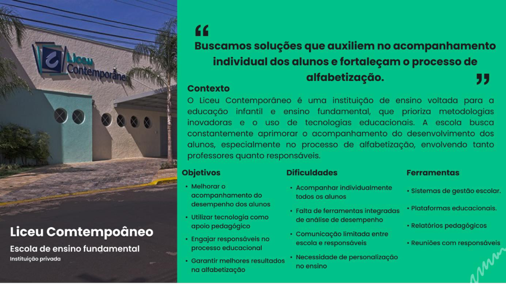

Fonte: elaborado pelo autor (2026)

As personas definidas representam os principais atores envolvidos no processo
educacional: o professor, o responsável e a instituição de ensino. O professor, representado
por Carlos Henrique, destaca a necessidade de ferramentas que auxiliem no acompanhamento
individual dos alunos, reduzindo a sobrecarga de trabalho e otimizando o processo de
alfabetização. A responsável, Juliana Souza, evidencia a dificuldade em conciliar a rotina com

---

## Página física 16 do PDF — página impressa: 10

o acompanhamento escolar, além da necessidade de orientações claras para apoiar o
desenvolvimento do filho. Já a instituição de ensino, representada pelo Liceu Contemporâneo,
demonstra a busca por soluções tecnológicas integradas que melhorem o monitoramento do
desempenho dos alunos e fortaleçam a comunicação com os responsáveis.

De forma geral, as personas apontam para a necessidade de uma solução que promova
integração, praticidade e personalização no acompanhamento educacional, beneficiando todos
os envolvidos no processo de aprendizagem.

#### 1.3 CONCEITO DO PRODUTO

O produto proposto consiste no desenvolvimento de um aplicativo educacional que utiliza
inteligência artificial para apoiar o processo de alfabetização infantil, por meio do
acompanhamento do desempenho da criança e da oferta de orientações personalizadas de
aprendizagem.

A solução busca atender à necessidade de pais, responsáveis e educadores que enfrentam
dificuldades em acompanhar de forma eficaz o desenvolvimento educacional das crianças.
Nesse contexto, o sistema tem como finalidade fornecer suporte no entendimento do nível de
aprendizagem, além de sugerir atividades e estratégias adequadas para cada etapa do processo
de alfabetização.

Como diferencial, o aplicativo propõe a utilização de inteligência artificial para análise
do progresso individual da criança, possibilitando a personalização do ensino de acordo com
suas necessidades específicas. Além disso, destaca-se a integração entre responsáveis e
educadores, promovendo maior alinhamento no acompanhamento do desenvolvimento
educacional. Outro aspecto relevante é a proposta de uma interface acessível e de fácil
utilização, visando atender usuários com diferentes níveis de familiaridade tecnológica.

Entretanto, o desenvolvimento da solução envolve alguns riscos que devem ser
considerados. Entre eles, destacam-se a aceitação da tecnologia por parte dos usuários,
especialmente no que se refere à confiança no uso de inteligência artificial no contexto
educacional. Além disso, a eficácia das recomendações depende diretamente da qualidade dos
dados fornecidos ao sistema. Por fim, desafios técnicos relacionados à implementação e
manutenção da plataforma também podem impactar o desenvolvimento do produto.
Dessa forma, o projeto apresenta potencial para contribuir significativamente com o processo
de alfabetização infantil, ao mesmo tempo em que exige planejamento adequado para mitigar
os riscos identificados.

---

## Página física 17 do PDF — página impressa: 11

### 2 BUSINESS MODEL CANVAS

No desenvolvimento de um projeto de software, especialmente aqueles que envolvem
inovação tecnológica, como o uso de inteligência artificial na educação, não basta apenas
definir as funcionalidades do sistema. É fundamental compreender como a solução proposta
gera valor para os usuários e como esse valor será sustentado ao longo do tempo. Nesse
contexto, o Business Model Canvas se apresenta como uma ferramenta estratégica para
estruturar e visualizar o modelo de negócio de forma integrada.

A principal “dor” que o Business Model Canvas busca resolver é a dificuldade de
organizar, de maneira clara e objetiva, todos os elementos que envolvem a criação, entrega e
captura de valor de uma solução. Em muitos projetos, há um forte foco no desenvolvimento
técnico, enquanto aspectos como público-alvo, forma de monetização, canais de distribuição e
relacionamento com o cliente acabam sendo tratados de forma superficial ou desconectada.
Isso pode resultar em soluções tecnicamente eficientes, mas com baixa aderência ao mercado
ou dificuldade de sustentação.

No caso do presente projeto, que propõe o desenvolvimento de um aplicativo
educacional com inteligência artificial voltado à alfabetização infantil, essa dor se manifesta
na necessidade de alinhar diferentes perspectivas: as necessidades das crianças em fase de
aprendizagem, as expectativas de pais e educadores, e a viabilidade de implementação e
manutenção da solução. Sem uma estrutura clara, esses elementos poderiam ser tratados de
forma isolada, comprometendo a efetividade do sistema.

Dessa forma, o Business Model Canvas permite integrar esses aspectos em um único
modelo visual, facilitando a compreensão de como o aplicativo atende aos diferentes
segmentos de clientes, quais são as propostas de valor oferecidas, como essas propostas serão
entregues por meio de canais específicos, e de que forma o projeto se sustenta
financeiramente. Além disso, possibilita identificar os recursos necessários, as atividades
essenciais e as parcerias estratégicas para o desenvolvimento e operação da solução.

Portanto, a utilização do Canvas neste trabalho não apenas organiza o modelo de
negócio, mas também contribui para a validação da proposta, garantindo que o sistema
desenvolvido esteja alinhado com as necessidades reais dos usuários e com a viabilidade do
projeto.

A Figura a seguir apresenta o modelo de negócios desenvolvido para o presente
projeto.

---

## Página física 18 do PDF — página impressa: 12

Figura 4. Business Model Canvas

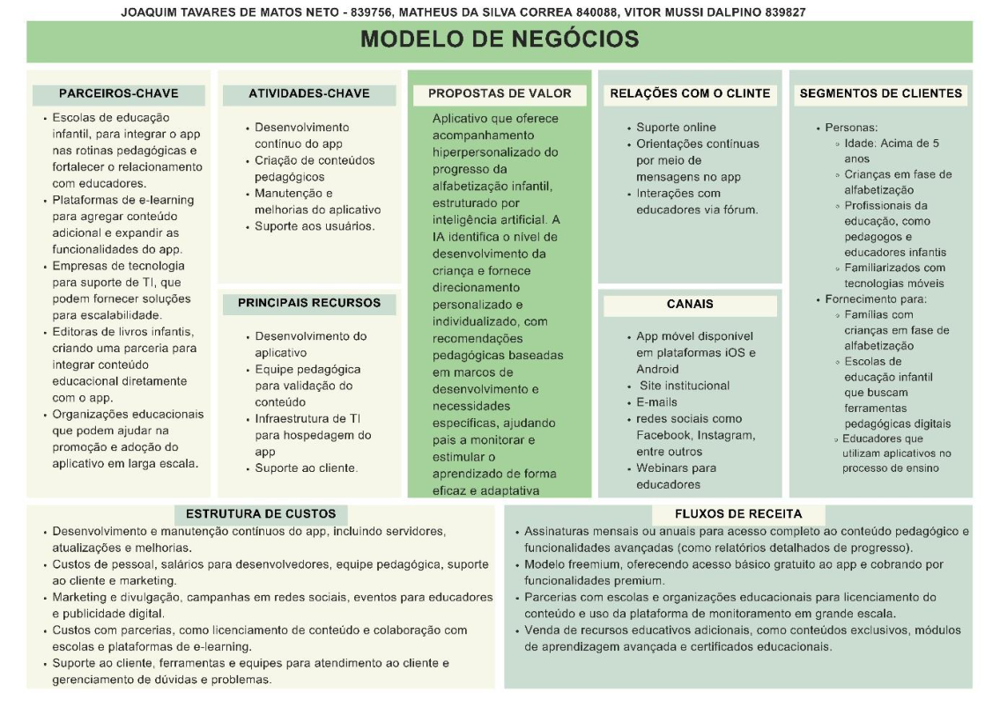

A partir da análise do modelo de negócios apresentado, é possível detalhar os
principais elementos que compõem a solução proposta.

No que se refere aos segmentos de clientes, o sistema é direcionado a crianças a partir
de cinco anos em fase de alfabetização, além de seus pais ou responsáveis, que acompanham
o desenvolvimento educacional. Também fazem parte desse público professores e pedagogos
do ensino infantil, bem como escolas de educação infantil, tanto públicas quanto privadas, e
instituições educacionais interessadas na aplicação de tecnologias no processo de ensino-aprendizagem.

Em relação às propostas de valor, o projeto oferece um acompanhamento
personalizado do processo de alfabetização infantil, utilizando inteligência artificial para
identificar dificuldades de aprendizagem e fornecer recomendações pedagógicas adaptativas.
Além disso, a solução apoia os pais no monitoramento do desempenho escolar das crianças e
oferece ferramentas que auxiliam professores no acompanhamento individual dos alunos,
promovendo melhorias no processo de ensino por meio do uso de tecnologia.

No que diz respeito aos canais de acesso, o sistema será disponibilizado por meio de
um aplicativo mobile, compatível com plataformas Android e iOS, além de uma plataforma
web voltada para pais e educadores. A comunicação com os usuários também ocorrerá por
meio de redes sociais, e-mails e conteúdos educativos, como webinars, além de parcerias com
instituições de ensino que contribuirão para a distribuição da solução.

Quanto ao relacionamento com os clientes, a proposta inclui suporte online
diretamente pelo aplicativo, comunicação contínua por meio de notificações e relatórios de
desempenho, além de funcionalidades de autoatendimento dentro da plataforma. Também
será promovida a interação entre usuários por meio de comunidades, como fóruns entre
educadores e responsáveis, estabelecendo um relacionamento baseado no acompanhamento
contínuo do progresso da criança.

---

## Página física 19 do PDF — página impressa: 13

No que se refere aos modelos de receita, o projeto adota a estratégia de assinatura
mensal ou anual para acesso completo às funcionalidades, além de um modelo freemium, no
qual recursos básicos são disponibilizados gratuitamente e funcionalidades avançadas são
oferecidas mediante pagamento. Também são consideradas fontes de receita provenientes do
licenciamento da plataforma para escolas e instituições, bem como da venda de conteúdos
educacionais adicionais e parcerias estratégicas.

Em relação aos recursos principais, destacam-se a equipe de desenvolvimento de
software, a equipe pedagógica especializada, os algoritmos de inteligência artificial, a
infraestrutura de tecnologia da informação, incluindo servidores e banco de dados, a
plataforma do aplicativo (mobile e web) e o suporte ao cliente.

As atividades principais envolvem o desenvolvimento e evolução contínua do
aplicativo, a implementação e o treinamento dos modelos de inteligência artificial, a criação e
atualização de conteúdos pedagógicos, a análise de dados de aprendizagem dos usuários, além
da manutenção da plataforma e do suporte aos usuários.

No que se refere às parcerias principais, o projeto estabelece conexões com escolas de
educação infantil, plataformas de ensino a distância, empresas de tecnologia, editoras de
conteúdo educacional, organizações educacionais e profissionais da área pedagógica, visando
ampliar a qualidade, o alcance e a escalabilidade da solução.

Por fim, a estrutura de custos do projeto envolve despesas com desenvolvimento e
manutenção do sistema, infraestrutura tecnológica, salários da equipe envolvida, ações de
marketing e divulgação, custos relacionados a parcerias e licenciamento de conteúdo, além do
atendimento ao cliente.

---

## Página física 20 do PDF — página impressa: 14

### 3 ANÁLISE DE VIABILIDADE

A análise de viabilidade tem como objetivo avaliar a possibilidade de
desenvolvimento e implementação do sistema proposto sob três perspectivas principais:
demanda, econômica e técnica. Essa etapa é fundamental para verificar se a solução atende a
uma necessidade real do público-alvo, se é financeiramente sustentável e se pode ser
desenvolvida com os recursos e tecnologias disponíveis.

Para a análise da viabilidade de demanda, optou-se pela aplicação de um formulário
estruturado, disponibilizado ao público em geral por meio de plataformas digitais. A
divulgação foi realizada de forma ampla, com foco em potenciais usuários da solução. O
objetivo da pesquisa foi compreender as dificuldades enfrentadas no acompanhamento da
alfabetização, bem como avaliar o interesse na utilização de uma ferramenta tecnológica de
apoio.

#### 3.1 ANÁLISE DE DEMANDA E VIABILIDADE

Para analisar a viabilidade de demanda do projeto, foi realizada uma pesquisa com
potenciais usuários da solução, incluindo pais, responsáveis e indivíduos envolvidos no
processo de alfabetização infantil. O objetivo da pesquisa foi compreender as dificuldades
enfrentadas no acompanhamento da alfabetização, bem como avaliar o interesse na utilização
de uma ferramenta tecnológica de apoio.

O instrumento de coleta de dados utilizado foi um formulário estruturado, contendo
questões relacionadas à percepção sobre o acompanhamento da alfabetização, frequência de
participação no processo de aprendizagem, uso de ferramentas educacionais e interesse em
soluções baseadas em tecnologia e inteligência artificial.

Figura 5. Formulário aplicado para análise de demanda

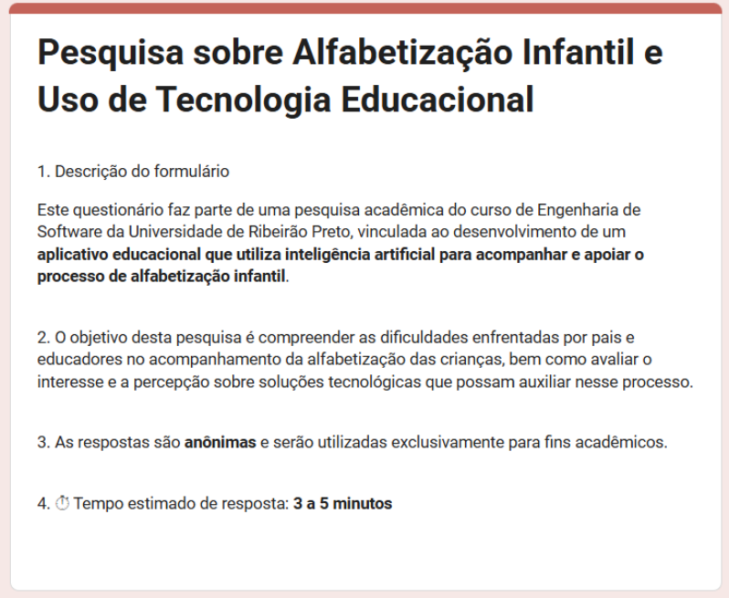

Fonte: Elaborado pelos autores (2026).

A pesquisa abordou inicialmente a percepção dos participantes quanto à dificuldade no
acompanhamento do processo de alfabetização infantil.

---

## Página física 21 do PDF — página impressa: 15

Figura 6. Percepção sobre a dificuldade no acompanhamento da alfabetização

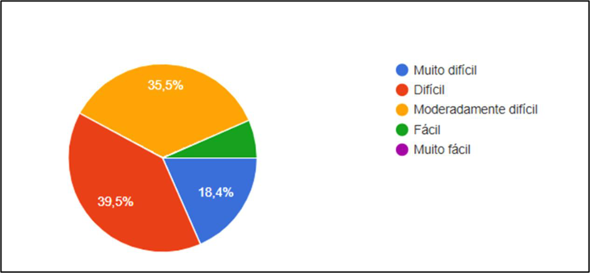

Fonte: Formulário - Pesquisa sobre Alfabetização Infantil e Uso de Tecnologia Educacional (2026).

A partir dos dados apresentados, observa-se que a maioria dos respondentes considera
o acompanhamento da alfabetização como difícil ou moderadamente difícil. Esse resultado
evidencia a existência de desafios no processo, indicando uma necessidade por soluções que
auxiliem os responsáveis. Dessa forma, reforça-se a viabilidade do projeto ao propor uma
ferramenta de apoio que facilite esse acompanhamento.

Em relação aos principais desafios enfrentados, foram identificados fatores como falta
de tempo, ausência de conhecimento pedagógico e dificuldade em acompanhar a evolução da
criança.

Figura 7. Principais desafios no acompanhamento da alfabetização infantil

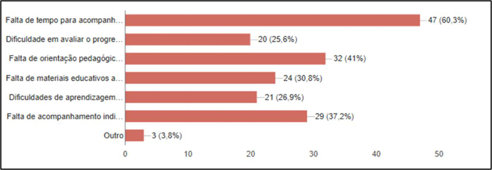

Fonte: Formulário - Pesquisa sobre Alfabetização Infantil e Uso de Tecnologia Educacional (2026).

Conforme os resultados obtidos, observa-se que a falta de tempo e a ausência de
orientação pedagógica estão entre os principais desafios enfrentados pelos responsáveis. Esses
fatores evidenciam dificuldades práticas no acompanhamento da alfabetização infantil. Nesse
contexto, a proposta do projeto mostra-se viável ao oferecer suporte e direcionamento,
auxiliando na superação dessas limitações.

---

## Página física 22 do PDF — página impressa: 16

Também foi analisada a frequência com que os participantes acompanham o processo
de aprendizagem da criança, permitindo compreender o nível de envolvimento dos
responsáveis.

Figura 8. Frequência de acompanhamento do processo de aprendizagem

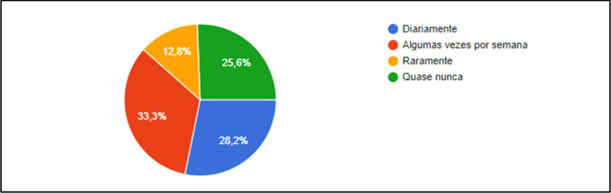

Fonte: Formulário - Pesquisa sobre Alfabetização Infantil e Uso de Tecnologia Educacional (2026).

A partir dos dados apresentados, observa-se que a maior parte dos respondentes não
acompanha o processo de aprendizagem de forma contínua, concentrando-se principalmente
nas opções de acompanhamento esporádico. Esse resultado indica uma limitação no
envolvimento dos responsáveis, o que pode impactar o desenvolvimento da criança. Nesse
contexto, a proposta do projeto mostra-se viável, ao oferecer uma solução que auxilia no
acompanhamento e orientação de forma mais prática e acessível.

Além disso, verificou-se a necessidade de orientações mais claras para auxiliar no
desenvolvimento da alfabetização infantil.

Figura 9. Necessidade de orientação no processo de alfabetização

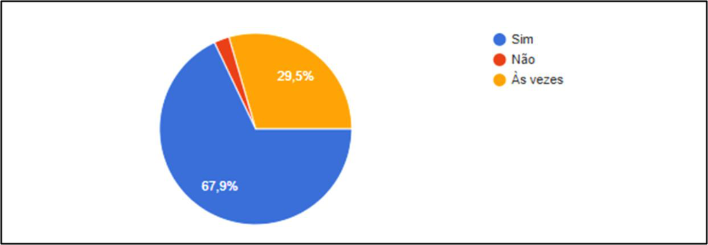

Fonte: Formulário - Pesquisa sobre Alfabetização Infantil e Uso de Tecnologia Educacional (2026).

Com base nas respostas coletadas, verifica-se que a maioria dos participantes sente
necessidade de orientações mais claras no processo de alfabetização infantil. Esse resultado
evidencia uma lacuna no suporte disponível aos responsáveis. Nesse sentido, a proposta do
projeto mostra-se viável ao oferecer direcionamento e orientações personalizadas.

A pesquisa também investigou o uso de ferramentas ou recursos para auxiliar na
alfabetização e sua efetividade percebida pelos usuários.

---

## Página física 23 do PDF — página impressa: 17

Figura 10. Utilização de ferramentas de apoio à alfabetização

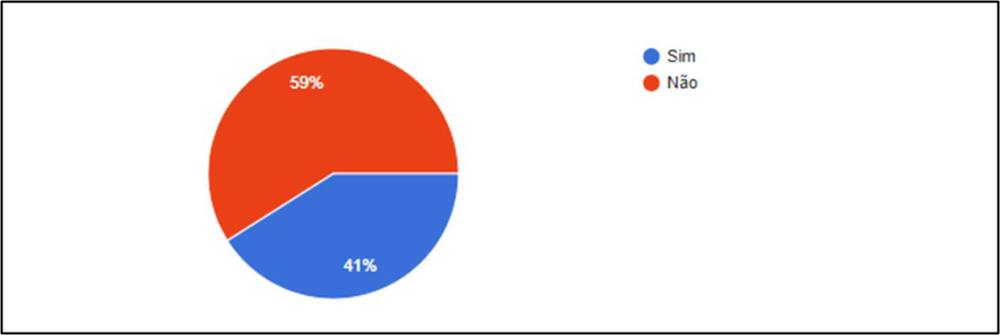

Fonte: Formulário - Pesquisa sobre Alfabetização Infantil e Uso de Tecnologia Educacional (2026).

Figura 11. Tipos de ferramentas utilizadas

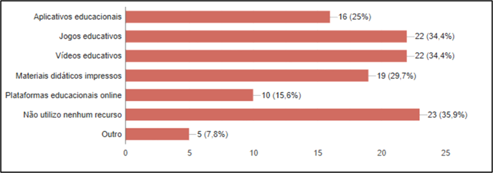

Fonte: Formulário - Pesquisa sobre Alfabetização Infantil e Uso de Tecnologia Educacional (2026).

Figura 12. Percepção sobre a efetividade das ferramentas utilizadas

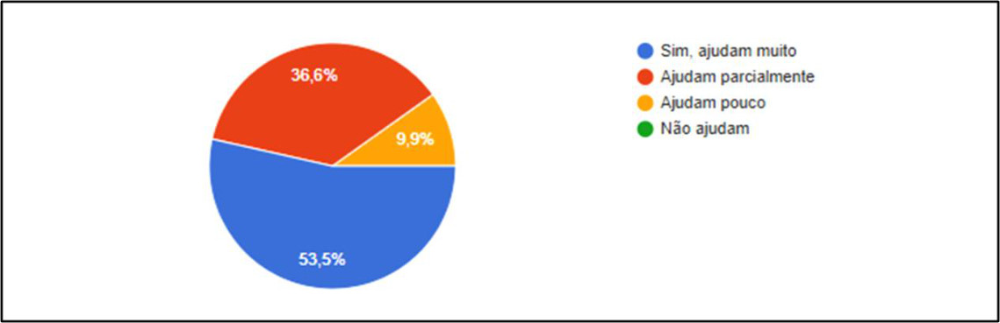

Fonte: Formulário - Pesquisa sobre Alfabetização Infantil e Uso de Tecnologia Educacional (2026).

Conforme apresentado na Figura 11, 59% dos participantes afirmaram não utilizar
ferramentas de apoio no processo de alfabetização, enquanto 41% relataram fazer uso desses

recursos.

Na Figura 8, entre os principais recursos utilizados destacam-se jogos educativos e
vídeos educativos (34,4%), seguidos por materiais didáticos impressos (29,7%) e aplicativos
educacionais (25%). As plataformas educacionais online foram mencionadas por 15,6% dos

---

## Página física 24 do PDF — página impressa: 18

participantes, enquanto 7,8% indicaram utilizar outros recursos. Além disso, 35,9% afirmaram
não utilizar nenhum tipo de ferramenta.

Por fim, conforme a Figura 12, a maioria dos participantes (53,5%) considera que as
ferramentas ajudam muito no processo de alfabetização, enquanto 36,6% avaliam que ajudam
parcialmente e 9,9% acreditam que ajudam pouco. Esses resultados indicam uma percepção
majoritariamente positiva sobre a efetividade dessas ferramentas.

No que se refere à aceitação da solução proposta, os participantes demonstraram
interesse significativo na utilização de um aplicativo que acompanhe o progresso da
alfabetização da criança.

Figura 13. Interesse no uso de aplicativo de acompanhamento

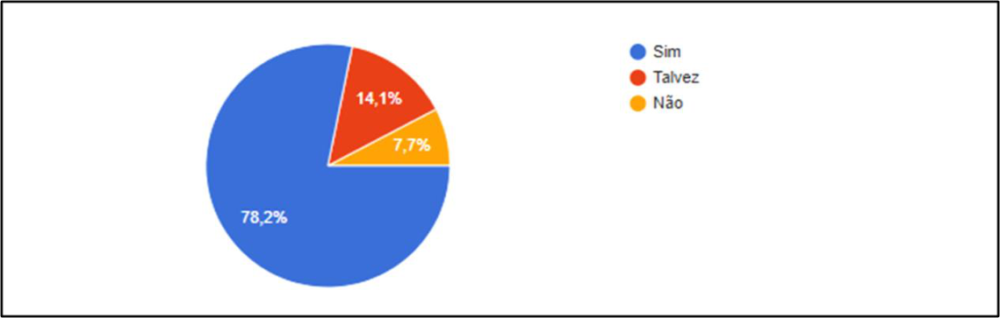

Fonte: Formulário - Pesquisa sobre Alfabetização Infantil e Uso de Tecnologia Educacional (2026).

Conforme apresentado na Figura 13, a maioria dos participantes (78,2%) demonstrou
interesse em utilizar um aplicativo para acompanhar o progresso da alfabetização da criança.
Além disso, 14,1% responderam que talvez utilizariam, enquanto apenas 7,7% indicaram que
não utilizariam.

Figura 14. Percepção sobre a utilidade da solução proposta

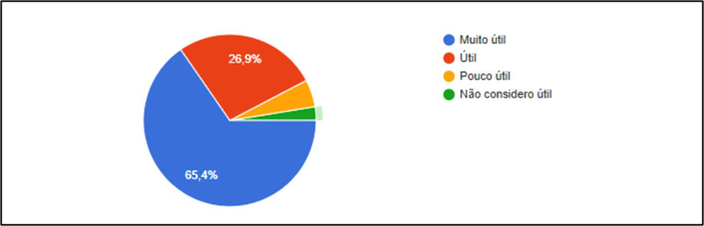

Fonte: Formulário - Pesquisa sobre Alfabetização Infantil e Uso de Tecnologia Educacional (2026).

Na Figura 14, observa-se que 65,4% dos participantes consideram a solução proposta
muito útil, enquanto 26,9% a classificam como útil. Uma pequena parcela avaliou a solução
como pouco útil ou não útil, indicando que a percepção geral sobre a proposta é
majoritariamente positiva.

A proposta de um aplicativo que utiliza inteligência artificial para personalização do
aprendizado foi amplamente considerada útil pelos respondentes

---

## Página física 25 do PDF — página impressa: 19

Figura 15. Funcionalidades consideradas mais importantes

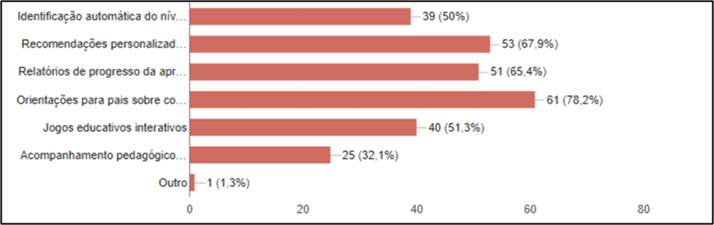

Fonte: Formulário - Pesquisa sobre Alfabetização Infantil e Uso de Tecnologia Educacional (2026).

A Figura 15 apresenta as funcionalidades consideradas mais importantes pelos
participantes. Entre as mais citadas estão orientações para pais sobre como auxiliar na
alfabetização (78,2%), recomendações personalizadas (67,9%) e relatórios de progresso do
aprendizado (65,4%). Também foram mencionados jogos educativos interativos (51,3%),
identificação automática do nível da criança (50%) e acompanhamento pedagógico (32,1%).

Também foram identificadas as funcionalidades mais relevantes esperadas pelos
usuários, com destaque para acompanhamento de desempenho, recomendações
personalizadas e orientações práticas.

A confiança no uso de inteligência artificial aplicada à educação foi analisada,
demonstrando aceitação por parte dos participantes.

Figura 16. Confiança no uso de inteligência artificial na educação

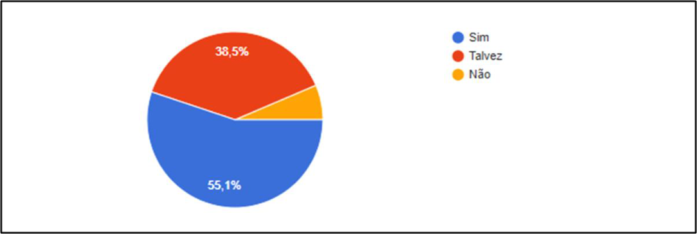

Fonte: Formulário - Pesquisa sobre Alfabetização Infantil e Uso de Tecnologia Educacional (2026).

A Figura 16 apresenta a confiança dos participantes no uso de inteligência artificial
aplicada à educação. Observa-se que 55,1% afirmaram confiar nesse tipo de tecnologia,
enquanto 38,5% responderam que talvez confiem e apenas uma pequena parcela indicou não
confiar. Esses resultados demonstram uma tendência positiva em relação ao uso da
inteligência artificial no contexto educacional.

No que se refere à percepção dos participantes acerca da contribuição da tecnologia no
processo de alfabetização infantil, a questão foi apresentada de forma aberta, possibilitando a
obtenção de respostas descritivas e mais aprofundadas.

A análise qualitativa das respostas evidencia que, de modo geral, os participantes
reconhecem o potencial positivo da tecnologia no processo de ensino-aprendizagem. Observa-se que os respondentes destacam a capacidade das ferramentas tecnológicas de tornar o
aprendizado mais interativo, dinâmico e atrativo, contribuindo para o engajamento das
crianças no desenvolvimento das habilidades de leitura e escrita.

---

## Página física 26 do PDF — página impressa: 20

Outro aspecto recorrente nas respostas refere-se à possibilidade de personalização do
ensino, especialmente por meio da utilização de inteligência artificial. Nesse contexto, os
participantes apontam que a tecnologia pode auxiliar na identificação de dificuldades
específicas de cada criança, permitindo a adaptação de conteúdos e estratégias pedagógicas
conforme o ritmo individual de aprendizagem.

Adicionalmente, evidencia-se a percepção de que a tecnologia pode atuar como
ferramenta de apoio tanto para os responsáveis quanto para os profissionais da educação,
especialmente no acompanhamento do progresso da criança e na oferta de orientações mais
direcionadas. Também foram mencionados aspectos relacionados à ampliação da
acessibilidade e à utilização de diferentes recursos pedagógicos, como jogos e aplicações
interativas.

Por outro lado, parte dos participantes ressaltou a importância do uso consciente e
supervisionado da tecnologia, enfatizando que sua aplicação deve ocorrer de forma
complementar ao ensino tradicional, sem substituir o papel do professor ou a participação
ativa dos responsáveis no processo de alfabetização.

Dessa forma, as respostas obtidas indicam que a tecnologia é percebida como um
elemento relevante no apoio ao processo de alfabetização infantil, desde que utilizada de
maneira adequada, contribuindo para a personalização do ensino, o acompanhamento
contínuo e o suporte pedagógico aos envolvidos.

Por fim, observou-se intenção de uso contínuo da solução e interesse em participar de
testes futuros.

Figura 17. Intenção de uso frequente da solução

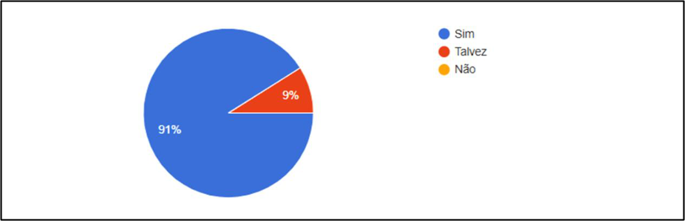

Fonte: Formulário - Pesquisa sobre Alfabetização Infantil e Uso de Tecnologia Educacional (2026).

Figura 18. Interesse em participar de testes futuros

Fonte: Formulário - Pesquisa sobre Alfabetização Infantil e Uso de Tecnologia Educacional (2026).

---

## Página física 27 do PDF — página impressa: 21

A Figura 17 apresenta a intenção de uso frequente da solução. Observa-se que a
grande maioria dos participantes (91%) afirmou que utilizaria a ferramenta, enquanto 9%
responderam que talvez utilizariam.

Já a Figura 18 mostra o interesse em participar de testes futuros da solução. Os
resultados indicam que 79,5% dos participantes demonstraram interesse em participar,
enquanto 20,5% afirmaram que não participariam. Esses dados indicam uma boa aceitação da
proposta e abertura dos usuários para futuras melhorias da solução.

De modo geral, os resultados do formulário indicam que há uma necessidade
significativa de apoio no processo de alfabetização infantil, especialmente no que se refere a
orientações mais claras para pais e responsáveis. Observou-se que, embora parte dos
participantes ainda não utilize ferramentas de apoio, aqueles que utilizam percebem
benefícios no acompanhamento da aprendizagem.

Além disso, os dados demonstram boa aceitação da proposta de uma solução
tecnológica voltada ao acompanhamento da alfabetização, com destaque para funcionalidades
como recomendações personalizadas, orientações práticas e relatórios de progresso. Também
foi identificada uma percepção positiva em relação ao uso de inteligência artificial na
educação.

Por fim, a maioria dos participantes demonstrou interesse em utilizar a solução com
frequência e participar de testes futuros, indicando potencial de adoção da ferramenta e
relevância da proposta para apoiar o processo de alfabetização infantil.

#### 3.2 PREÇO DE VENDA
O modelo de precificação adotado para a solução proposta baseia-se na estratégia
freemium, amplamente utilizada no mercado de aplicativos educacionais. A análise de
mercado realizada demonstrou que a maioria dos aplicativos de alfabetização disponíveis é
gratuita ou apresenta custos reduzidos, utilizando modelos de monetização baseados em
assinaturas ou funcionalidades premium.

Diante desse cenário, optou-se por disponibilizar uma versão gratuita do aplicativo,
com acesso a funcionalidades básicas, visando ampliar o alcance da solução e facilitar a
adesão por parte dos usuários. Paralelamente, será oferecida uma versão premium por meio de
assinatura, que incluirá recursos avançados, como personalização do aprendizado por meio de
inteligência artificial, relatórios detalhados de desempenho e acompanhamento contínuo do
desenvolvimento da criança.

O Quadro 1 apresenta com detalhes a descrição das regras utilizadas para a definição
dos planos oferecidos.

Quadro 1 - Planos de assinatura

| Planos | Descrição |
| --- | --- |
| Gratuito | Será composto por funcionalidades básicas do aplicativo, incluindo acesso a atividades iniciais de alfabetização, jogos educativos e uso limitado do sistema de acompanhamento. |
| Premium | Será composto por todos os módulos disponíveis no sistema, incluindo personalização completa por inteligência artificial, relatórios detalhados, plano de desenvolvimento individual da criança e acompanhamento contínuo do progresso. |
| Institucional |  |

---

## Página física 28 do PDF — página impressa: 22

| Coluna 1 | Coluna 2 |
| --- | --- |
| | Será composto pelos módulos do plano Premium, adaptados para uso em escolas e instituições de ensino, com possibilidade de gerenciamento de múltiplos alunos e relatórios coletivos. O valor poderá variar de acordo com o número de usuários. |

Fonte: Elaborado pelos autores (2026).

Quadro 2 – Valores Planos de assinatura

O Quadro 2 define os valores utilizados para a comercialização do software
, juntamente aos módulos incluídos na versão inicial, no contexto de planos individuais,
focados em pequenas equipes, profissionais liberais e estudantes.

| Planos | Descrição | Valor |
| --- | --- | --- |
| Gratuito | Atividades básicas, jogos educativos, acesso limitado ao sistema | Gratuito |
| Premium | Acesso completo, IA personalizada, relatórios detalhados, acompanhamento contínuo | R$ 19,90 |
| Institucional | Acesso completo para múltiplos usuários, gestão escolar, relatórios pedagógicos | Variável |

Fonte: Elaborado pelos autores (2026).

A definição dos valores foi realizada com base na análise comparativa de aplicativos
concorrentes e na percepção de valor identificada na pesquisa com o público-alvo. Dessa
forma, estabeleceu-se o valor de R$ 19,90 mensais para o plano premium.

Adicionalmente, considera-se a possibilidade de licenciamento da solução para
instituições de ensino, permitindo sua utilização em larga escala e ampliando o impacto
educacional do sistema.

A estratégia de precificação adotada busca equilibrar acessibilidade financeira,
competitividade de mercado e sustentabilidade do projeto, ao mesmo tempo em que valoriza o
diferencial tecnológico da solução, baseado no uso de inteligência artificial para
personalização do processo de aprendizagem.

Ressalta-se que a solução proposta não tem como objetivo substituir o papel do
professor, mas atuar como ferramenta complementar de apoio ao processo de alfabetização.

---

## Página física 29 do PDF — página impressa: 23

### 4 GESTÃO DO PROJETO

A gestão do projeto consiste no conjunto de práticas utilizadas para planejar,
organizar, executar e controlar o desenvolvimento da solução proposta, garantindo o
cumprimento dos objetivos estabelecidos dentro dos prazos e recursos disponíveis.

No contexto deste trabalho, a gestão do projeto tem como foco o desenvolvimento de
um aplicativo educacional com uso de inteligência artificial, voltado ao acompanhamento do
processo de alfabetização infantil. Para isso, são consideradas etapas que envolvem desde o
levantamento de requisitos até a validação da solução junto ao público-alvo.

A condução do projeto busca alinhar aspectos técnicos e pedagógicos, garantindo que
a solução desenvolvida atenda às necessidades identificadas na pesquisa de viabilidade e
esteja de acordo com os objetivos definidos.

Além disso, a gestão do projeto envolve a definição de um planejamento estruturado
das atividades, permitindo o acompanhamento contínuo do progresso e a identificação de
possíveis desvios ao longo do desenvolvimento. Dessa forma, torna-se possível realizar
ajustes necessários de maneira antecipada, contribuindo para a eficiência do processo e a
qualidade da solução final.

Outro aspecto relevante refere-se à organização das etapas de desenvolvimento, que
seguem uma sequência lógica baseada nas fases de engenharia de software, incluindo análise,
modelagem, prototipação e definição da proposta de implementação. Essa estrutura permite
maior controle sobre o desenvolvimento do sistema, bem como a integração entre os
diferentes componentes do projeto.

Adicionalmente, a gestão contempla a utilização de ferramentas e práticas que
auxiliam na comunicação entre os envolvidos, no registro das atividades realizadas e no
acompanhamento das entregas previstas. Esse processo contribui para a transparência do
desenvolvimento e para a organização das informações geradas ao longo do projeto.

Por fim, destaca-se que a gestão do projeto também considera a análise de riscos, a
definição de recursos necessários e o planejamento das etapas futuras, garantindo que a
solução proposta seja desenvolvida de forma estruturada, viável e alinhada às necessidades do
público-alvo, conforme identificado nas etapas anteriores do trabalho.

#### 4.1 Detalhamento das Atividades
O desenvolvimento do projeto foi estruturado em etapas, considerando o fluxo lógico
de criação de um sistema de software educacional.

Inicialmente, realizou-se a etapa de contextualização e definição do problema, com o
objetivo de compreender as dificuldades enfrentadas no processo de alfabetização infantil.
Essa etapa foi fundamental para delimitar o escopo do projeto e identificar as principais
necessidades relacionadas ao acompanhamento do desenvolvimento educacional das crianças.
Em seguida, foi realizada a identificação do público-alvo e a construção de personas,
permitindo uma melhor compreensão das necessidades, comportamentos e desafios dos
usuários envolvidos no processo.

Posteriormente, foi desenvolvido o modelo de negócio por meio do Business Model
Canvas, possibilitando a organização dos principais elementos relacionados à proposta de
valor, segmentos de clientes, canais de distribuição, fontes de receita e estrutura de custos.
Essa etapa contribuiu para a definição estratégica da solução, garantindo alinhamento entre a
proposta do sistema e as demandas do mercado.

Na sequência, foi realizada a análise de viabilidade, com destaque para a aplicação de
um formulário estruturado, que permitiu validar a existência da demanda e identificar as
principais dificuldades enfrentadas pelos usuários. A análise dos dados coletados possibilitou
uma compreensão mais aprofundada do problema, além de fornecer subsídios para a definição
das funcionalidades e características da solução proposta.

---

## Página física 30 do PDF — página impressa: 24

Com base nesses dados, serão desenvolvidas as etapas técnicas do projeto, incluindo a
análise de requisitos, modelagem do sistema, definição do banco de dados e prototipagem das
interfaces. Essas atividades têm como objetivo estruturar o funcionamento do sistema, definir
suas funcionalidades e garantir que a solução atenda às necessidades identificadas nas etapas
anteriores.

Além disso, essas etapas permitem a organização lógica do sistema, facilitando o
desenvolvimento, a implementação e a manutenção da solução. A modelagem e a
prototipagem contribuem para a visualização do funcionamento do aplicativo, possibilitando a
validação prévia das funcionalidades antes da etapa de desenvolvimento.

O projeto contempla a proposta de desenvolvimento, envolvendo a definição das
tecnologias, metodologias e métricas de qualidade a serem utilizadas. Essa etapa final tem
como objetivo orientar a implementação da solução, garantindo que o sistema seja
desenvolvido de forma estruturada, eficiente e alinhada aos padrões de qualidade
estabelecidos.

#### 4.2 Detalhamento dos Recursos
Para o desenvolvimento da solução proposta, são necessários recursos humanos,
tecnológicos e organizacionais.

No que se refere aos recursos humanos, o projeto conta com a participação dos autores
do trabalho, responsáveis pelo planejamento, desenvolvimento e validação da solução. Além
disso, considera-se a necessidade de conhecimento técnico em desenvolvimento de software e
conhecimento pedagógico para a elaboração das funcionalidades educacionais.

Em relação aos recursos tecnológicos, destacam-se os dispositivos computacionais
utilizados no desenvolvimento, ferramentas de programação, ambientes de desenvolvimento e
tecnologias necessárias para a implementação do aplicativo, incluindo plataformas mobile e
web, banco de dados e infraestrutura de tecnologia da informação.

Também são considerados recursos relacionados à inteligência artificial, utilizados
para análise do desempenho da criança e geração de recomendações personalizadas.

No âmbito organizacional, incluem-se os materiais de apoio utilizados na pesquisa,
como o formulário aplicado para análise de demanda, bem como ferramentas de comunicação
e organização das atividades do projeto.

Quadro 3 - Cronograma do Projeto

| Etapa | Atividade | Período |
| --- | --- | --- |
| 1 | Contextualização e definição do problema | Início do projeto |
| 2 | Definição do público-alvo e personas | Início do projeto |
| 3 | Desenvolvimento do Business Model Canvas | Fase inicial |
| 4 | Elaboração e aplicação do questionário | Fase inicial |
| 5 | Análise de viabilidade | Fase intermediária |

---

## Página física 31 do PDF — página impressa: 25

| Coluna 1 | Coluna 2 | Coluna 3 |
| --- | --- | --- |
| 6 | Análise de requisitos | Fase intermediária |
| 7 | Modelagem do sistema | Fase intermediária |
| 8 | Modelagem do banco de dados | Fase intermediária |
| 9 | Prototipagem das telas | Fase final |
| 10 | Definição da proposta de desenvolvimento | Fase final |

Fonte: Elaborado pelos autores (2026).

Figura 19. Cronograma do projeto

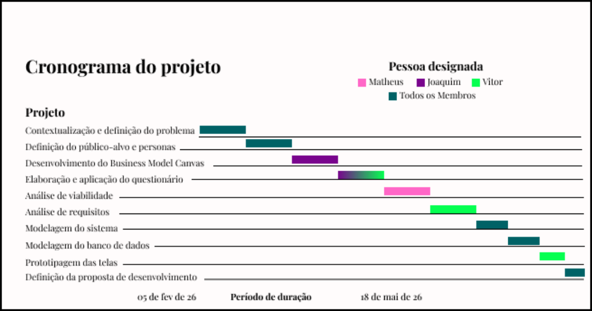

Fonte: Elaborado pelos autores (2026).

#### 4.4 Riscos do Projeto – Matriz SWOT

A análise SWOT foi utilizada para identificar os principais fatores internos e externos
que podem impactar o desenvolvimento da solução proposta.

---

## Página física 32 do PDF — página impressa: 26

Figura 20 - Matriz SWOT

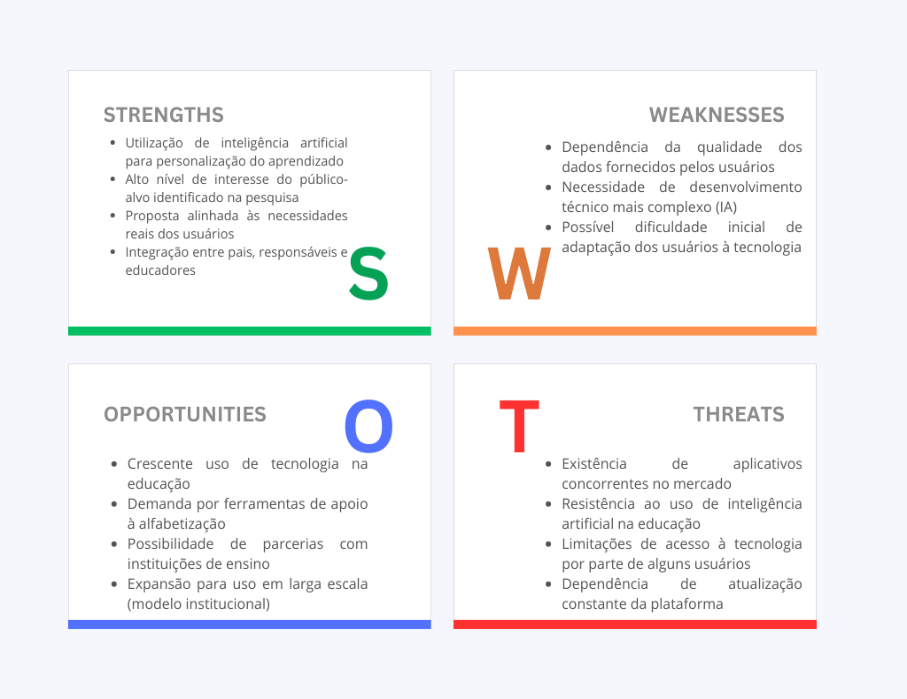

Fonte: Elaborado pelos autores (2026).

---

## Página física 33 do PDF — página impressa: 27

### 5 ANÁLISE DE REQUISITOS

A análise de requisitos consiste em uma etapa fundamental no desenvolvimento de
sistemas de software, sendo responsável por identificar, compreender e documentar as
necessidades dos usuários e as funcionalidades que o sistema deve oferecer. Essa etapa tem
como objetivo garantir que a solução proposta esteja alinhada com os problemas identificados
e com as expectativas do público-alvo.

No contexto deste trabalho, a análise de requisitos é baseada nas informações obtidas
nas etapas anteriores, especialmente na contextualização do problema, definição do público-alvo, construção de personas e análise de viabilidade. Dessa forma, busca-se assegurar que o
sistema desenvolvido atenda de maneira efetiva às dificuldades relacionadas ao
acompanhamento do processo de alfabetização infantil.

Além disso, essa etapa contribui para a organização das funcionalidades do sistema,
permitindo uma visão estruturada do que será desenvolvido e servindo como base para as
etapas de modelagem, implementação e validação da solução.

#### 5.1 DEFINIÇÃO DO PROBLEMA

O processo de alfabetização infantil exige acompanhamento contínuo por parte de
pais, responsáveis e educadores, sendo um fator determinante para o desenvolvimento das
habilidades de leitura e escrita. No entanto, observa-se que esse acompanhamento nem
sempre ocorre de forma eficaz, devido a diferentes dificuldades enfrentadas pelos envolvidos

no processo.

Entre os principais desafios identificados, destacam-se a falta de tempo por parte dos
responsáveis, a ausência de conhecimento pedagógico adequado e a dificuldade em
compreender o nível de desenvolvimento da criança. Esses fatores dificultam a participação
ativa no processo de aprendizagem, podendo impactar negativamente o desempenho
educacional.

Além disso, verifica-se a carência de ferramentas acessíveis que auxiliem no
acompanhamento da alfabetização de forma prática e orientada. Embora existam recursos
educacionais disponíveis, muitos deles não oferecem direcionamento individualizado ou não
possibilitam uma análise clara do progresso da criança. E muito menos um acompanhamento,
personalizado para cada indivíduo, fazendo com que cada criança tenha um progresso muito
mais gradual do que, na forma convencional.

Com base nos dados obtidos por meio da pesquisa realizada, observa-se que uma
parcela significativa dos participantes considera o acompanhamento da alfabetização como
difícil ou moderadamente difícil, além de demonstrar necessidade de orientações mais claras e
interesse em soluções tecnológicas que auxiliem nesse processo.

Diante desse cenário, o problema central abordado neste trabalho consiste na
dificuldade enfrentada por pais, responsáveis e educadores em acompanhar, de forma eficaz, o
desenvolvimento da alfabetização infantil, especialmente no que se refere à identificação do
nível da criança e à definição de estratégias adequadas para seu aprendizado.

#### 5.2 STAKEHOLDERS

Os stakeholders correspondem aos indivíduos ou organizações que possuem interesse
direto ou indireto no desenvolvimento e na utilização do sistema proposto. A identificação
desses atores é essencial para compreender suas necessidades, expectativas e influências no
projeto.

Os principais stakeholders estão diretamente relacionados ao processo de alfabetização
infantil e ao uso da solução proposta.

---

## Página física 34 do PDF — página impressa: 28

Inicialmente, destacam-se as crianças em fase de alfabetização, que representam os
usuários finais do sistema. Embora não interajam diretamente com todas as funcionalidades,
são o foco principal da solução, uma vez que o aplicativo busca contribuir para o seu
desenvolvimento educacional.

Em seguida, destacam-se os pais e responsáveis, que atuam no acompanhamento da
aprendizagem da criança. Esses usuários utilizam o sistema para compreender o progresso
educacional, receber orientações e apoiar o desenvolvimento das habilidades de leitura e
escrita.

Os professores e pedagogos também representam stakeholders importantes, uma vez
que podem utilizar a solução como ferramenta de apoio no acompanhamento individual dos
alunos, auxiliando na identificação de dificuldades e na aplicação de estratégias pedagógicas
mais adequadas.

Além disso, incluem-se as instituições de ensino, tanto públicas quanto privadas, que
podem adotar a solução como recurso complementar ao processo educacional. Nesse
contexto, o sistema pode contribuir para a melhoria do acompanhamento do desempenho dos
alunos e para a integração entre escola e responsáveis.

Destacam-se os desenvolvedores do sistema, responsáveis pela implementação,
manutenção e evolução da solução, garantindo seu funcionamento adequado e sua adaptação
às necessidades dos usuários.

Quadro 4 - Stakeholders

| Stakeholder | Descrição | Interesse no Projeto | Influência | Necessidades Principais |
| --- | --- | --- | --- | --- |
| Crianças em fase de alfabetização | Usuários finais do sistema, em processo de desenvolvimento das habilidades de leitura e escrita | Alto, pois são diretamente impactadas pela solução | Baixa | Aprendizado interativo, atividades adequadas ao nível de desenvolvimento, experiência acessível e atrativa |
| Pais e responsáveis | Acompanham o desenvolvimento educacional da criança e utilizam o sistema para monitoramento | Muito alto, pois utilizam diretamente a solução | Alta | Orientações claras, acompanhamento do progresso, facilidade de uso e praticidade |
| Professores e pedagogos | Profissionais responsáveis pelo ensino e acompanhamento educacional das crianças | Alto, pois podem utilizar o sistema como apoio pedagógico | Alta | Ferramentas de acompanhamento individual, relatórios de desempenho e apoio na identificação de dificuldades |
| Instituições de ensino | Escolas e organizações educacionais que podem adotar a solução | Médio a alto, dependendo da adoção da solução | Alta | Monitoramento coletivo, integração com responsáveis, gestão de múltiplos alunos |
|  | Responsáveis pela criação, manutenção | Alto, pois garantem o | Alta | Definição clara de requisitos, viabilidade |

---

## Página física 35 do PDF — página impressa: 29

| Coluna 1 | Coluna 2 | Coluna 3 | Coluna 4 | Coluna 5 |
| --- | --- | --- | --- | --- |
| Desenvolvedores do sistema | e evolução do aplicativo | funcionamento da solução |  | técnica, organização do projeto |
| Equipe pedagógica | Responsável pela validação das atividades e alinhamento educacional | Alto | Média | Garantia de qualidade pedagógica, alinhamento com práticas educacionais |
| Usuários em potencial | Pessoas que ainda não utilizam a solução, mas podem vir a utilizar | Médio | Baixa | Acessibilidade, confiabilidade e valor percebido da solução |

Fonte: Elaborado pelos autores (2026).

#### 5.3 CAUSAS RAÍZES DO PROBLEMA

A identificação das causas raízes do problema permite compreender de forma mais
aprofundada os fatores que contribuem para as dificuldades no acompanhamento da
alfabetização infantil. Essa análise é fundamental para o desenvolvimento de uma solução
eficaz, que atue diretamente nos pontos críticos identificados.

Com base nas informações obtidas na pesquisa de viabilidade e nas etapas anteriores
do projeto, foram identificadas algumas causas principais relacionadas ao problema.

Uma das principais causas refere-se à falta de tempo por parte dos pais e responsáveis,
o que dificulta o acompanhamento contínuo do processo de aprendizagem da criança. Esse
fator está diretamente relacionado às rotinas diárias e às demandas pessoais e profissionais
dos responsáveis.

Outra causa relevante é a ausência de conhecimento pedagógico adequado, o que
impede que os responsáveis compreendam o nível de desenvolvimento da criança e saibam
como auxiliá-la de forma eficiente. Essa limitação dificulta a tomada de decisões relacionadas
às estratégias de ensino mais apropriadas.

Além disso, destaca-se a dificuldade em identificar o progresso da criança, uma vez
que nem sempre existem ferramentas que apresentem informações claras e acessíveis sobre o
desempenho educacional. Essa falta de visibilidade compromete o acompanhamento e a
intervenção no momento adequado.

Também foi identificada a carência de soluções tecnológicas que ofereçam
direcionamento personalizado, considerando as necessidades específicas de cada criança.
Embora existam aplicativos educacionais, muitos não apresentam recursos que permitam
adaptação individualizada do conteúdo.

Observa-se que o uso da tecnologia no processo educacional ainda enfrenta desafios
relacionados à aceitação e à confiança, especialmente no que se refere à utilização de
inteligência artificial. Esse fator pode influenciar a adoção da solução proposta.

Dessa forma, as causas identificadas evidenciam a necessidade de uma solução que
ofereça acompanhamento contínuo, orientações claras e personalização do aprendizado,
contribuindo para a melhoria do processo de alfabetização infantil.

---

## Página física 36 do PDF — página impressa: 30

### 6 MODELAGEM DO SISTEMA

A modelagem do sistema tem como objetivo representar, de forma estruturada, as
principais funcionalidades, restrições e comportamentos esperados para a solução proposta.
Essa etapa permite compreender como o aplicativo deverá funcionar, quais atores irão
interagir com o sistema e quais requisitos deverão ser atendidos durante seu desenvolvimento.

No contexto deste projeto, a modelagem considera as necessidades identificadas nas
etapas anteriores, especialmente a análise de demanda, o público-alvo e a proposta de uso de
inteligência artificial para acompanhamento personalizado da alfabetização infantil. Dessa
forma, são definidos os requisitos funcionais, requisitos não funcionais, restrições do sistema
e os diagramas necessários para apoiar a compreensão da solução.

#### 6.1 LISTA DE RESTRIÇÕES

A lista de restrições apresenta limitações e condições que devem ser consideradas
durante o desenvolvimento e utilização do sistema. Essas restrições auxiliam na definição dos
limites técnicos, operacionais e pedagógicos da solução.

#### Quadro 5 - Restrições

| Coluna 1 | Coluna 2 | Coluna 3 |
| --- | --- | --- |
| Software | O sistema deverá possuir acesso por aplicativo mobile e plataforma web | A solução foi pensada para atender pais, responsáveis e educadores em diferentes contextos de uso |
| Hardware | O usuário precisará de dispositivo com acesso à internet | O sistema dependerá de comunicação com banco de dados e recursos de inteligência artificial |
| Usuário | O progresso da criança dependerá dos dados inseridos e das atividades realizadas | A qualidade das recomendações depende das informações coletadas durante o uso |
| Tecnologia | A inteligência artificial dependerá de dados suficientes para gerar recomendações personalizadas | A personalização exige análise do desempenho individual da criança |

---

## Página física 37 do PDF — página impressa: 31

| Coluna 1 | Coluna 2 | Coluna 3 |
| --- | --- | --- |
| Segurança | O sistema deverá proteger dados de crianças e responsáveis | Por se tratar de dados educacionais infantis, é necessário cuidado com privacidade e segurança |
| Pedagógica | As recomendações devem seguir critérios educacionais adequados | O aplicativo deve atuar como apoio ao processo de alfabetização, sem substituir o professor |

Fonte: Elaborado pelos autores (2026).

#### 6.2 REQUISITOS E DIAGRAMAS

Esta seção apresenta os requisitos identificados para o sistema, divididos em requisitos
funcionais e requisitos não funcionais. Os requisitos funcionais descrevem as ações que o
sistema deve permitir ao usuário realizar, enquanto os requisitos não funcionais representam
características de qualidade esperadas, como segurança, usabilidade, desempenho e
confiabilidade.

Além disso, são apresentados os diagramas e descrições de casos de uso, com o
objetivo de representar a interação entre os usuários e as funcionalidades principais do
aplicativo.

##### 6.2.1 Requisitos funcionais

Quadro 6 - Requisitos funcionais

| Código | Requisito | Descrição | Prioridade | Ator(es) |
| --- | --- | --- | --- | --- |
| RF001 | Realizar cadastro | O usuário deve conseguir criar uma conta no sistema | Obrigatório | Pai/Responsável, Professor |
| RF002 | Realizar login | O usuário deve conseguir acessar o sistema por meio de e-mail e senha | Obrigatório | Usuário |
| RF003 | Cadastrar criança | O responsável deve conseguir cadastrar os dados básicos da criança | Obrigatório | Pai/Responsável |
| RF004 | Registrar atividades | O sistema deve permitir registrar atividades realizadas pela criança | Obrigatório | Usuário |
| RF005 | Identificar nível da criança | O sistema deve analisar informações e indicar o nível de | Obrigatório | Sistema/IA |

---

## Página física 38 do PDF — página impressa: 32

| Coluna 1 | Coluna 2 | Coluna 3 | Coluna 4 | Coluna 5 |
| --- | --- | --- | --- | --- |
|  |  | desenvolvimento da criança |  |  |
| RF006 | Gerar recomendações personalizadas | O sistema deve sugerir atividades conforme o nível identificado | Obrigatório | Sistema/IA |
| RF007 | Visualizar progresso | O usuário deve conseguir acompanhar o progresso da criança por meio de relatórios | Obrigatório | Pai/Responsável, Professor |
| RF008 | Gerenciar perfil | O usuário deve conseguir alterar seus dados cadastrais | Desejável | Usuário |
| RF009 | Acessar orientações pedagógicas | O sistema deve disponibilizar orientações para apoiar o processo de alfabetização | Obrigatório | Pai/Responsável, Professor |
| RF010 | Participar de testes ou acompanhamento futuro | O sistema poderá permitir acompanhamento da evolução e coleta de feedback | Desejável | Usuário |

Fonte: Elaborado pelos autores (2026).

##### 6.2.2 Requisitos não funcionais

Quadro 7 - Requisitos não funcionais e de qualidade

| Coluna 1 | Coluna 2 | Coluna 3 | Coluna 4 |
| --- | --- | --- | --- |
| RNF001 | Usabilidade | O sistema deve possuir interface simples, acessível e intuitiva | Obrigatório |
| RNF002 | Segurança | O sistema deve proteger os dados dos usuários e das crianças cadastradas | Obrigatório |
| RNF003 | Privacidade | O sistema deve respeitar a confidencialidade das informações educacionais | Obrigatório |
| RNF004 | Desempenho | O sistema deve apresentar respostas rápidas durante o uso das funcionalidades | Desejável |

---

## Página física 39 do PDF — página impressa: 33

| Coluna 1 | Coluna 2 | Coluna 3 | Coluna 4 |
| --- | --- | --- | --- |
| RNF005 | Confiabilidade | O sistema deve manter os dados de progresso corretamente armazenados | Obrigatório |
| RNF006 | Portabilidade | O sistema deve funcionar em dispositivos móveis e plataforma web | Obrigatório |
| RNF007 | Manutenibilidade | O sistema deve permitir atualizações e melhorias futuras | Desejável |
| RNF008 | Acessibilidade | O sistema deve ser fácil de utilizar por usuários com diferentes níveis de familiaridade tecnológica | Obrigatório |

Fonte: Elaborado pelos autores (2026).

##### 6.2.3 Diagrama de casos de uso

O diagrama de casos de uso tem como objetivo representar as principais interações
entre os usuários e o sistema. Por meio dele, é possível visualizar quais funcionalidades
estarão disponíveis para cada ator, facilitando a compreensão do funcionamento geral da
aplicação.

Neste projeto, os principais atores identificados são pais ou responsáveis, professores e
pedagogos, crianças em fase de alfabetização e o sistema de inteligência artificial, responsável
pela análise do desempenho e geração de recomendações personalizadas.

---

## Página física 40 do PDF — página impressa: 34

Figura 21 - Diagrama de Casos de Uso

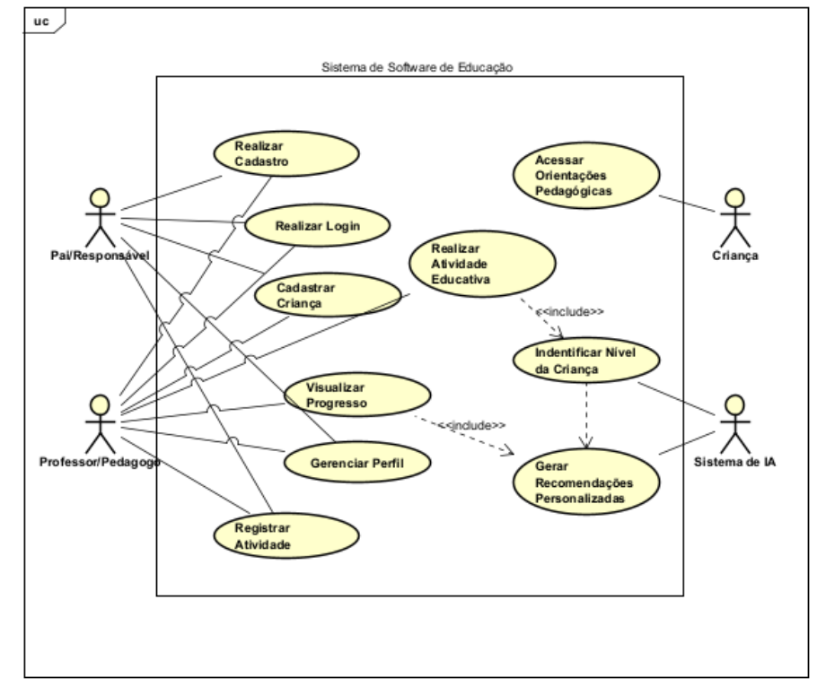

Fonte: Elaborado pelos autores (2026).

##### 6.2.4 Descrição de casos de uso

Nesta seção serão descritos os principais casos de uso identificados para o sistema
proposto. Cada caso de uso apresenta seu respectivo identificador, atores envolvidos,
descrição, pré-condições, pós-condições, fluxo principal e fluxos alternativos. O objetivo é
detalhar o comportamento esperado do sistema diante das principais funcionalidades previstas
para o aplicativo

#### Quadro 8 - Caso de uso: Realizar cadastro

| Campo | Descrição |
| --- | --- |
| Caso de uso | [UC001] Realizar cadastro |
| Ator(es) | Pai/Responsável, Professor/Pedagogo |
| Descrição | Permite que o usuário crie uma conta no sistema para acessar as funcionalidades do aplicativo. |
| Pré-condições | O usuário ainda não possui cadastro no sistema. |
| Pós-condições | O cadastro é criado e o usuário passa a ter acesso à plataforma. |
| Fluxo principal | 1. O usuário acessa a tela de cadastro. 2. O sistema apresenta o formulário de cadastro. 3. O usuário informa os dados solicitados. 4. O sistema valida os dados informados. 5. O sistema registra o novo usuário. 6. O sistema informa que o cadastro foi realizado com sucesso. |

---

## Página física 41 do PDF — página impressa: 35

| Coluna 1 | Coluna 2 |
| --- | --- |
| Fluxos alternativos | a. Caso existam campos obrigatórios não preenchidos, o sistema informa o erro e solicita correção. b. Caso o e-mail informado já esteja cadastrado, o sistema informa que já existe uma conta vinculada ao e-mail. |

Fonte: Elaborado pelos autores (2026).

#### Quadro 9 - Caso de uso: Realizar login

| Campo | Descrição |
| --- | --- |
| Caso de uso | [UC002] Realizar login |
| Ator(es) | Pai/Responsável, Professor/Pedagogo |
| Descrição | Permite que o usuário acesse o sistema por meio de autenticação. |
| Pré-condições | O usuário deve possuir cadastro ativo no sistema. |
| Pós-condições | O usuário é direcionado para a área principal do aplicativo. |
| Fluxo principal | 1. O usuário acessa a tela de login. 2. O usuário informa e-mail e senha. 3. O sistema valida as credenciais informadas. 4. O sistema libera o acesso à plataforma |
| Fluxos alternativos | a. Caso os dados estejam incorretos, o sistema apresenta mensagem de erro. b. Caso o usuário tenha esquecido a senha, o sistema permite iniciar o processo de recuperação. |

Fonte: Elaborado pelos autores (2026).

Quadro 10 - Caso de uso: Cadastrar criança

| Campo | Descrição |
| --- | --- |
| Caso de uso | [UC003] Cadastrar criança |
| Ator(es) | Pai/Responsável |
| Descrição | Permite que o responsável cadastre uma criança para acompanhamento do processo de alfabetização. |
| Pré-condições | O usuário deve estar autenticado no sistema. |
| Pós-condições | A criança é cadastrada e vinculada ao perfil do responsável. |
| Fluxo principal | 1. O usuário acessa a área de cadastro de criança. 2. O sistema apresenta o formulário com os dados necessários. 3. O usuário informa os dados básicos da criança. 4. O sistema valida as informações. 5. O sistema salva o cadastro da criança. 6. O sistema informa que o cadastro foi realizado com sucesso. |
| Fluxos alternativos | a. Caso existam dados obrigatórios não preenchidos, o sistema informa o erro. b. Caso ocorra falha no salvamento, o sistema apresenta mensagem solicitando nova tentativa. |

Fonte: Elaborado pelos autores (2026).

---

## Página física 42 do PDF — página impressa: 36

Quadro 11 - Caso de uso: Registrar atividade realizada

| Campo | Descrição |
| --- | --- |
| Caso de uso | [UC004] Registrar atividade realizada |
| Ator(es) | Pai/Responsável, Professor/Pedagogo |
| Descrição | Permite registrar atividades realizadas pela criança durante o processo de alfabetização. |
| Pré-condições | A criança deve estar cadastrada no sistema. |
| Pós-condições | A atividade é registrada e passa a compor o histórico de aprendizagem da criança. |
| Fluxo principal | 1. O usuário acessa o perfil da criança. 2. O sistema apresenta as opções de registro de atividade. 3. O usuário seleciona ou informa a atividade realizada. 4. O usuário registra o desempenho observado. 5. O sistema salva as informações. 6. O sistema atualiza o histórico de aprendizagem. |
| Fluxos alternativos | a. Caso a atividade não seja preenchida corretamente, o sistema solicita correção. b. Caso não seja possível salvar o registro, o sistema apresenta mensagem de erro. |

Fonte: Elaborado pelos autores (2026).

Quadro 12 - Caso de uso: Realizar atividade educativa

| Campo | Descrição |
| --- | --- |
| Caso de uso | [UC005] Realizar atividade educativa |
| Ator(es) | Criança |
| Descrição | Permite que a criança realize atividades educativas voltadas ao desenvolvimento da alfabetização. |
| Pré-condições | A criança deve estar cadastrada e possuir atividades disponíveis. |
| Pós-condições | O desempenho da criança na atividade é registrado pelo sistema. |
| Fluxo principal | 1. A criança acessa a atividade disponível. 2. O sistema apresenta a atividade educativa. 3. A criança interage com a atividade. 4. O sistema registra o desempenho obtido. 5. O sistema finaliza a atividade e atualiza o progresso da criança. |
| Fluxos alternativos | a. Caso a atividade seja interrompida, o sistema poderá salvar o progresso parcial. b. Caso ocorra erro no carregamento, o sistema apresenta mensagem e permite nova tentativa. |

Fonte: Elaborado pelos autores (2026).

Quadro 13 - Caso de uso: Identificar nicel da criança

| Campo | Descrição |
| --- | --- |
| Caso de uso | [UC006] Identificar nível da criança |
| Ator(es) | Sistema de Inteligência Artificial |

---

## Página física 43 do PDF — página impressa: 37

| Coluna 1 | Coluna 2 |
| --- | --- |
| Descrição | Permite que o sistema analise os dados registrados e identifique o nível de desenvolvimento da criança no processo de alfabetização. |
| Pré-condições | A criança deve possuir registros de atividades ou informações suficientes para análise. |
| Pós-condições | O sistema identifica o nível da criança e disponibiliza essa informação para acompanhamento. |
| Fluxo principal | 1. O sistema coleta os dados de desempenho da criança. 2. A inteligência artificial analisa os registros disponíveis. 3. O sistema identifica padrões de desempenho. 4. O sistema define o nível atual da criança. 5. O resultado é armazenado no perfil da criança. |
| Fluxos alternativos | a. Caso não existam dados suficientes, o sistema informa a necessidade de novas atividades. b. Caso ocorra falha na análise, o sistema mantém o último nível registrado e solicita nova avaliação posteriormente. |

Fonte: Elaborado pelos autores (2026).

Quadro 14 – Caso de uso: Gerar recomendações personalizadas

| Campo | Descrição |
| --- | --- |
| Caso de uso | [UC007] Gerar recomendações personalizadas |
| Ator(es) | Sistema de Inteligência Artificial |
| Descrição | Permite que o sistema gere orientações e atividades personalizadas com base no nível identificado da criança. |
| Pré-condições | O nível da criança deve ter sido identificado pelo sistema. |
| Pós-condições | O sistema disponibiliza recomendações individualizadas para o usuário. |
| Fluxo principal | 1. O sistema acessa o nível de desenvolvimento da criança. 2. A inteligência artificial analisa as necessidades identificadas. 3. O sistema seleciona recomendações adequadas. 4. O sistema apresenta atividades e orientações personalizadas. 5. As recomendações ficam disponíveis para pais, responsáveis ou educadores. |
| Fluxos alternativos | a. Caso não haja informações suficientes, o sistema recomenda a realização de novas atividades diagnósticas. b. Caso ocorra erro na geração das recomendações, o sistema apresenta mensagem e permite nova tentativa. |

Fonte: Elaborado pelos autores (2026).

Quadro 15 - Caso de uso: Visualizar progresso da criança

| Campo | Descrição |
| --- | --- |
| Caso de uso | [UC008] Visualizar progresso da criança |
| Ator(es) | Pai/Responsável, Professor/Pedagogo |
| Descrição | Permite acompanhar o desenvolvimento da criança por meio de informações e relatórios de progresso. |

---

## Página física 44 do PDF — página impressa: 38

| Coluna 1 | Coluna 2 |
| --- | --- |
| Pré-condições | A criança deve possuir registros de atividades ou avaliações no sistema. |
| Pós-condições | O usuário visualiza o progresso da criança de forma organizada. |
| Fluxo principal | 1. O usuário acessa o perfil da criança. 2. O sistema carrega os dados de desempenho. 3. O sistema apresenta informações sobre o progresso da alfabetização. 4. O usuário visualiza relatórios, histórico e evolução da criança. |
| Fluxos alternativos | a. Caso não existam registros suficientes, o sistema informa que ainda não há dados para exibição. b. Caso ocorra erro no carregamento, o sistema apresenta mensagem e permite tentar novamente. |

Fonte: Elaborado pelos autores (2026).

Quadro 16 - Caso de uso: Acessar orientações pedagógicas

| Campo | Descrição |
| --- | --- |
| Caso de uso | [UC009] Acessar orientações pedagógicas |
| Ator(es) | Pai/Responsável, Professor/Pedagogo |
| Descrição | Permite que o usuário acesse orientações voltadas ao apoio da alfabetização infantil. |
| Pré-condições | O usuário deve estar autenticado no sistema. |
| Pós-condições | O usuário visualiza orientações relacionadas ao desenvolvimento da criança. |
| Fluxo principal | 1. O usuário acessa a área de orientações. 2. O sistema apresenta conteúdos e recomendações disponíveis. 3. O usuário seleciona a orientação desejada. 4. O sistema exibe o conteúdo correspondente. |
| Fluxos alternativos | a. Caso não existam orientações disponíveis para o nível da criança, o sistema apresenta orientações gerais. b. Caso ocorra erro no carregamento, o sistema solicita nova tentativa. |

Fonte: Elaborado pelos autores (2026).

Quadro 17 - Caso de uso: Gerenciar perfil do usuário

| Campo | Descrição |
| --- | --- |
| Caso de uso | [UC010] Gerenciar perfil do usuário |
| Ator(es) | Pai/Responsável, Professor/Pedagogo |
| Descrição | Permite que o usuário visualize e altere seus dados cadastrais. |
| Pré-condições | O usuário deve estar autenticado no sistema. |
| Pós-condições | Os dados do usuário são atualizados no sistema. |

---

## Página física 45 do PDF — página impressa: 39

| Coluna 1 | Coluna 2 |
| --- | --- |
| Fluxo principal | 1. O usuário acessa a área de perfil. 2. O sistema apresenta os dados cadastrados. 3. O usuário altera as informações desejadas. 4. O sistema valida os dados informados. 5. O sistema salva as alterações. 6. O sistema informa que os dados foram atualizados com sucesso. |
| Fluxos alternativos | a. Caso algum dado esteja inválido, o sistema informa o erro e solicita correção. b. Caso o usuário cancele a operação, nenhuma alteração é realizada. |

Fonte: Elaborado pelos autores (2026).

Quadro 18 - Caso de uso: Vincular professor ou responsável à criança

| Campo | Descrição |
| --- | --- |
| Caso de uso | [UC011] Vincular professor ou responsável à criança |
| Ator(es) | Pai/Responsável, Professor/Pedagogo |
| Descrição | Permite associar um responsável ou educador ao perfil da criança para acompanhamento do desenvolvimento educacional. |
| Pré-condições | A criança deve estar cadastrada no sistema. |
| Pós-condições | O usuário passa a ter acesso às informações de acompanhamento da criança. |
| Fluxo principal | 1. O usuário acessa o perfil da criança. 2. O sistema apresenta a opção de vínculo. 3. O usuário informa os dados necessários para associação. 4. O sistema valida as informações. 5. O sistema cria o vínculo entre usuário e criança. 6. O sistema informa que o vínculo foi realizado com sucesso. |
| Fluxos alternativos | a. Caso os dados informados não sejam válidos, o sistema solicita correção. b. Caso o vínculo já exista, o sistema informa que o usuário já está associado à criança. |

Fonte: Elaborado pelos autores (2026).

Quadro 19 - Caso de uso: Visualizar relatório de desempenho

| Campo | Descrição |
| --- | --- |
| Caso de uso | [UC012] Visualizar relatório de desempenho |
| Ator(es) | Pai/Responsável, Professor/Pedagogo |
| Descrição | Permite visualizar relatórios detalhados sobre o desempenho da criança no processo de alfabetização. |
| Pré-condições | A criança deve possuir registros suficientes para geração do relatório. |
| Pós-condições | O relatório é exibido ao usuário. |

---

## Página física 46 do PDF — página impressa: 40

| Coluna 1 | Coluna 2 |
| --- | --- |
| Fluxo principal | 1. O usuário acessa a área de relatórios. 2. O sistema busca os dados da criança. 3. O sistema organiza as informações de desempenho. 4. O sistema apresenta o relatório ao usuário. |
| Fluxos alternativos | a. Caso não existam dados suficientes, o sistema informa que o relatório ainda não pode ser gerado. b. Caso ocorra erro na busca dos dados, o sistema apresenta mensagem e permite nova tentativa. |

Fonte: Elaborado pelos autores (2026).

Quadro 20 - Caso de uso: Recuperar senha

| Campo | Descrição |
| --- | --- |
| Caso de uso | [UC013] Recuperar senha |
| Ator(es) | Pai/Responsável, Professor/Pedagogo |
| Descrição | Permite que o usuário recupere o acesso à conta caso esqueça sua senha. |
| Pré-condições | O usuário deve possuir e-mail cadastrado no sistema. |
| Pós-condições | O usuário redefine sua senha e pode acessar novamente o sistema. |
| Fluxo principal | 1. O usuário acessa a tela de login. 2. O usuário seleciona a opção de recuperação de senha. 3. O sistema solicita o e-mail cadastrado. 4. O usuário informa o e-mail. 5. O sistema envia instruções de recuperação. 6. O usuário redefine a senha. 7. O sistema confirma a alteração. |
| Fluxos alternativos | a. Caso o e-mail não esteja cadastrado, o sistema informa que não foi possível localizar a conta. b. Caso a nova senha não atenda aos critérios definidos, o sistema solicita alteração. |

Fonte: Elaborado pelos autores (2026).

#### Quadro 21 - Sair do sistema

| Campo | Descrição |
| --- | --- |
| Caso de uso | [UC014] Sair do sistema |
| Ator(es) | Pai/Responsável, Professor/Pedagogo |
| Descrição | Permite que o usuário encerre sua sessão no aplicativo. |
| Pré-condições | O usuário deve estar autenticado no sistema. |
| Pós-condições | A sessão do usuário é encerrada. |
| Fluxo principal | 1. O usuário seleciona a opção de sair. 2. O sistema solicita confirmação. 3. O usuário confirma a saída. 4. O sistema encerra a sessão. 5. O usuário é direcionado para a tela de login. |

---

## Página física 47 do PDF — página impressa: 41

| Coluna 1 | Coluna 2 |
| --- | --- |
| Fluxos alternativos | a. Caso o usuário cancele a operação, a sessão permanece ativa. |

Fonte: Elaborado pelos autores (2026).

---

## Página física 48 do PDF — página impressa: 42

### 7 MODELAGEM DO BANCO DE DADOS

A modelagem do banco de dados representa uma etapa fundamental no
desenvolvimento do sistema, sendo responsável pela definição da estrutura utilizada para
armazenamento, organização e gerenciamento das informações da aplicação. Essa etapa tem
como objetivo garantir que os dados relacionados ao funcionamento do sistema sejam
estruturados de forma lógica, organizada e consistente, contribuindo para o desempenho,
integridade e confiabilidade da solução proposta.

No contexto deste projeto, a modelagem foi desenvolvida considerando as
necessidades identificadas durante a análise de requisitos, especialmente no que se refere ao
acompanhamento personalizado da alfabetização infantil e à utilização de inteligência
artificial para apoio ao processo educacional. Dessa forma, a estrutura do banco de dados foi
planejada para permitir o gerenciamento das informações relacionadas aos usuários, crianças,
atividades educativas, progresso de aprendizagem, relatórios de desempenho e recomendações
individualizadas.

Além disso, a modelagem busca garantir a integração entre os diferentes componentes
do sistema, permitindo que as funcionalidades da aplicação compartilhem informações de
maneira estruturada e eficiente. Essa organização também contribui para futuras manutenções,
atualizações e expansão da plataforma.

Para representar a estrutura proposta, serão apresentados o diagrama de classes, o
diagrama entidade relacionamento e o modelo entidade relacionamento, possibilitando uma
visão detalhada das entidades do sistema, seus atributos e os relacionamentos existentes entre
elas.

#### 7.1 MODELAGEM DO BANCO DE DADOS
O diagrama de classes tem como objetivo representar a estrutura lógica do sistema,
demonstrando as principais entidades do projeto, seus atributos e os relacionamentos
existentes entre elas. Essa modelagem permite uma visão mais detalhada da organização do
aplicativo, contribuindo para o entendimento das funcionalidades e da forma como os dados
serão estruturados durante o desenvolvimento da solução.

No contexto deste projeto, o diagrama de classes foi desenvolvido considerando as
necessidades identificadas durante a análise de requisitos e a proposta de acompanhamento
personalizado da alfabetização infantil por meio de inteligência artificial. Dessa forma, a
estrutura do sistema foi organizada de modo a possibilitar o gerenciamento das informações
relacionadas aos usuários, crianças, atividades educacionais, progresso de aprendizagem e
recomendações individualizadas.

A classe central do sistema é representada pela entidade Student, responsável por
armazenar as principais informações da criança em fase de alfabetização, incluindo dados
básicos, nível de alfabetização, progresso e status de avaliação. A partir dessa entidade, são
estabelecidos relacionamentos com os demais componentes do sistema.

O diagrama também apresenta a entidade User, responsável pelo gerenciamento dos
usuários da plataforma, como pais, responsáveis, professores e pedagogos. Além disso, são
apresentadas as entidades relacionadas à organização escolar, como School e Turma,
permitindo a vinculação da criança ao ambiente educacional correspondente.

Em relação ao acompanhamento do desenvolvimento infantil, destacam-se as
entidades ProgressEntry e BimestreReport, responsáveis pelo registro do desempenho da
criança e pela geração de relatórios de evolução ao longo do processo de alfabetização. Essas
estruturas permitem que o sistema acompanhe o progresso individual da criança de forma
contínua e organizada.

O sistema também contempla entidades voltadas à personalização da aprendizagem,
como Recommendation e IndividualGuidance, responsáveis pela geração de recomendações e
orientações individualizadas com base no desempenho identificado pela inteligência artificial.

---

## Página física 49 do PDF — página impressa: 43

Além disso, o diagrama apresenta a entidade StudentTrail, relacionada às trilhas de
aprendizagem personalizadas, bem como a entidade TrailTask, responsável pelas atividades
que compõem cada trilha educacional. Essa estrutura possibilita a criação de percursos de
aprendizagem adaptados às necessidades específicas de cada criança.

Outro ponto importante refere-se à entidade SpecialNeeds, responsável pelo
armazenamento de informações relacionadas a necessidades específicas da criança,
permitindo maior personalização e acessibilidade no processo de aprendizagem.

Por fim, o diagrama evidencia a integração entre os diferentes componentes do
sistema, demonstrando como as informações serão organizadas e compartilhadas entre as
funcionalidades da plataforma, contribuindo para a construção de uma solução estruturada,
personalizada e alinhada às necessidades identificadas ao longo do projeto.

Figura 22 - Diagrama de Classes

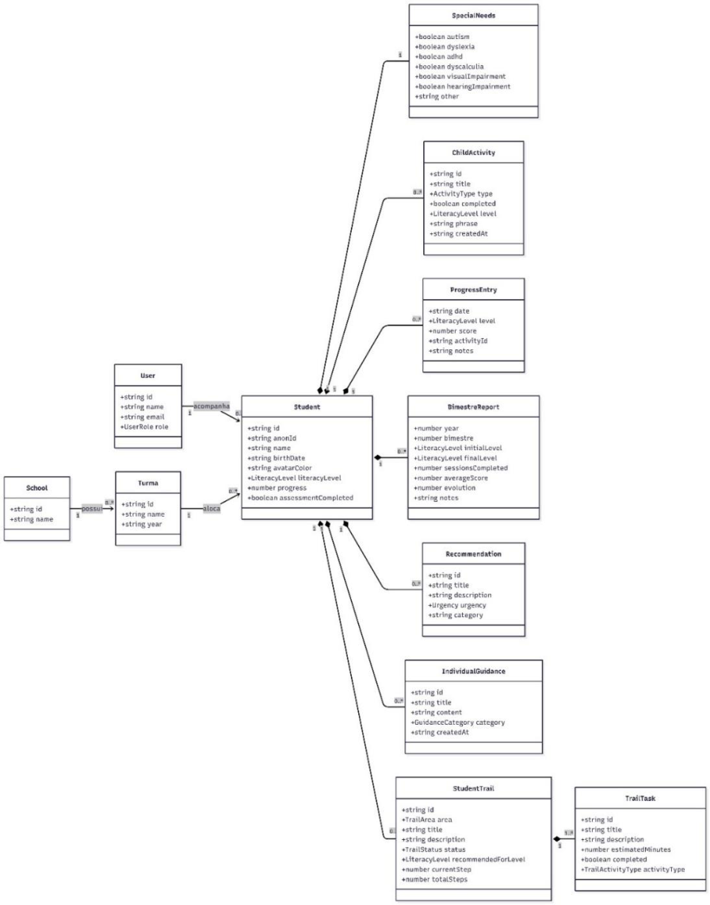

Fonte: Elaborado pelos autores (2026).

#### 7.2 DIAGRAMA ENTIDADE RELACIONAMENTO
O Diagrama Entidade Relacionamento (DER) tem como objetivo representar a
estrutura lógica do banco de dados do sistema, demonstrando as entidades existentes, seus

---

## Página física 50 do PDF — página impressa: 44

atributos e os relacionamentos estabelecidos entre elas. Essa representação permite visualizar
de forma organizada como os dados serão armazenados e conectados dentro da aplicação.

No contexto deste projeto, o DER foi desenvolvido considerando as funcionalidades
relacionadas ao acompanhamento da alfabetização infantil, ao gerenciamento das informações
educacionais e à personalização do aprendizado por meio da inteligência artificial. Dessa
forma, o modelo busca garantir organização, integridade e eficiência no armazenamento dos
dados utilizados pelo sistema.

A entidade central do diagrama é representada pela tabela Students, responsável pelo
armazenamento das principais informações relacionadas às crianças cadastradas na
plataforma, incluindo dados pessoais, nível de alfabetização, progresso, observações e status
de avaliação. A partir dessa entidade principal, são estabelecidos os relacionamentos com os
demais componentes do banco de dados.

O diagrama também apresenta a entidade Users, responsável pelo gerenciamento dos
usuários da plataforma, como pais, responsáveis, professores e pedagogos. Essa entidade se
relaciona diretamente com a tabela de estudantes, permitindo o acompanhamento
individualizado das crianças cadastradas.

Além disso, são apresentadas as entidades Schools e Turmas, utilizadas para
representar a estrutura escolar vinculada ao processo educacional. Essas entidades permitem
associar os estudantes às respectivas instituições e turmas, contribuindo para uma organização
mais estruturada das informações acadêmicas.

Em relação ao acompanhamento do desenvolvimento da alfabetização, destacam-se as
entidades Activities e ProgressEntries, responsáveis pelo registro das atividades realizadas
pela criança e pelo armazenamento das informações de progresso e desempenho obtidas
durante o uso da plataforma.

O diagrama também contempla entidades voltadas à geração de relatórios e
recomendações personalizadas, como BimestreReports, Recommendations e
IndividualGuidances, permitindo que o sistema registre análises de desempenho, orientações
pedagógicas e recomendações individualizadas com base nos dados coletados.

Outro componente importante é representado pela entidade StudentTrails, responsável
pelas trilhas de aprendizagem personalizadas da criança. Essa entidade se relaciona
diretamente com a tabela TrailTasks, que armazena as atividades pertencentes a cada trilha
educacional, possibilitando o acompanhamento contínuo do desenvolvimento do estudante.

Além disso, o modelo contempla a entidade SpecialNeeds, utilizada para armazenar
informações relacionadas a necessidades específicas da criança, permitindo maior
acessibilidade e personalização no processo de aprendizagem.

Por fim, o DER evidencia os relacionamentos entre as entidades do sistema, utilizando
chaves primárias e estrangeiras para garantir a integridade referencial das informações. Essa
estrutura contribui para a organização do banco de dados e para o funcionamento adequado
das funcionalidades previstas na solução proposta.

---

## Página física 51 do PDF — página impressa: 45

Figura 23 - Diagrama Entidade Relacionamento

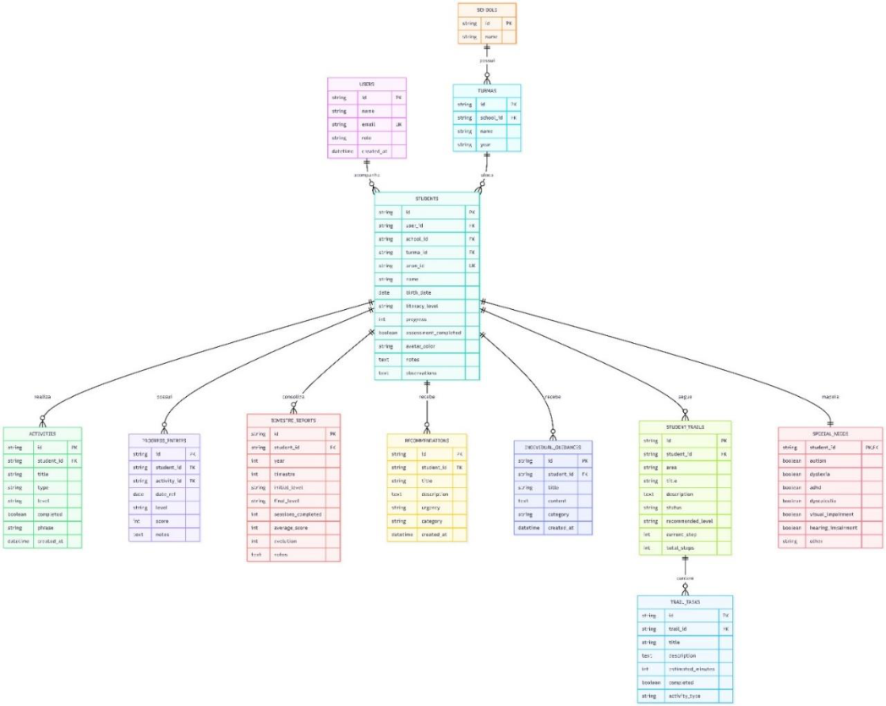

Fonte: Elaborado pelos autores (2026).

#### 7.3 DIAGRAMA DE SEQUÊNCIA
O diagrama de sequência tem como objetivo representar a ordem das interações
realizadas entre o usuário, a interface do aplicativo e os componentes internos do sistema
durante a execução de uma funcionalidade. Esse tipo de diagrama permite visualizar o fluxo
de comunicação entre os elementos envolvidos, demonstrando como as informações são
processadas e atualizadas ao longo do uso da aplicação.

No contexto deste projeto, o diagrama apresentado demonstra o fluxo relacionado à
avaliação inicial da criança e à liberação das trilhas de aprendizagem. Inicialmente, o usuário
preenche a avaliação inicial no aplicativo, por meio da tela AssessmentScreen. Após esse
preenchimento, o sistema atualiza as informações da criança, considerando dados como
avaliação, pontuação e nível identificado.

Em seguida, o componente ChildStore aciona as regras de trilhas por meio do
TrailsRules, responsável por construir as trilhas de aprendizagem iniciais com base no nível
da criança. Após a geração dessas trilhas, os dados da criança são atualizados e enviados ao
ChildService, que realiza a comunicação com a API ou estrutura simulada do sistema para
persistência das informações.

Após a confirmação da atualização, o aplicativo exibe ao usuário as trilhas liberadas.
Dessa forma, a criança passa a ter acesso a atividades organizadas conforme seu nível de
desenvolvimento. O diagrama também apresenta o fluxo de conclusão de uma tarefa da trilha,
no qual o usuário finaliza uma atividade e o sistema registra essa conclusão.

A partir desse registro, o sistema normaliza as trilhas de aprendizagem, verifica a
possibilidade de desbloqueio da próxima etapa e atualiza novamente o progresso da criança.

---

## Página física 52 do PDF — página impressa: 46

Por fim, o aplicativo apresenta um feedback de evolução ao usuário, demonstrando que o
progresso foi atualizado com sucesso.

Dessa forma, o diagrama de sequência evidencia o funcionamento dinâmico do
sistema, mostrando como a avaliação inicial, a geração de trilhas personalizadas e o
acompanhamento do progresso da criança ocorrem de maneira integrada entre a interface, as
regras de negócio, o serviço da aplicação e a camada de persistência de dados.

Figura 24 - Diagrama de Sequência

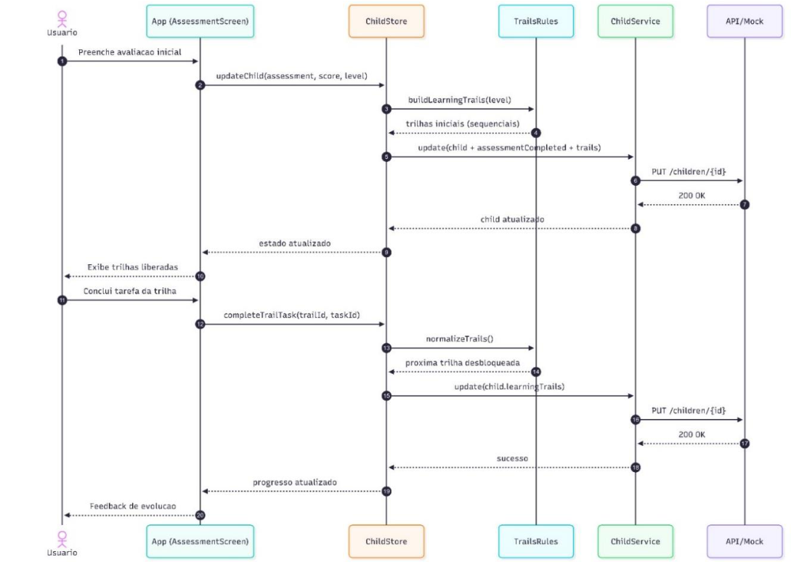

Fonte: Elaborado pelos autores (2026).

A partir da modelagem apresentada, é possível compreender a estrutura planejada para
o armazenamento e organização dos dados do sistema. Os diagramas demonstram como as
principais informações da aplicação se relacionam, incluindo usuários, crianças cadastradas,
escolas, turmas, atividades, progresso, relatórios, recomendações, trilhas de aprendizagem e
necessidades específicas.

A estrutura proposta permite que o sistema registre o desenvolvimento da criança de
forma organizada, possibilitando o acompanhamento contínuo da alfabetização infantil. Além
disso, a relação entre as entidades favorece a personalização do aprendizado, uma vez que os
dados armazenados podem ser utilizados para gerar recomendações, orientações
individualizadas e trilhas educacionais adaptadas ao nível de cada criança.

Dessa forma, a modelagem do banco de dados contribui diretamente para o
funcionamento da solução proposta, garantindo maior organização, integridade das
informações e suporte às funcionalidades previstas no aplicativo. Com essa base estruturada,
torna-se possível avançar para as próximas etapas do projeto, como a prototipagem das telas e
a proposta de desenvolvimento do sistema.

---

## Página física 53 do PDF — página impressa: 47

### 8 PROTOTIPAGEM DAS TELAS

Segundo a Dextra (2013), a prototipação de software consiste no desenvolvimento de
modelos que representem a ideia, as funcionalidades e as regras de negócio do projeto. Esses
modelos podem ser desenvolvidos de diferentes formas, desde wireframes voltados à estrutura
lógica da aplicação até protótipos interativos focados na validação visual, navegabilidade,
usabilidade e experiência do usuário.

Nesse contexto, o principal objetivo da prototipação consiste em validar requisitos e
garantir melhor compreensão sobre as funcionalidades propostas para o sistema,
possibilitando identificar melhorias antes da implementação efetiva do software (DEXTRA,
2013). Além disso, os protótipos permitem demonstrar visualmente o funcionamento da
solução junto aos usuários e demais envolvidos no projeto.

Com base nisso, foi desenvolvido um protótipo inicial para o aplicativo proposto,
utilizando a abordagem de prototipação visual e interativa, com o objetivo de representar as
principais funcionalidades do sistema de acompanhamento da alfabetização infantil. O
protótipo foi elaborado visando validar a proposta de valor da solução, bem como facilitar o
entendimento sobre a experiência do usuário e os recursos disponibilizados para pais,
responsáveis, educadores e instituições de ensino.

A Figura 25 apresenta o protótipo desenvolvido para o painel do professor no sistema
proposto, contemplando funcionalidades relacionadas ao gerenciamento do perfil do usuário,
criação de orientações pedagógicas individualizadas, acompanhamento do desempenho dos
alunos e geração de relatórios educacionais. Além disso, a interface permite a visualização do
progresso da alfabetização por período letivo, identificação de alunos que demandam maior
atenção e acompanhamento individualizado do desenvolvimento educacional, auxiliando
professores no processo de tomada de deci são pedagógica.

Figura 25 - Protótipo do painel do professor e acompanhamento pedagógico do sistemav

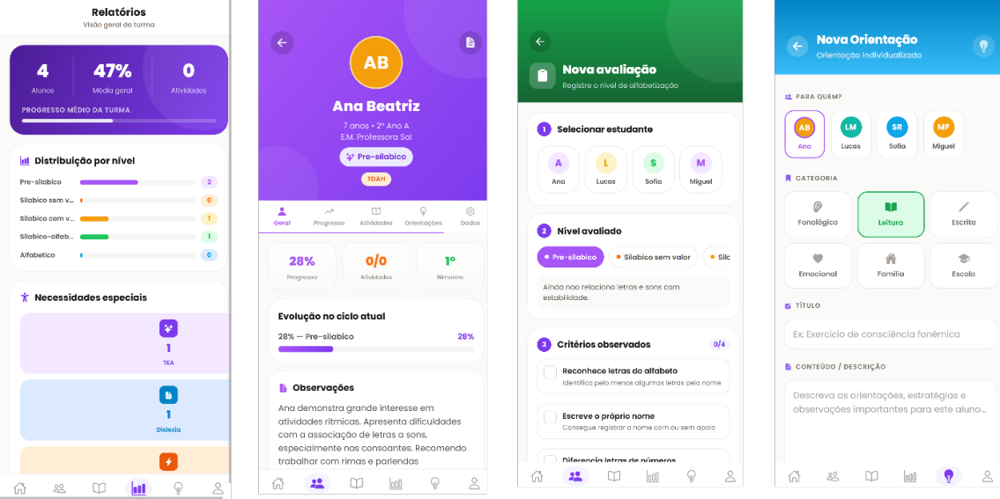

Fonte: Elaborado pelos autores (2026).

A Figura 26 apresenta o protótipo desenvolvido para o módulo de acompanhamento
pedagógico do sistema, reunindo funcionalidades voltadas à gestão do perfil do professor,
criação de orientações individualizadas e monitoramento do progresso dos alunos. Além
disso, a interface possibilita a visualização de indicadores de desempenho, evolução da
alfabetização por período letivo e relatórios que auxiliam na identificação de alunos que

---

## Página física 54 do PDF — página impressa: 48

necessitam de maior atenção pedagógica, contribuindo para um acompanhamento mais
direcionado e personalizado.

Figura 26 -Protótipo do módulo de acompanhamento pedagógico do sistema

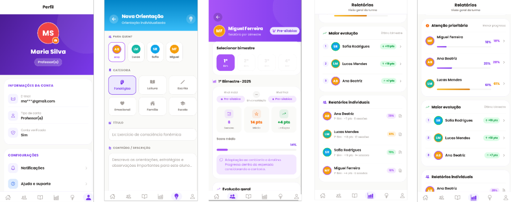

Fonte: Elaborado pelos autores (2026).

A Figura 27 apresenta o protótipo desenvolvido para o módulo de gerenciamento
pedagógico do sistema, contemplando funcionalidades relacionadas à criação de atividades
personalizadas, acompanhamento do desempenho das turmas e visualização de indicadores
gerais do processo de alfabetização. Além disso, a interface permite ao professor monitorar o
progresso dos alunos, identificar necessidades de atenção pedagógica e acessar ações rápidas
para apoio no acompanhamento educacional.

Figura 27 - Protótipo do módulo de gerenciamento pedagógico e acompanhamento de turmas

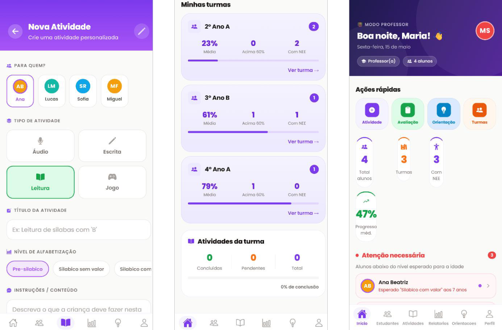

Fonte: Elaborado pelos autores (2026).

A Figura 28 apresenta o protótipo desenvolvido para o módulo de acompanhamento
pedagógico do sistema, contemplando funcionalidades relacionadas ao perfil do usuário,
orientações educacionais personalizadas e visualização de relatórios de desempenho. Além

---

## Página física 55 do PDF — página impressa: 49

disso, a interface permite ao professor acompanhar a evolução individual dos alunos,
identificar necessidades especiais, monitorar níveis de atenção pedagógica e acessar recursos
de apoio voltados ao processo de alfabetização e desenvolvimento educacional.

Figura 28 - Protótipo do módulo de acompanhamento pedagógico e relatórios de desempenho

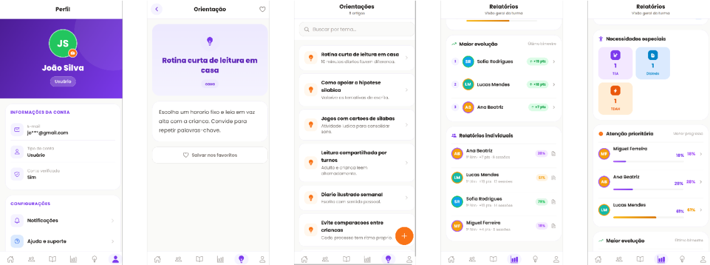

Fonte: Elaborado pelos autores (2026).

A Figura 29 apresenta o protótipo desenvolvido para o módulo de gerenciamento de
estudantes e acompanhamento pedagógico do sistema, contemplando funcionalidades
relacionadas ao cadastro de novos alunos, definição de necessidades educacionais especiais e
monitoramento individual do desempenho acadêmico. Além disso, a interface permite ao
professor visualizar relatórios personalizados, acessar recomendações pedagógicas,
acompanhar métricas de evolução dos estudantes e utilizar ações rápidas para suporte ao
processo de alfabetização e inclusão educacional.

Figura 29 - Protótipo do módulo de gerenciamento de estudantes e acompanhamento pedagógico

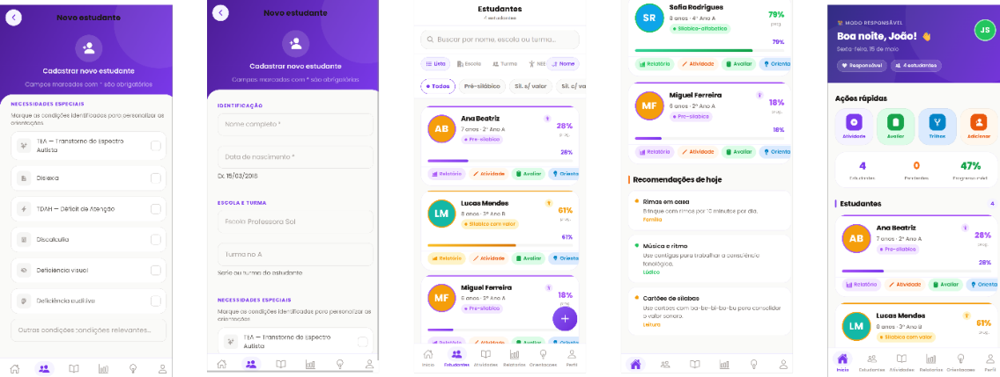

Fonte: Elaborado pelos autores (2026).

---

## Página física 56 do PDF — página impressa: 50

### 9 PROPOSTA DE DESENVOLVIMENTO

Após a elaboração do plano de negócios, a elicitação e especificação de requisitos e a
modelagem do sistema, foram levantadas as tecnologias para apoiar a implementação do
software, assim como as metodologias para orientar esse processo. Nesse sentido, foram
consideradas boas práticas em padrões, testes e garantia de qualidade de software para
compor o plano de desenvolvimento descrito nesta seção.

#### 9.1 TECNOLOGIAS QUE SERÃO UTILIZADAS
As tecnologias a serem utilizadas durante o desenvolvimento do software foram
selecionadas com base em fatores como: viabilidade técnica, manutenibilidade, portabilidade,
acesso à documentação e grau de familiaridade da equipe. Tais fatores influenciam
diretamente o desenvolvimento do software, uma vez que, escolhidas essas ferramentas, é
provável que permaneçam atreladas à solução desde o início de seu desenvolvimento até a sua
descontinuação.

Com base nos fatores apresentados, foi realizada uma análise sobre ferramentas,
linguagens de programação e frameworks voltados ao desenvolvimento mobile, a fim de
avaliar a viabilidade de cada um no contexto do projeto. Dessa forma, as tecnologias mais
adequadas para o desenvolvimento do software Elevva foram selecionadas e são apresentadas
na tabela 1, juntamente a seus fornecedores, descrições e versões de referência.

Quadro 22 - Tecnologias utilizadas para o desenvolvimento do software

| Nome | Fornecedor | Descrição | Versão (ref.) | Utilização | Custo |
| --- | --- | --- | --- | --- | --- |
| React Native | Meta | Framework para desenvolvimento mobile multiplataforma | 0.79.x | Camada de interface mobile | Gratuito |
| Expo | Expo | Framework e toolchain para desenvolvimento, build e execução do app React Native | SDK 53 | Execução local, bibliotecas nativas e fluxo de desenvolvimento | Gratuito |
| TypeScript | Microsoft | Linguagem de tipagem estática para JavaScript | 5.8.x | Padronização e segurança de tipos no frontend | Gratuito |
| FastAPI | Comunidade Python | Framework backend para APIs REST de alta produtividade | Estável atual | API principal do sistema | Gratuito |
| Python | Python Software Foundation | Linguagem de programação do backend | 3.11+ | Serviços de negócio e integração com IA | Gratuito |
| Uvicorn | Encode | Servidor ASGI para FastAPI | Estável atual | Execução da API em ambiente de | Gratuito |

---

## Página física 57 do PDF — página impressa: 51

| Nome | Fornecedor | Descrição | Versão (ref.) | Utilização | Custo |
| --- | --- | --- | --- | --- | --- |
|  |  |  |  | desenvolvimento e produção |  |
| SQLAlchemy / SQLModel | Comunidade Python | Mapeamento objeto-relacional (ORM) | Estável atual | Persistência de dados relacionais | Gratuito |
| Alembic | SQLAlchemy | Ferramenta de versionamento de esquema de banco de dados (migrations) | Estável atual | Controle evolutivo do esquema do banco | Gratuito |
| Neon (PostgreSQL) | Neon | Banco de dados relacional serverless baseado em PostgreSQL | Plano Free | Persistência principal dos dados do sistema | Gratuito |
| Clerk | Clerk | Serviço de autenticação e gestão de sessão de usuários | Plano Free | Autenticação e identidade de usuários | Gratuito |
| Axios | Axios | Cliente HTTP para consumo de APIs REST | 1.x | Consumo da API no aplicativo | Gratuito |
| Zustand | Comunidade | Biblioteca de gerenciamento de estado global | 5.x | Estado do aplicativo (autenticação, estudante, sessão) | Gratuito |
| Jest + React Native Testing Library | Meta / Callstack | Ferramentas de testes unitários e de componentes | Estável atual | Testes automatizados do frontend | Gratuito |
| Pytest | Comunidade Python | Framework de testes automatizados para Python | Estável atual | Testes da API e das regras de negócio | Gratuito |
| ESLint + Prettier | OpenJS Foundation | Ferramentas de análise estática e formatação de código | Estável atual | Qualidade e padronização do código-fonte | Gratuito |

Fonte: Elaborado pelos autores (2026).
##### 9.1.1 Decisão sobre a estratégia de banco de dados

Para o núcleo de dados do Elevva, será adotado banco de dados relacional (PostgreSQL,
provisionado via Neon) como solução principal de persistência. Essa escolha se justifica pelo

---

## Página física 58 do PDF — página impressa: 52

forte grau de relacionamento entre as entidades do domínio pedagógico como usuários,
estudantes, atividades, trilhas, avaliações e registros de progresso, que demandam integridade
referencial e suporte a consultas agregadas para a geração de relatórios.

Adicionalmente, o projeto prevê uma estratégia complementar para cenários de maior
escala, com possível adoção de banco de dados não relacional para dados de alta volumetria e
baixa criticidade transacional, tais como eventos de telemetria, logs de interação e cache de
respostas de serviços de inteligência artificial. Essa abordagem mantém a consistência
transacional nas operações críticas do sistema e reduz a complexidade inicial da solução.

#### 9.2 METODOLOGIA DE PADRÕES DE SOFTWARE
Segundo Sommerville (2011), a utilização de padrões de desenvolvimento de software
oferece subsídios para que a equipe possa criar e documentar um processo de
desenvolvimento estruturado e adaptável às suas necessidades. Para o autor, a padronização
desses processos objetiva a documentação de conhecimentos adquiridos durante a
implementação, a formalização do que se entende por qualidade de software e a facilitação do
trabalho em equipe por meio do uso comum de boas práticas.

Portanto, com o objetivo de estruturar e facilitar o desenvolvimento do software proposto,
foram escolhidos os padrões arquiteturais e de projeto descritos na Tabela 2.

Quadro 23 -Metodologias e padrões utilizados para o desenvolvimento do software

| Nome | Descrição | Utilização |
| --- | --- | --- |
| REST | Padrão arquitetural para implementação de APIs Web com comunicação via HTTP | API FastAPI |
| SOLID | Conjunto de princípios orientados ao projeto de software modular e de fácil manutenção | Backend e frontend |
| DRY | Princípio que orienta a eliminação de duplicação de lógica no código-fonte | Serviços, hooks e utilitários |
| Clean Architecture (adaptação leve) | Separação do sistema em camadas (apresentação, aplicação, domínio e infraestrutura) | Estrutura do backend |
| DDD tático (adaptado) | Modelagem orientada ao domínio com uso de linguagem ubíqua entre equipe e negócio | Entidades do sistema |
| API-first (pragmático) | Definição do contrato de API previamente à integração entre frontend e backend | Integração app/API |

Fonte: Elaborado pelos autores (2026).

Apresentados os padrões que serão utilizados durante o desenvolvimento do software
Elevva, é necessário destacar alguns pontos:

O padrão REST será utilizado para o desenvolvimento da API do sistema; entretanto,
algumas adaptações serão realizadas, visto que certas diretrizes do padrão não se adequam ao
contexto mobile do projeto, onde payloads enxutos e respostas orientadas ao consumo em
aplicativo são prioritários;

O DDD será aplicado de forma tática e incremental, priorizando o domínio
educacional sem sobrecarga documental, conforme as necessidades do projeto;

A Clean Architecture será adotada como referência estrutural para o backend, sem
imposição de rigidez excessiva, mantendo o equilíbrio entre organização e praticidade de
desenvolvimento.

---

## Página física 59 do PDF — página impressa: 53

#### 9.3 METODOLOGIA PARA TESTES DE SOFTWARE
Nesta seção, será descrita a metodologia adotada para conduzir os testes de software do
sistema que, de acordo com Sommerville (2011), são realizados com o intuito de garantir a
conformidade do software com os requisitos do usuário (validação), assim como detectar
comportamentos indesejáveis ou inconsistentes apresentados por ele (verificação).
De modo geral, o processo de testes para a API será conduzido por meio de testes
unitários e de integração automatizados, implementados com o framework Pytest. Cada
recurso disponibilizado pela API será acompanhado de um ou mais casos de teste, que serão
avaliados automaticamente, visando capturar falhas em seu funcionamento e garantir a
conformidade das regras de negócio.

Os testes relacionados ao aplicativo mobile serão realizados com Jest e React Native
Testing Library para componentes críticos, além de validação manual conduzida por meio de
roteiros de teste que simulam o fluxo de uso pelo ponto de vista do usuário. Os fluxos críticos
previstos para validação são:

1.  cadastro e autenticação;
2.  cadastro de estudante;
3.  realização de avaliação inicial;
4.  liberação e execução de trilhas de atividades;
5.  visualização de progresso e relatório.
Por fim, o sistema e suas representações tangíveis — como código-fonte, requisitos e
diagramas serão inspecionados de forma contínua por meio de revisão de código, análise
estática com ferramentas de lint e verificação de consistência de tipos e contratos de API,
visando controlar falhas não rastreáveis pelos procedimentos de teste automatizados.

#### 9.4 MÉTRICAS DE QUALIDADE
De acordo com Sommerville (2011), o conceito de qualidade no contexto de software
deve ser entendido de forma diferente da interpretação utilizada pela indústria manufatureira,
que se baseia na conformidade dos produtos quanto às características definidas em suas
especificações. Para o autor, a qualidade de um software não pode ser medida de forma
objetiva, em decorrência de fatores como as dificuldades para definir especificações de
requisitos suficientemente detalhadas e gerenciar as expectativas de diferentes partes
interessadas.

Por esse motivo, a abordagem para a garantia de qualidade do software será baseada no
levantamento e na priorização dos fatores de qualidade relevantes para a solução,
simultaneamente à utilização de métricas que permitam mensurar e acompanhar a evolução
do software ao longo de seu desenvolvimento, conforme apresentado na Tabela 3.

Quadro 24 - Priorização de métricas de qualidade

| Fator de Qualidade | Motivação | Possíveis medidas |
| --- | --- | --- |
| Manutenibilidade | O processo de manutenção do software deve ser facilitado, visando acompanhar as mudanças frequentes nas regras pedagógicas e nas telas do sistema | Número de módulos alterados por versão; complexidade ciclomática; cobertura de testes por módulo. Adaptado de Pressman (2011) |
| Usabilidade | O fluxo de uso do sistema deve ser intuitivo, considerando que o público-alvo inclui famílias e educadores com diferentes graus de familiaridade tecnológica | Tempo médio para conclusão de uma tarefa pelo usuário; taxa de erros em fluxos críticos; taxa de abandono por tela. Adaptado de Guimarães (2019) |
| Segurança e Privacidade | O sistema manipula dados de crianças, exigindo proteção reforçada | Percentual de endpoints protegidos por autenticação; número de incidentes de |

---

## Página física 60 do PDF — página impressa: 54

| Fator de Qualidade | Motivação | Possíveis medidas |
| --- | --- | --- |
|  | e conformidade com a Lei Geral de Proteção de Dados (LGPD) | acesso indevido; conformidade com políticas de anonimização |
| Desempenho | O uso em dispositivos móveis exige respostas rápidas e estabilidade, especialmente em conexões com largura de banda variável | Tempo de resposta médio da API; tempo de carregamento de tela; taxa de falhas por sessão |
| Confiabilidade pedagógica | As recomendações e classificações de nível devem ser consistentes com os resultados das avaliações realizadas | Divergência entre avaliação e trilha sugerida; taxa de correção manual de classificação por parte dos educadores |

Fonte: Elaborado pelos autores (2026).

#### 9.5 MODELO DE DADOS E ESTRATÉGIA DE PERSISTÊNCIA
A persistência de dados do sistema seguirá uma abordagem orientada por criticidade, com
separação entre dados transacionais e dados de suporte operacional.

•  Camada relacional
O banco de dados relacional PostgreSQL, provisionado por meio do serviço Neon, será
adotado como solução principal de persistência. As entidades centrais do sistema incluindo
usuários, estudantes, atividades, registros de progresso, relatórios, recomendações, trilhas e
tarefas serão armazenadas nessa camada, em razão da necessidade de integridade referencial,
rastreabilidade histórica e suporte a consultas agregadas para a geração de relatórios
pedagógicos.

•  Camada não relacional (complementar)
De forma complementar, prevê-se a possível adoção de banco de dados não relacional
para o armazenamento de dados de alta volumetria e baixa criticidade transacional, tais como
eventos de telemetria, logs de interação do usuário e cache de respostas de serviços externos
de inteligência artificial. Entre as alternativas avaliadas, destacam-se Firebase (Firestore) e
MongoDB Atlas, ambas disponíveis em planos gratuitos e adequadas para esses casos de uso.
A adoção dessa camada ficará condicionada ao surgimento de requisitos concretos que a
justifiquem ao longo do desenvolvimento.

#### 9.6 PLANO DE IMPLEMENTAÇÃO
A implementação do software será organizada de forma incremental, em ciclos curtos
com entregas parciais e verificáveis. Essa abordagem permite o controle contínuo da
qualidade e a identificação precoce de desvios em relação aos requisitos definidos. As etapas
macro do desenvolvimento são apresentadas na Tabela 4.

Quadro 25 - Etapas macro de desenvolvimento

| Etapa | Objetivo | Entregáveis |
| --- | --- | --- |
| Etapa 1 | Consolidação de arquitetura e contratos de API | Modelo de dados inicial, endpoints-base e estrutura de projeto |
| Etapa 2 | Implementação do núcleo de autenticação e gestão de estudantes | Cadastro, autenticação, CRUD de estudante e estado global integrado |
| Etapa 3 | Implementação do núcleo pedagógico | Avaliação inicial, trilhas de atividades e progressão por tarefas |

---

## Página física 61 do PDF — página impressa: 55

| Etapa | Objetivo | Entregáveis |
| --- | --- | --- |
| Etapa 4 | Validação, qualidade e documentação | Testes automatizados, métricas de qualidade, revisão técnica e documentação final |

Fonte: Elaborado pelos autores (2026).

#### 9.7 RISCOS E MITIGAÇÕES

O desenvolvimento do software está sujeito a riscos técnicos que podem comprometer
os prazos ou a qualidade das entregas. A tabela 5 apresenta os principais riscos identificados,
seus impactos estimados e as estratégias de mitigação previstas.

Quadro 26 - Principais riscos técnicos e estratégias de mitigação

| Risco | Impacto | Mitigação |
| --- | --- | --- |
| Limites dos planos gratuitos dos serviços utilizados | Indisponibilidade temporária de serviços externos ao longo do desenvolvimento | Adoção de arquitetura desacoplada, com suporte a dados simulados (mock) para continuidade do desenvolvimento |
| Complexidade de integração entre o aplicativo mobile e o backend | Atraso nas entregas das funcionalidades integradas | Definição antecipada de contratos de API estáveis e implementação de testes de integração |
| Expansão de escopo além do planejado | Perda de foco e comprometimento dos prazos estabelecidos | Priorização por requisitos críticos e congelamento de escopo por ciclo de desenvolvimento |
| Dependência de serviços externos de inteligência artificial | Instabilidade ou aumento de custos no uso das APIs de IA | Abstração por camada de serviço dedicada e implementação de cache de respostas |

Fonte: Elaborado pelos autores (2026).

#### 9.8 INFRAESTRUTURA E IMPLANTAÇÃO

A infraestrutura de implantação do sistema será definida com base na disponibilidade
de planos gratuitos oferecidos pelas plataformas selecionadas, viabilizando a execução e
demonstração do software sem custos operacionais durante o período de desenvolvimento. As
opções mapeadas para esse fim são:

API FastAPI hospedada nas plataformas Render ou Railway, ambas disponíveis em
planos gratuitos com limitações de uso banco de dados PostgreSQL provisionado pelo serviço
Neon, em plano gratuito; aplicativo mobile executado por meio do Expo Go para validação
em dispositivos reais, com possibilidade de geração de builds de teste locais.

Ressalta-se que a implantação produtiva completa não constitui o escopo principal
deste trabalho, sendo priorizada a validação funcional e técnica do sistema desenvolvido. Essa
delimitação evita a dispersão de esforço em atividades operacionais de infraestrutura e
mantém o foco no desenvolvimento e na verificação dos requisitos definidos.

---

## Página física 62 do PDF — página impressa: 56

> Página sem conteúdo textual extraível além da numeração.

---

## Página física 63 do PDF — página impressa: 57

57

REFERÊNCIAS

GOOGLE FOR EDUCATION. TECNOLOGIAS EDUCACIONAIS E TRANSFORMAÇÃO DIGITAL NA
EDUCAÇÃO. ACESSO EM: 17 MAIO 2026.
KHAN ACADEMY BRASIL. PLATAFORMA EDUCACIONAL DE APOIO À APRENDIZAGEM. ACESSO
EM: 17 MAIO 2026.
MEC – MINISTÉRIO DA EDUCAÇÃO. DIRETRIZES E INFORMAÇÕES SOBRE ALFABETIZAÇÃO E
EDUCAÇÃO BÁSICA. ACESSO EM: 17 MAIO 2026.
OPENAI. INTELIGÊNCIA ARTIFICIAL APLICADA À PERSONALIZAÇÃO DE EXPERIÊNCIAS DIGITAIS.
ACESSO EM: 17 MAIO 2026.
SEBRAE. MODELO DE NEGÓCIOS E EMPREENDEDORISMO PARA SOLUÇÕES DIGITAIS
EDUCACIONAIS. ACESSO EM: 17 MAIO 2026.
BACICH, L.; MORAN, J. METODOLOGIAS ATIVAS PARA UMA EDUCAÇÃO INOVADORA. PORTO
ALEGRE: PENSO, 2018.
BEHAR, P. A. MODELOS PEDAGÓGICOS EM EDUCAÇÃO A DISTÂNCIA. PORTO ALEGRE:
ARTMED, 2009.
BERTAGNOLLI, S. C.; SILVA, M. A. TECNOLOGIAS DIGITAIS APLICADAS À EDUCAÇÃO
INFANTIL. SÃO PAULO: PEARSON, 2020.
BRASIL. MINISTÉRIO DA EDUCAÇÃO. BASE NACIONAL COMUM CURRICULAR (BNCC).
BRASÍLIA: MEC, 2018. DISPONÍVEL EM: HTTPS://BASENACIONALCOMUM.MEC.GOV.BR/. ACESSO
EM: 17 MAIO 2026.
CAMARGO, F.; DAROS, T. A SALA DE AULA INOVADORA: ESTRATÉGIAS PEDAGÓGICAS PARA
FOMENTAR O APRENDIZADO ATIVO. PORTO ALEGRE: PENSO, 2018.
FREIRE, P. PEDAGOGIA DA AUTONOMIA: SABERES NECESSÁRIOS À PRÁTICA EDUCATIVA. 25.
ED. SÃO PAULO: PAZ E TERRA, 1996.
KENSKI, V. M. EDUCAÇÃO E TECNOLOGIAS: O NOVO RITMO DA INFORMAÇÃO. CAMPINAS:
PAPIRUS, 2012.
LAUDON, K. C.; LAUDON, J. P. SISTEMAS DE INFORMAÇÃO GERENCIAIS. 11. ED. SÃO PAULO:
PEARSON, 2014.
MORAN, J. METODOLOGIAS ATIVAS PARA UMA APRENDIZAGEM MAIS PROFUNDA. IN:
BACICH, L.; MORAN, J. METODOLOGIAS ATIVAS PARA UMA EDUCAÇÃO INOVADORA. PORTO
ALEGRE: PENSO, 2018.
PRESSMAN, R. S.; MAXIM, B. R. ENGENHARIA DE SOFTWARE: UMA ABORDAGEM
PROFISSIONAL. 8. ED. PORTO ALEGRE: AMGH, 2016.
SOMMERVILLE, I. ENGENHARIA DE SOFTWARE. 10. ED. SÃO PAULO: PEARSON, 2019.
STALLINGS, W. ARQUITETURA E ORGANIZAÇÃO DE COMPUTADORES. 10. ED. SÃO PAULO:
PEARSON, 2017.
TANENBAUM, A. S.; WETHERALL, D. REDES DE COMPUTADORES. 5. ED. SÃO PAULO:
PEARSON, 2011.
TURING, A. M. COMPUTING MACHINERY AND INTELLIGENCE. MIND, OXFORD, V. 59, N. 236, P.
433–460, 1950. DISPONÍVEL EM:
HTTPS://ACADEMIC.OUP.COM/MIND/ARTICLE/LIX/236/433/986238. ACESSO EM: 17 MAIO 2026.
VALENTE, J. A. TECNOLOGIAS DIGITAIS, EDUCAÇÃO E APRENDIZAGEM. CAMPINAS:
NIED/UNICAMP, 2014.

---
