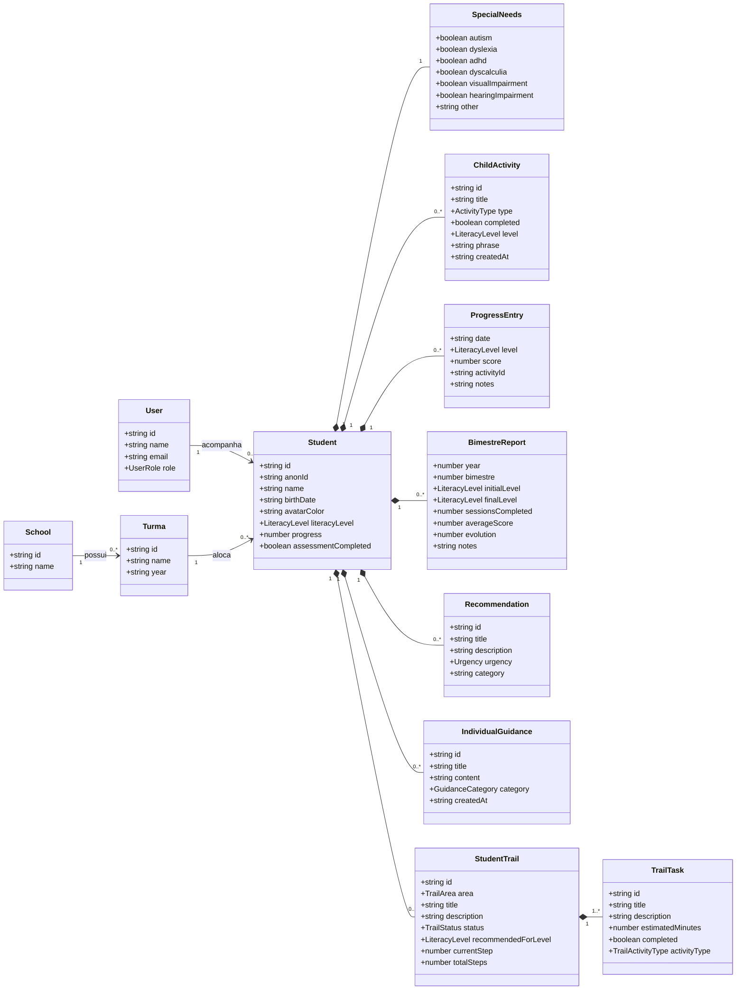
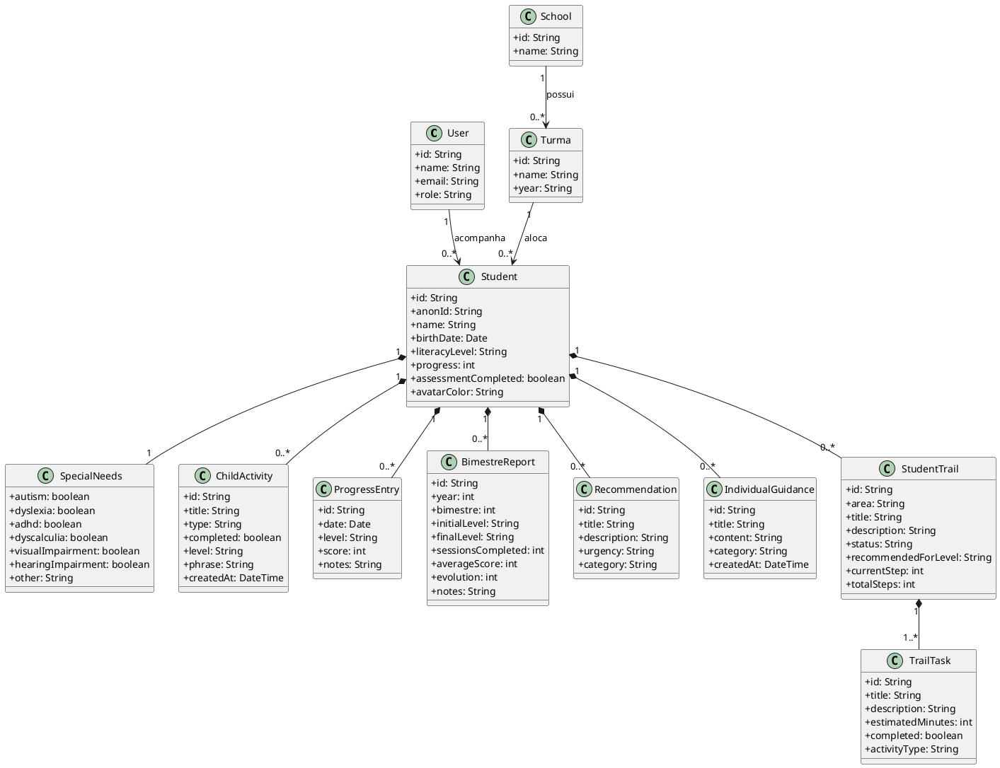
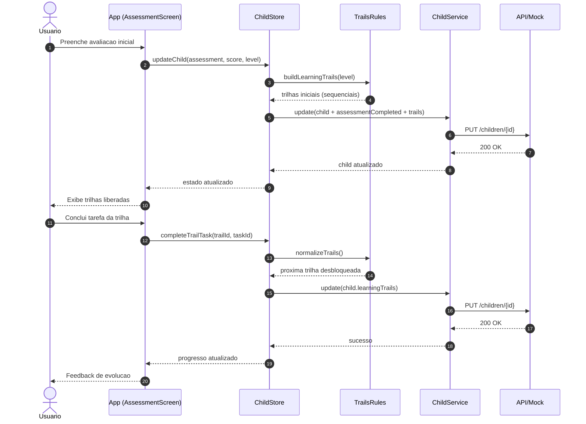
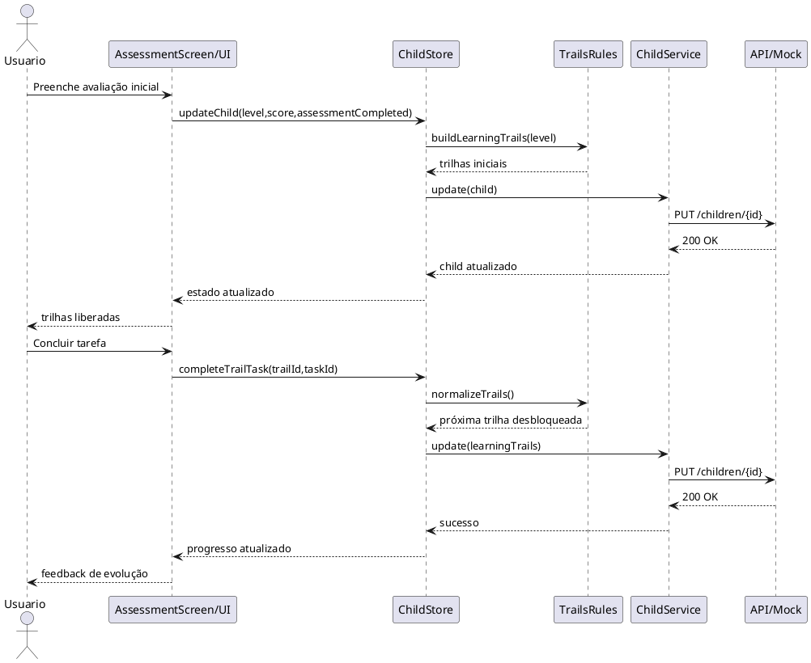
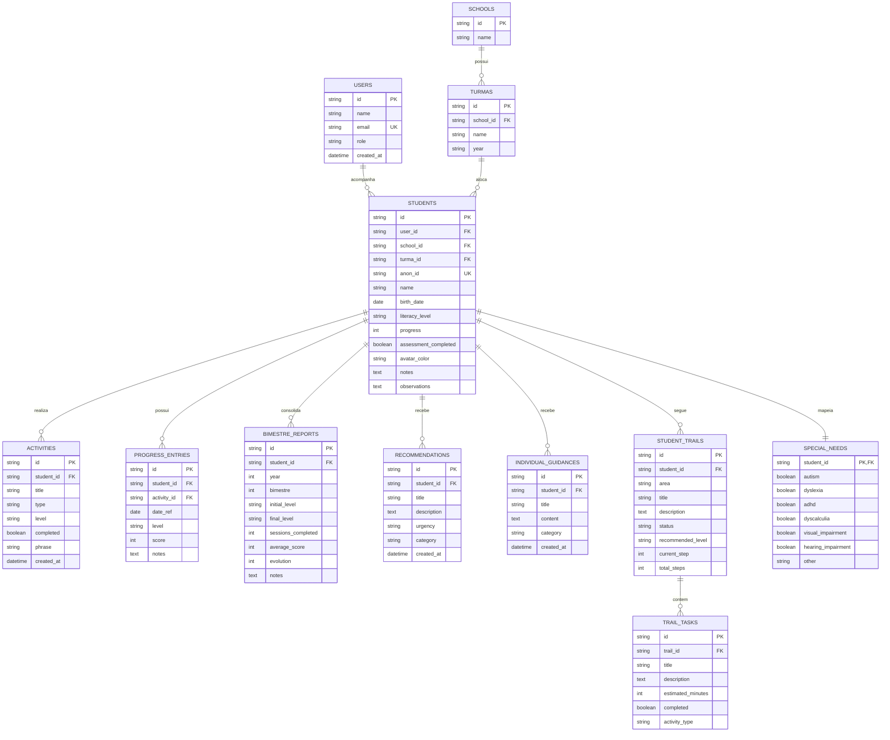
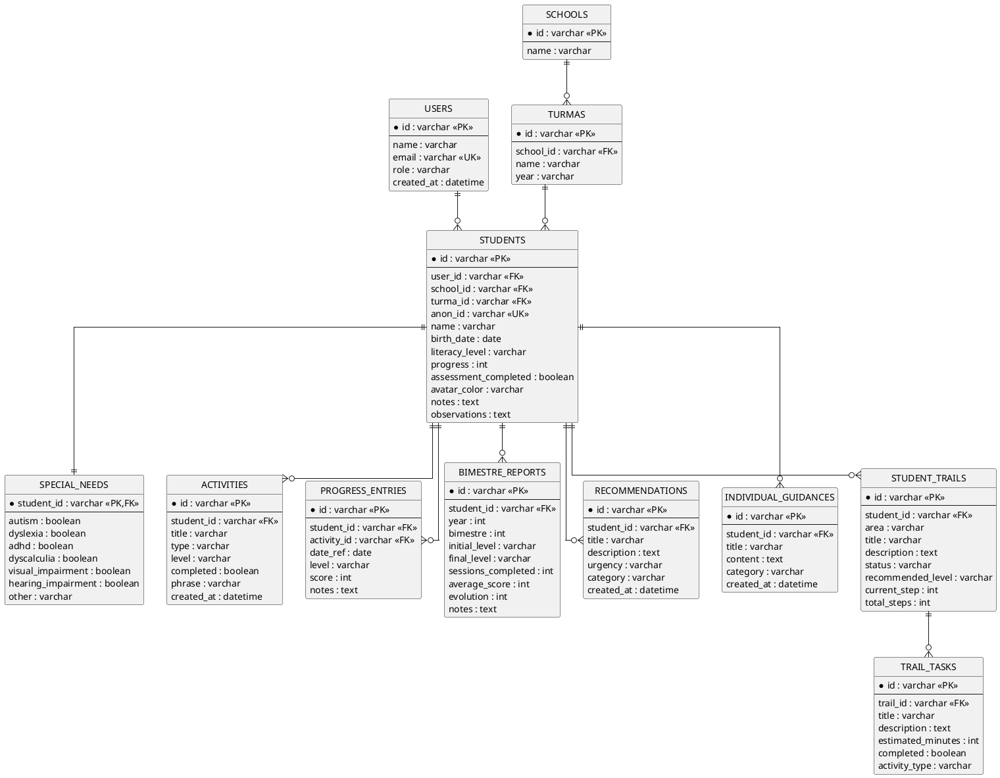

# Elevva — Pacote de Diagramas e Texto para TCC

Este arquivo reúne tudo em um só lugar para importação/cópia:
- Diagrama de Classes
- Diagrama de Sequência
- Diagrama Entidade-Relacionamento (DER)
- Modelo Entidade-Relacionamento (texto ABNT)

## Como usar
1. Se o software suportar **Mermaid**, copie os blocos `mermaid`.
2. Se o software suportar **PlantUML**, copie os blocos `plantuml`.
3. Para o TCC, use as seções de texto ABNT (3.2 a 3.5).

---

## 1) Diagrama de Classes — Mermaid

## 1.1) Diagrama de Classes — PlantUML

---

## 2) Diagrama de Sequência — Mermaid

## 2.1) Diagrama de Sequência — PlantUML

---

## 3) Diagrama Entidade-Relacionamento (DER) — Mermaid

## 3.1) Diagrama Entidade-Relacionamento (DER) — PlantUML

---

## 4) Texto ABNT (para TCC)

### 3.2 Diagrama de Classes
O diagrama de classes do sistema Elevva apresenta a estrutura lógica da aplicação, evidenciando as principais classes de domínio e seus relacionamentos. A classe central é `Student`, responsável por consolidar dados cadastrais e pedagógicos do estudante, incluindo nível de alfabetização, progresso, histórico avaliativo e trilhas de aprendizagem.

A classe `User` representa os perfis de uso (responsável e professor), com relacionamento de acompanhamento para múltiplos estudantes. Classes complementares como `ChildActivity`, `ProgressEntry`, `BimestreReport`, `Recommendation` e `IndividualGuidance` suportam o monitoramento contínuo e a tomada de decisão pedagógica.

O módulo de trilhas é composto por `StudentTrail` e `TrailTask`, permitindo modelar progressão por etapas com desbloqueio sequencial após avaliação inicial.

**Figura X – Diagrama de Classes do Elevva**
**Fonte:** Elaborado pelos autores (2026).

### 3.3 Diagrama de Sequência
O diagrama de sequência representa o comportamento dinâmico do sistema nos fluxos críticos de avaliação e progressão por trilhas. Inicialmente, o usuário registra a avaliação do estudante na interface; em seguida, a camada de estado processa os dados e aciona as regras de trilhas para criação das etapas iniciais. Após persistência no serviço de dados, a interface é atualizada com as trilhas liberadas.

No fluxo de evolução, cada conclusão de tarefa aciona a normalização do estado das trilhas, podendo desbloquear automaticamente a próxima trilha. Esse encadeamento garante rastreabilidade temporal das ações e consistência entre interface, regras de negócio e persistência.

**Figura Y – Diagrama de Sequência do fluxo Avaliação → Trilhas**
**Fonte:** Elaborado pelos autores (2026).

### 3.4 Diagrama Entidade-Relacionamento
O DER do Elevva descreve a organização das entidades persistidas, com foco em integridade e histórico pedagógico. A entidade `STUDENTS` é o núcleo do modelo e se relaciona com atividades, progresso, relatórios bimestrais, recomendações, orientações e trilhas.

O relacionamento com `USERS` define quem acompanha cada estudante, enquanto `SCHOOLS` e `TURMAS` estruturam o vínculo institucional. As entidades `STUDENT_TRAILS` e `TRAIL_TASKS` modelam a lógica de aprendizagem por etapas. Já `SPECIAL_NEEDS` registra características educacionais específicas em relação 1:1 com o estudante, possibilitando personalização de intervenções.

**Figura Z – Diagrama Entidade-Relacionamento do Elevva**
**Fonte:** Elaborado pelos autores (2026).

### 3.5 Modelo Entidade-Relacionamento do Sistema
O modelo entidade-relacionamento foi concebido para sustentar três objetivos principais: cadastro estruturado, acompanhamento evolutivo e personalização pedagógica. O cadastro contempla dados de usuários, estudantes, escola/turma e necessidades específicas. O acompanhamento evolutivo é realizado por atividades, entradas de progresso e relatórios bimestrais. A personalização ocorre por recomendações, orientações individuais e trilhas de aprendizagem.

Como regra de negócio central, a avaliação inicial (`assessment_completed`) condiciona a liberação das trilhas. Assim, o modelo favorece consistência semântica, histórico auditável e escalabilidade para futuras extensões, como novos domínios de habilidade e novos indicadores de desempenho.

---

## Sugestão de nomenclatura de figuras (ABNT)
- Figura X – Diagrama de Classes do Elevva
- Figura Y – Diagrama de Sequência do fluxo Avaliação → Trilhas
- Figura Z – Diagrama Entidade-Relacionamento do Elevva

